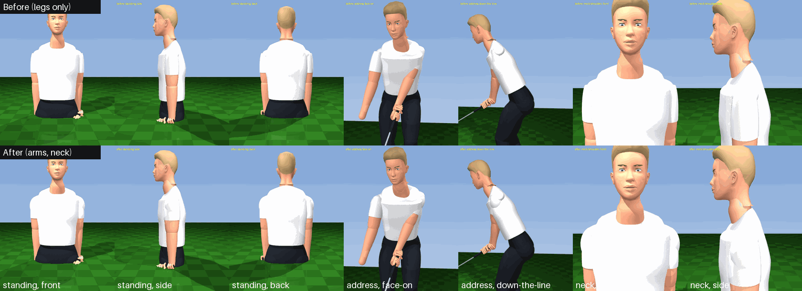

# Leg Shape From the CC0 Body Sections (#15299)

Visual only: masses, inertias, joints, markers and contact are unchanged. The
drawn thighs and shins now follow the sections measured on the CC0 MakeHuman
athletic male body (1.82 m). Settings live in
`src/shared/python/model_appearance/library.py`: `PART_RADIUS_M`,
`LEG_DISTAL_SCALE`, `PART_BELLY`, `PART_OFFSET`, `PART_ASPECT`,
`CAPSULE_END_PARTS`, `PART_TAPER_END`, `LIMB_REFERENCE_STATURE_M` and
`STATURE_SCALED_PARTS`. Leg radii scale with the subject's stature.

## Girths of the Drawn Skin

Girth in mm at a fraction of the segment length, joint to joint. The measured
body is 1.82 m tall; its values scale with stature for the 1.71 m subject.

| Section | Measured (1.82 m) | Before (1.82 m) | After (1.82 m) | Before (1.71 m) | After (1.71 m) |
| --- | --- | --- | --- | --- | --- |
| Thigh at 0.35 | 591 | 427 | 580 | 427 | 545 |
| Thigh at 0.95 (knee) | 392 | 274 | 391 | 274 | 365 |
| Shin at 0.28 (calf) | 399 | 285 | 396 | 285 | 372 |
| Shin at 0.84 (ankle) | 230 | 215 | 229 | 215 | 215 |

At 0.28 of the shin the skin reaches 98 mm behind the knee-ankle line and
29 mm ahead of it (measured 96 and 34); at 0.35 of the thigh, 122 mm ahead and
68 mm behind (measured 124 and 65). The trousers clear each other by 3.4 mm
standing and 10.3 mm at address along the hip line (1.82 m; 3.3 mm and 10.2 mm
at 1.71 m).

## Limitations

- The thigh is 4 mm narrower side to side than measured (90 mm half width,
  not 94 mm) so the trousers do not interpenetrate when standing.
- The leg lengths do not change with stature in the built spec (thigh 401 mm,
  shin 439 mm in both subjects), so the 1.82 m golfer's thigh is shorter than
  the measured body's 439 mm.
- The acceptance is `tests/unit/model_appearance/test_leg_shape.py`; a picture
  is not a physical acceptance.

## Upper Arm, Deltoid Cap and Neck

Visual only, as above. The upper arm scales with stature, is deeper than wide
(`PART_ASPECT`, about the elbow's hinge axis from `cross_section`), holds its
width to the elbow (`PART_BELLY`, `PART_END_ASPECT`) and carries a deltoid cap
with its own radius (`DELTOID_RADIUS_M`, `DELTOID_OUTWARD`). The neck is wider
and its throat fuller (`neck.NeckSettings`).

Girth of the drawn skin in mm; the neck is a level cut 0.12 head lengths below
the neck point.

| Section | Measured (1.82 m) | Before (1.82 m) | After (1.82 m) | Before (1.71 m) | After (1.71 m) |
| --- | --- | --- | --- | --- | --- |
| Upper arm at 0.525 | 355 | 322 | 348 | 322 | 328 |
| Upper arm at 0.95 (elbow) | 310 | 263 | 295 | 262 | 274 |
| Neck under the jaw | 391 to 431 | 368 | 387 | 346 | 364 |

The deltoid cap is 116 mm across at 1.82 m (100 mm before; 150 mm measured)
and the shoulders 481 mm across (471 mm before). The deepest a sleeve sits
inside the shirt is 64.8 mm standing (unchanged) and 117.3 mm at address
(117.1 mm before) at 1.82 m, and 35.1 mm and 91.5 mm at 1.71 m (38.4 mm and
95.0 mm before). The neck clears the collar opening by 2.9 mm standing
(5.2 mm before) and stays 1.1 mm inside the jaw.

### Limits of the Arm and Neck

- The neck stops short of the measured girth: its width is held by the neck
  to head ratio (0.716 of at most 0.72), the collar gap (2 mm) and the throat
  line at address (14.3 mm of at most 15 mm ahead of the collar).
- The deltoid cap is a ball, smaller than measured, so the sleeve does not
  balloon; it still shows as a dome on the sleeve from the side.
- The acceptance is `tests/unit/model_appearance/test_arm_neck_shape.py`; a
  picture is not a physical acceptance.
