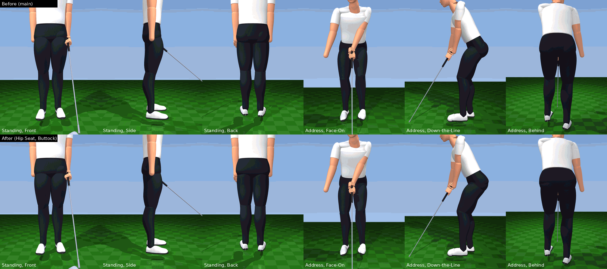

# Leg Shape From the CC0 Body Sections (#15299)

Visual only: masses, inertias, joints, markers and contact are unchanged. The
drawn thighs and shins now follow the sections measured on the CC0 MakeHuman
athletic male body (1.82 m). Settings live in
`src/shared/python/model_appearance/library.py`: `PART_RADIUS_M`,
`LEG_DISTAL_SCALE`, `PART_BELLY`, `PART_OFFSET`, `PART_ASPECT`,
`CAPSULE_END_PARTS`, `PART_TAPER_END`, `LIMB_REFERENCE_STATURE_M` and
`STATURE_SCALED_PARTS`. Leg radii scale with the subject's stature.

## Girths of the Drawn Skin

Girth in mm at a fraction of the segment length, joint to joint. The measured
body is 1.82 m tall; its values scale with stature for the 1.71 m subject.

| Section | Measured (1.82 m) | Before (1.82 m) | After (1.82 m) | Before (1.71 m) | After (1.71 m) |
| --- | --- | --- | --- | --- | --- |
| Thigh at 0.35 | 591 | 427 | 580 | 427 | 545 |
| Thigh at 0.95 (knee) | 392 | 274 | 391 | 274 | 365 |
| Shin at 0.28 (calf) | 399 | 285 | 396 | 285 | 372 |
| Shin at 0.84 (ankle) | 230 | 215 | 229 | 215 | 215 |

At 0.28 of the shin the skin reaches 98 mm behind the knee-ankle line and
29 mm ahead of it (measured 96 and 34); at 0.35 of the thigh, 122 mm ahead and
68 mm behind (measured 124 and 65). The trousers clear each other by 3.4 mm
standing and 10.3 mm at address along the hip line (1.82 m; 3.3 mm and 10.2 mm
at 1.71 m). The thigh's fore and aft seat and these clearances were changed
again; see Hip Seat, Thigh Front and Buttock below.

## Hip Seat, Thigh Front and Buttock

Visual only; the hip joints are not moved. Owner feedback (2026-11-19): the
upper front of the thighs too pronounced and far forward, the hip sockets too
far forward on the pelvis or the femur top too far back in the thigh, and the
behind 5-10 % bigger. Measured ahead of and behind the hip-knee line in a
20 mm strip through the joint, the drawn thigh had the joint 60-66 % of the
way back through its depth while the pelvis was centred on the joint, so the
thigh stood 31 mm ahead of the pelvis. The thigh offsets had been copied from
the CC0 body about its own leg pivot, which is a rig pivot (114 mm from the
midline against 95 mm fitted), not a hip joint centre. The thigh is re-seated
and the pelvis gets a buttock behind the joints. Settings in `library.py`:
`PART_OFFSET["thigh"]` (0.30, 0.35, 0.60) to (0.18, 0.40, 0.40),
`PART_RADIUS_M["thigh"]` 0.102 to 0.0998 with `PART_ASPECT["thigh"]` 1.06 to
1.105 (same girth; the thighs still clear), and new `PELVIS_BACK_SCALE` 1.08
and `PELVIS_BACK_SQUARE` 3.5.

Skin, standing, mm, tour-average golfer (1.82 m). "Measured" is the CC0 body
about its rig pivot: its whole depths are comparable, its split is not.

| Below the hip joint | Front, before | Front, after | Back, before | Back, after | Whole depth, after | Whole depth, measured |
| --- | --- | --- | --- | --- | --- | --- |
| 35 | 106 | 92 | 71 | 88 | 180 | 210 |
| 70 | 116 | 100 | 70 | 88 | 188 | 203 |
| 110 | 123 | 109 | 67 | 85 | 194 | 192 |
| 150 | 125 | 113 | 65 | 80 | 193 | 189 |
| 200 | 121 | 112 | 65 | 78 | 190 | 187 |

| Pelvis at the hip joints | Before | After | Measured |
| --- | --- | --- | --- |
| Front of the joints, side outline | 105 | 105 | 139 |
| Behind the joints, side outline | 105 | 113 | 94 |
| Behind the joints, through the joint | 92 | 109 | 86 |
| Girth | 906 | 960 | |

The behind is 8 % bigger in reach behind the joints and 6 % in girth. Thigh
girths are unchanged (580, 390 mm at 0.35 and 0.95). On the built 1.71 m
subject the trousers clear each other by 2.0 mm standing and 9.8 mm at address
(3.3 mm and 10.2 mm before).

## Limitations

- The thigh is 6 mm narrower side to side than measured (88 mm half width,
  not 94 mm) so the trousers do not interpenetrate when standing.
- The hip joint is 51-58 % of the way back through the upper thigh; it cannot
  go further forward while `test_leg_shape.py` keeps the front of the thigh at
  0.35 at least 1.3 times its back (now 1.33).
- The pelvis is still 15 mm shallower than the measured body at the hip joints
  and has no hollow at the lower back, so the buttock reads as a broad seat
  with a shelf above the thigh when the hip is bent.
- Where the hip joint lies fore and aft in the pelvis is set by the marker fit
  from assumed belt positions; this capture has no markers that measure it.
- The leg lengths do not change with stature in the built spec (thigh 401 mm,
  shin 439 mm in both subjects), so the 1.82 m golfer's thigh is shorter than
  the measured body's 439 mm.
- The upper arm is not changed here; it still measures 322 mm at its middle
  against 355 mm measured.
- The acceptance is `tests/unit/model_appearance/test_leg_shape.py`; a picture
  is not a physical acceptance.
