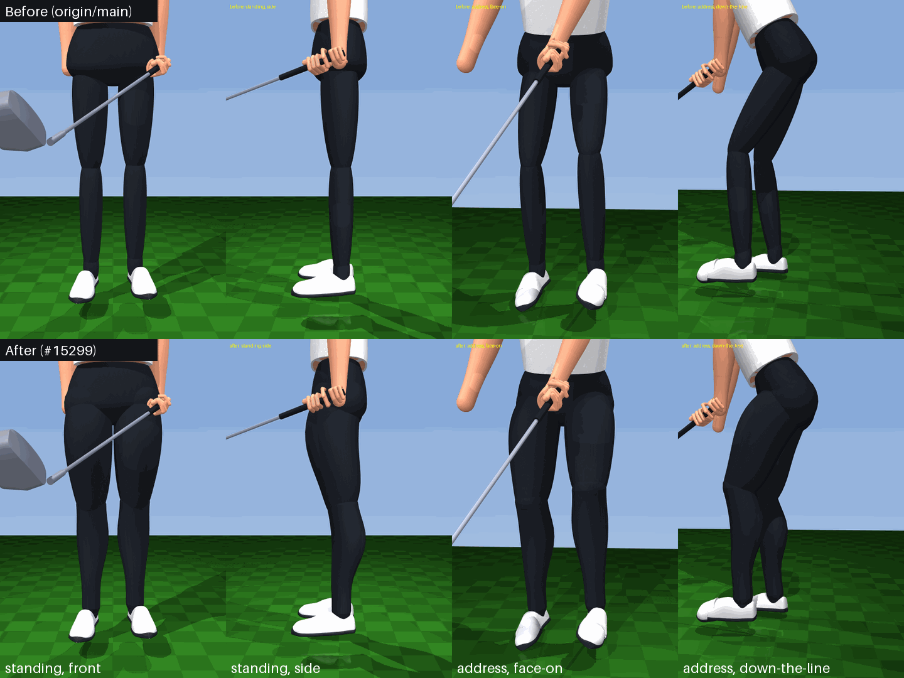
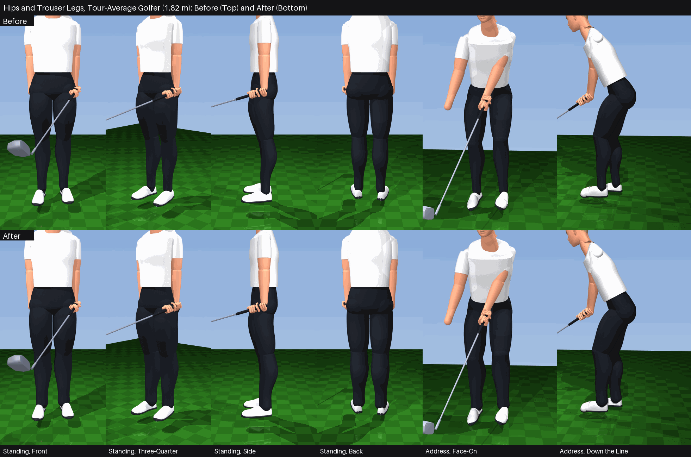

# Leg Shape From the CC0 Body Sections (#15299)

Visual only: masses, inertias, joints, markers and contact are unchanged. The
drawn thighs and shins now follow the sections measured on the CC0 MakeHuman
athletic male body (1.82 m). Settings live in
`src/shared/python/model_appearance/library.py`: `PART_RADIUS_M`,
`LEG_DISTAL_SCALE`, `PART_BELLY`, `PART_OFFSET`, `PART_ASPECT`,
`CAPSULE_END_PARTS`, `PART_TAPER_END`, `LIMB_REFERENCE_STATURE_M` and
`STATURE_SCALED_PARTS`. Leg radii scale with the subject's stature.

## Girths of the Drawn Skin

Girth in mm at a fraction of the segment length, joint to joint. The measured
body is 1.82 m tall; its values scale with stature for the 1.71 m subject.

| Section | Measured (1.82 m) | Before (1.82 m) | After (1.82 m) | Before (1.71 m) | After (1.71 m) |
| --- | --- | --- | --- | --- | --- |
| Thigh at 0.35 | 591 | 427 | 580 | 427 | 545 |
| Thigh at 0.95 (knee) | 392 | 274 | 391 | 274 | 365 |
| Shin at 0.28 (calf) | 399 | 285 | 396 | 285 | 372 |
| Shin at 0.84 (ankle) | 230 | 215 | 229 | 215 | 215 |

At 0.28 of the shin the skin reaches 98 mm behind the knee-ankle line and
29 mm ahead of it (measured 96 and 34); at 0.35 of the thigh, 122 mm ahead and
68 mm behind (measured 124 and 65). The trousers clear each other by 3.4 mm
standing and 10.3 mm at address along the hip line (1.82 m; 3.3 mm and 10.2 mm
at 1.71 m).

## Hips at the Belt Line and Trouser Ease

Visual only, and only the drawn surface: joint spacing, segment lengths and the
skin of the legs are unchanged. Owner feedback asked for hips "a little wider
at the pelvis to match the markers" and legs "about 10-20% larger". The skin
girths above already match the measured body within 2 %, so the legs are made
larger where they are seen: the trousers now hang with ease instead of lying on
the skin like leggings. Settings in `library.py`: `PELVIS_WAIST_RATIO`
0.75 to 0.84, and new `TROUSER_EASE` 1.14, `TROUSER_FITTED_TO` 0.40,
`TROUSER_HEM_EASE` 1.34, `TROUSER_HEM_FROM` 0.45 (`TROUSER_DRAPE`,
`garment_drape`). Shorts are not draped.

Half widths and girths in mm, tour-average golfer (1.82 m). The belt markers of
the driver capture (`data/C3D_TA_Driver.c3d`, `WaistLeft` to `WaistRight`) are
344.9 mm apart at address, 172.5 mm from the midline.

| Quantity | Reference | Before | After |
| --- | --- | --- | --- |
| Pelvis skin half width, top of pelvis | 156 (measured body) | 136.5 | 151.8 |
| Trousers half width, top of pelvis | 172.5 (marker centres) | 145.2 | 162.6 |
| Pelvis skin half width, hip joint level | 174 (measured body) | 179.3 | 179.3 |
| Trousers girth, thigh at 0.35 | | 626.5 | 626.5 |
| Trousers girth, thigh at 0.95 (knee) | | 422.6 | 475.8 |
| Trousers girth, shin at 0.28 (calf) | | 427.7 | 487.2 |
| Trousers girth, shin at 0.84 (ankle) | | 247.0 | 314.9 |

The marker centres now stand 10 mm outside the cloth at the top of the pelvis
(27 mm before). The trouser legs clear each other by 3.4 mm at the thigh and
18.8 mm at the shin when standing.

## Limitations

- The trousers stay fitted on the upper thigh (no added ease at 0.35): the
  3.4 mm standing clearance leaves no room without moving the hip joints.
- At the lowest fitted belt height (about 115 mm above the hip joints) the
  cloth passes about 4 mm outside the side marker centres.
- The drawn pelvis section is symmetric about the hip line; the measured body
  carries more of its depth in front. The hem flares by 2 % below the ankle.
- The acceptance for this section is
  `tests/unit/model_appearance/test_hip_and_trouser_shape.py`.

- The thigh is 4 mm narrower side to side than measured (90 mm half width,
  not 94 mm) so the trousers do not interpenetrate when standing.
- The leg lengths do not change with stature in the built spec (thigh 401 mm,
  shin 439 mm in both subjects), so the 1.82 m golfer's thigh is shorter than
  the measured body's 439 mm.
- The upper arm is not changed here; it still measures 322 mm at its middle
  against 355 mm measured.
- The acceptance is `tests/unit/model_appearance/test_leg_shape.py`; a picture
  is not a physical acceptance.
