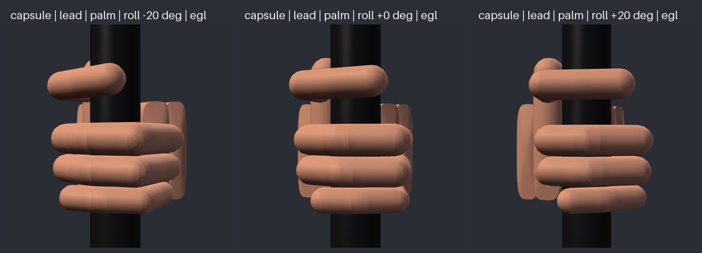
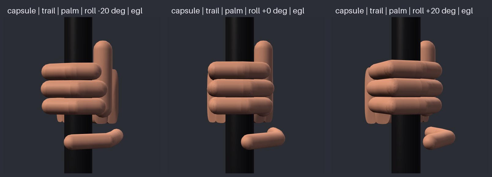

## Shared Hand Renderer (`hand_backends/render.py`)

Refs #15150 (epic). Auto-merge is not armed, on the owner's instruction.

### State at `49d64f9e57` Plus Re-Rendered Butt Frames (2026-11-15)

- One renderer for every hand backend: headless MuJoCo (EGL, then OSMesa), with a matplotlib fallback that is not quality-bar evidence.
- Views: palm, back, thumb side, pinky side, butt and eye, named relative to the hand so lead and trail keep the same names.
- Smooth skin shading from per-corner normals with a crease angle, so hard edges stay crisp.
- The camera fits the larger side of the bounding box to `fill_fraction` (0.70) of the frame. New: a skin part can mark the vertices to frame on (`ScenePart.focus`, or `result.frame_focus` for `render_view`), so a forearm stub no longer shrinks the hand. The reported fill is measured on the skin pixels inside the projected focus bounds. The club grip is always drawn.
- A command-line tool writes frames, a both-hands frame, contact sheets and a manifest. 65 renderer tests pass.
- PR #15149 uses it for the skinned hand's 36 frames. With the forearm left out of the fit, the hand's share of the frame went from 0.48 to 0.60 up to 0.67 to 0.70.

### Self-Review (Lead, After Driving It for the Skinned Hand All Evening)

| Check | Score out of 5 | Note |
| --- | --- | --- |
| Smooth shading | 4 | No facet glitter. No cast shadows, so fingers have no contact shadow on the grip. |
| Hand about 70 % of frame | 4 | Up from 3. The hand itself now spans 0.67 to 0.70 on its longer side; the forearm may run off the frame. A hand lying diagonally still covers less area than an upright one. The capsule hand below has no forearm, so its pictures are unchanged. |
| Club visible | 3 | Grip in every view. The steel shaft only shows in the eye view and at the top of both-hands frames. |
| Mirroring and view names | 5 | |
| Repeatable | 5 | Byte-identical on EGL. |

The capsule hand in these pictures is the crude in-repo source. It tests the renderer, not anatomy.

| Lead palm, three rolls | Trail palm, three rolls |
| --- | --- |
|  |  |

### Open Problems

- **Size.** 56 files and about 3,700 added lines of its own, over the 500-line gate. It needs `large-pr-approved` or an owner decision.
- **One unrelated test fails** on this branch: `tests/docs/test_matched_swing_status_freshness.py`.
- **`render_view` rolls the skin itself.** A backend that already applies shaft roll (the skinned hand does) must call `render_scene` with its own mesh and basis, or the roll is applied twice.
- **Shadows are off.** MuJoCo shadow maps showed acne at this scale.
- **No golden-image test.** Tests check fill, engine choice, normals and repeatability, not a reference picture.
- **Butt view (fixed this round).** It looked straight down the shaft, so the grip's end cap hid the hand. The eye is now tilted to the palm side (`views.butt.eye` = `(0, -0.55, -0.83)`), which shows the fingers wrapping and the heel of the hand on the grip. The grip end still crosses part of the frame. Only the seven butt frames changed in the re-render.
- **Fill is a bounding-box side, not an area.** I chose to fix what the box is fitted to (the hand) and did not add an area measure: no hand can cover 70 % of the frame's area without being cropped.

## Learnings

- Call `render_scene(parts, view, basis=..., settings=..., side=...)` when the backend owns its placement and roll; call `render_view(result, view, shaft_roll_deg=...)` only for an unrolled result.
- A backend passes its own basis (radial and dorsal directions in the grip frame) so "palm" and "back" mean the same thing for every hand.
- Build the club with `build_club_parts(z_min, z_max, ...)` from the skin's own extent, so the grip spans the hands.
- Headless rendering needs `MUJOCO_GL=egl` and no `DISPLAY`. The engine makes its own context, so it works even if MuJoCo is already bound to GLFW.
- Crease-aware normals: corners whose face normals differ by more than the crease angle are not averaged. Smooth skin and crisp block edges come from the same code.
- Fit the camera to the hand, not to everything skin-coloured. A backend with a forearm stub should set `frame_focus` (a boolean mask per vertex) on its result or pass `focus=` on its `ScenePart`.
- A view straight along the shaft shows the end cap, not the hand. Tilt the butt view to the palm side; a test now requires the tilt, so it cannot drift back.
- A test fixture that offsets a stub along one fixed direction can vanish into the distance in a new view. Offset it toward the camera side of every required view.
- Fill measured on the longer bounding-box side still overstates how big a diagonal hand looks.

### Next Steps

1. Judge the tilted butt view on the other backends and adjust the tilt if one of them hides the palm.
2. Draw the shaft in every view by extending the club toward the head inside the frame.
3. Try contact shadows again with a tighter light frustum.
4. Add a contact-sheet mode that tiles every registered backend at one view and roll.

🤖 Generated with [Claude Code](https://claude.com/claude-code)
