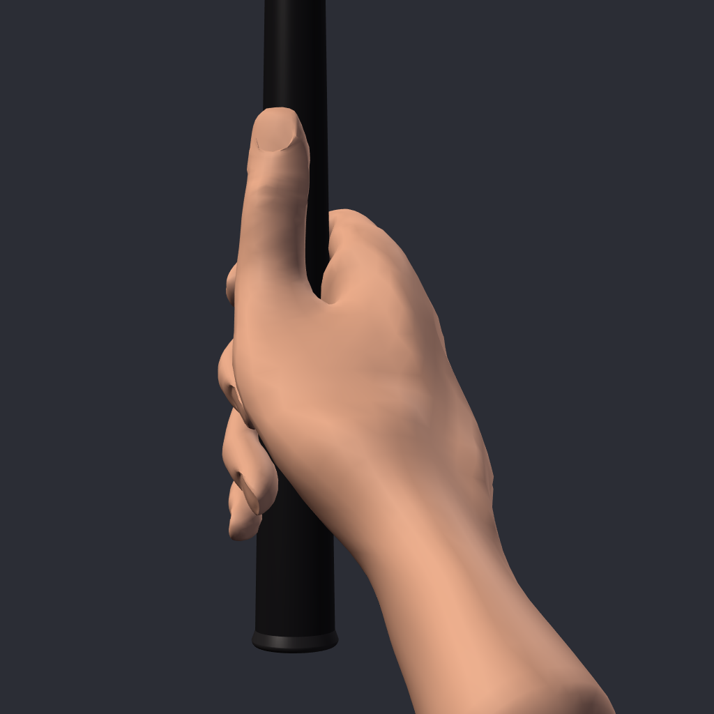
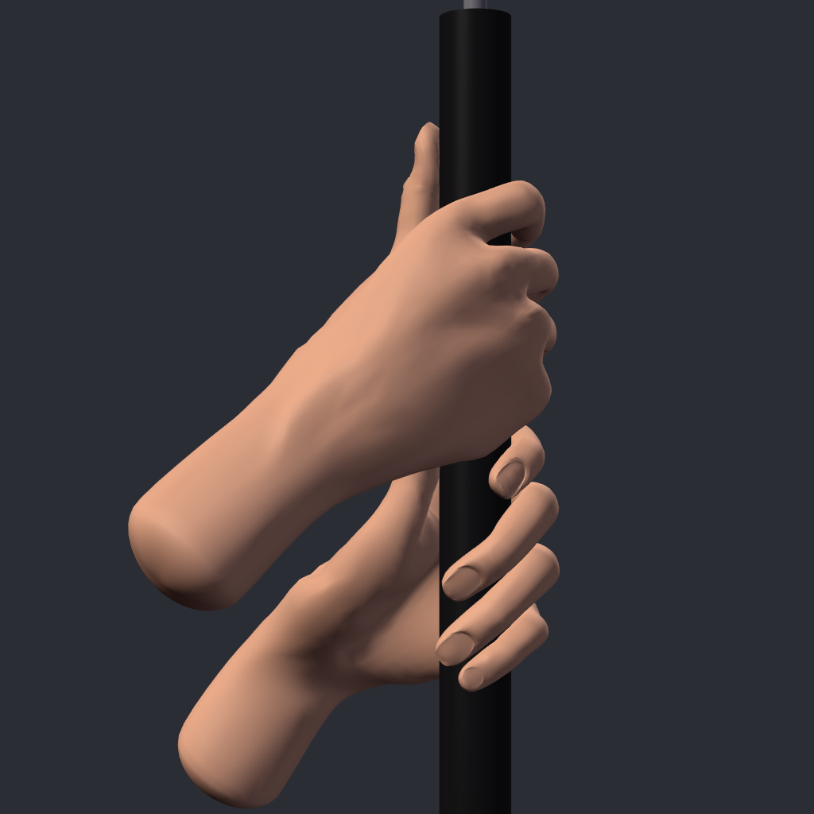
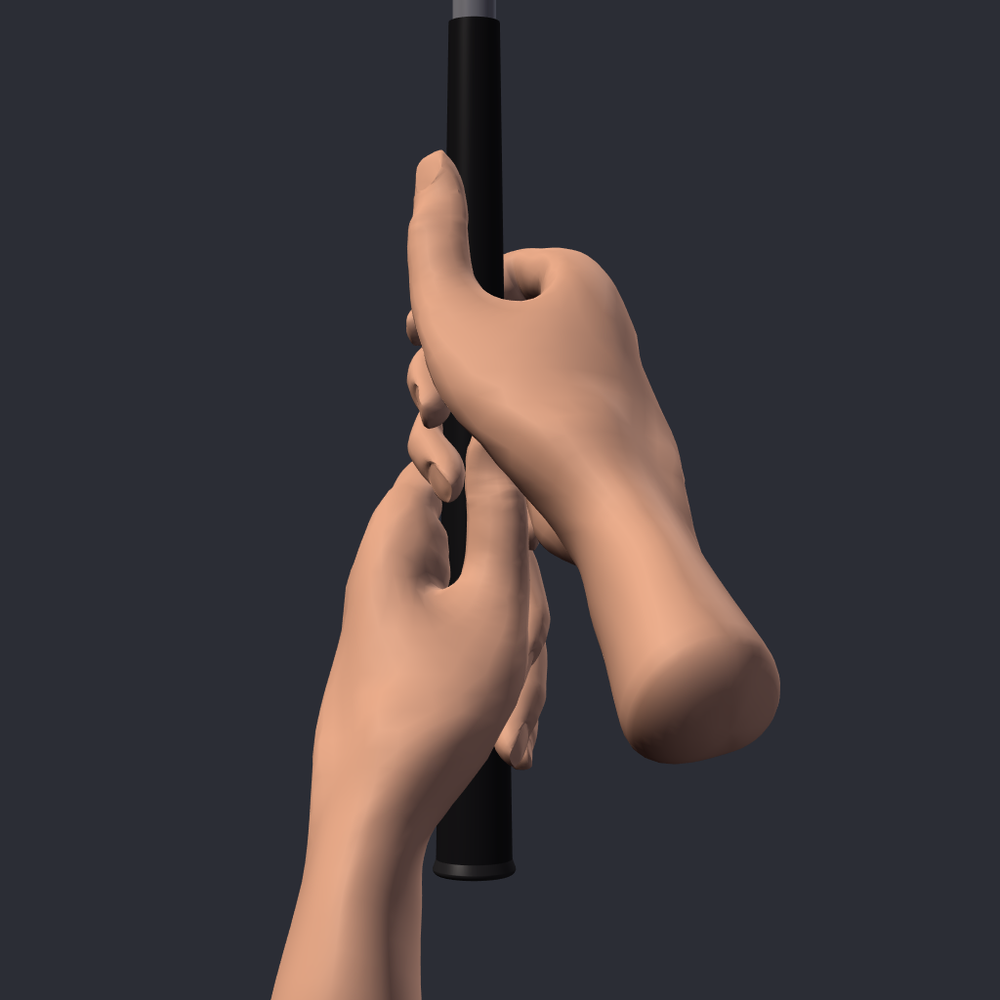
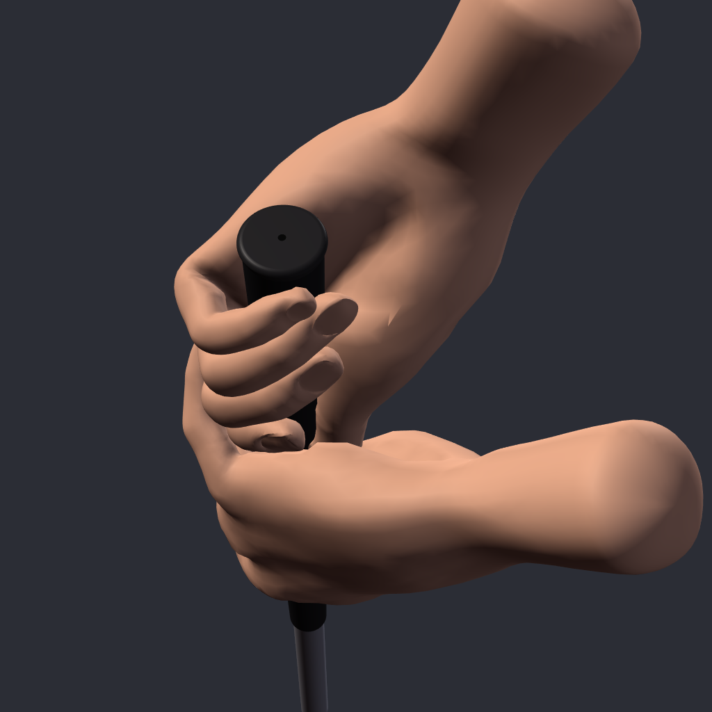
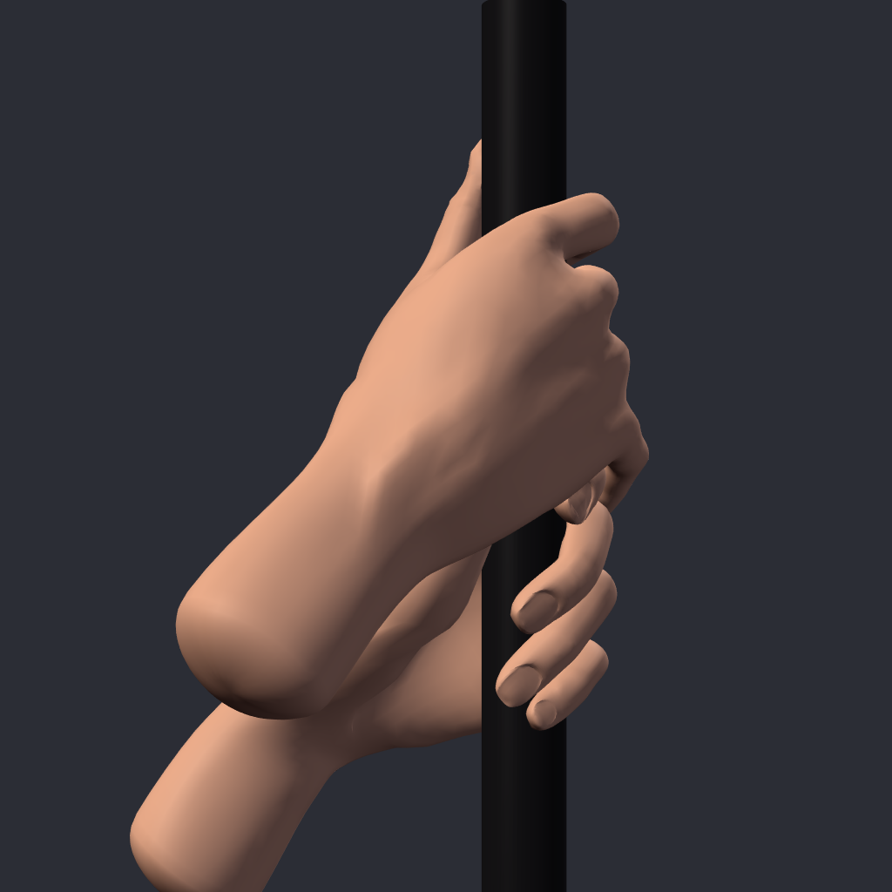
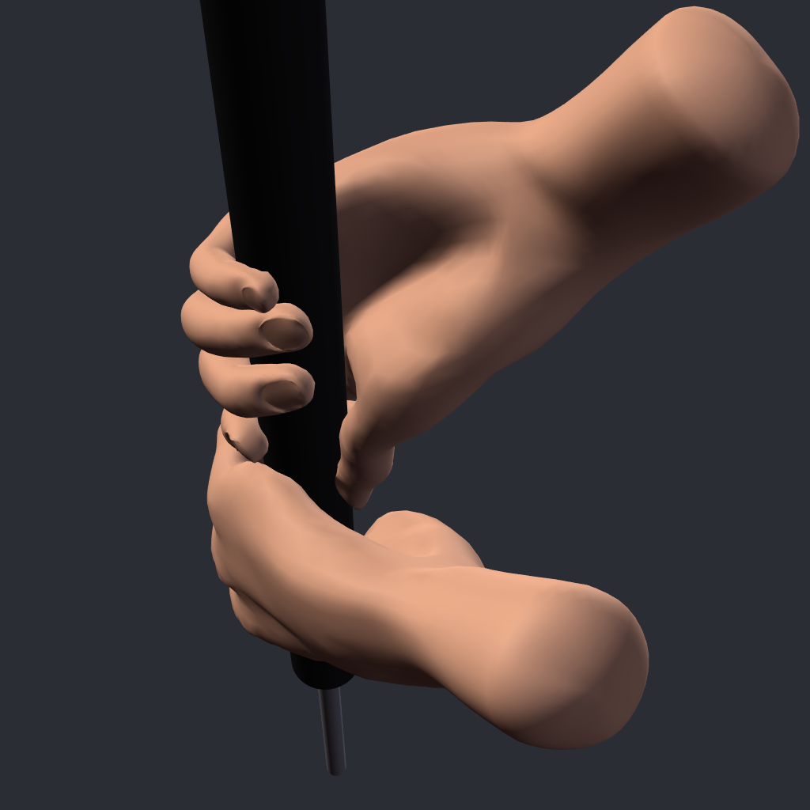

## Skinned Human Hand on the Club (MakeHuman CC0 Rig, Linear Blend Skinning)

Refs #15150 (epic), #15148. Stacked on `cursor/hrg-gb1b-shaft-roll-2882`. Auto-merge is not armed, on the owner's instruction.

### State at `a1b29c56a9` (2026-11-14, About 10:45 PM PT)

- The hand is MakeHuman's hm08 mesh with MakeHuman's own `default.mhskel` skeleton and `default_weights.mhw` skin weights (CC0, pinned commit, recorded in `assets/hand_cc0/NOTICE` and `PROVENANCE.json`). One declared change to the weights: see "Deviations".
- Posing is joint rotation plus linear blend skinning only. A test rebuilds the mesh from the reported bone transforms and requires agreement to 1e-9 m, so no vertex is pushed.
- The pose follows the grip spec: flat hand beside the club, club under the index finger's first segment and just below the base of the little finger, then MCP, PIP, DIP close in that order until the skin touches. Knuckle flexion drives the ring and little metacarpals so the palm cups.
- `build_grip_hands` poses both hands on one club. The trail hand is curled against the grip and the lead hand's digits, so the hands no longer pass through each other.
- Shaft roll comes from `HandGripSpec.shaft_roll_deg`. Every size, tolerance, limit, gain and colour is in `scripts/config/skinned_human_hand.json` or `scripts/config/hand_visual_quality.json`.
- Contact physics is untouched (still capsules). This is the visual model.
- Tests: 53 pass, 1 skipped (the source-rebuild check needs a MakeHuman checkout; I ran `build_hand_asset.py --check` by hand and it matches).

### Measured (Legacy Grip Spec, Grip Radius 14 mm)

| Check | Result | Limit (setting) |
| --- | --- | --- |
| Fingertip and middle phalanx to grip, single hands | at most 0.95 mm | 1.5 mm |
| Same, trail hand of the pair (grip or lead hand) | at most 0.82 mm | 1.5 mm |
| Skin inside the grip | 0.3 mm | 0.5 mm |
| One hand inside the other (pair) | 0.0 mm | 1.0 mm |
| Forearms apart, seen from the butt | 25 degrees | 15 to 50 |
| Degenerate triangles | 0 | 0 |
| Triangles folded into a crease | 5 per hand, 0.02 to 0.07 % of skin area | 10 and 0.15 % |
| Left-handed golfer is the exact mirror | yes | 1e-9 m |
| Shaft roll 0 and plus or minus 20 degrees is a rigid turn | yes | 1e-9 m |

### Self-Review (I Opened Every Frame; Scores Out Of 5)

| Criterion | Lead | Trail | Both hands |
| --- | --- | --- | --- |
| Separate fingers and thumb | 4 | 4 | 4 |
| Cupped palm | 3 | 3 | 3 |
| Knuckle line | 4 | 4 | 4 |
| Fingers wrap the grip | 4 | 4 | 3 |
| No tubes, blobs or torn triangles | 4 | 4 | 4 |
| Smooth shading | 4 | 4 | 4 |
| Correct mirroring | 5 | 5 | 5 |

A single hand reads as a human hand holding a golf club. The pair reads as two hands on a club but not yet as a golfer's overlap grip. What still falls short:

- **Palm cup (3).** The ring and little metacarpals arch (13 and 26 degrees), but the thenar pad does not come round, so the palm is still flatter than a real one.
- **Trail fingers in the pair (3).** The ring and little fingers rest on the lead hand's finger capsules, which are slightly fatter than the skin, so they look loose from the thumb side.
- **Creases.** Five triangles per hand still fold at the inner creases of strongly flexed joints. "No flipped triangles" is therefore capped and reported, not zero. This is a limit of plain linear blend skinning.
- **Thumb.** Only the thumb's pad touches; its first segment stays 12 to 15 mm off the grip. In the both-hands views the lead thumb is hidden under the trail palm.
- **Forearm cut.** The mesh stops about 45 mm above the wrist with a flat cap.
- **Frame fill.** The renderer fits the larger side of the skin's bounding box to 0.70 of the frame (0.696 to 0.699 measured). By area the hands look smaller than that.

| | Palm | Back | Thumb side | Butt |
| --- | --- | --- | --- | --- |
| Lead |  |  |  |  |
| Trail |  |  |  |  |
| Both |  |  |  |  |
| Both, roll -20 |  |  |  |  |
| Both, roll +20 |  |  |  |  |

All 36 frames (1024 px, MuJoCo EGL through the shared renderer of #15154) and `render_manifest.json` are in `docs/development/full_body_models/evidence/hand_skinned_human/`.

### Deviations and Things to Check

- **Skin weights at the thumb web are smoothed.** MakeHuman's weights change abruptly between thumb and index, and the web skin folded over itself when the thumb closed. `thumb_web_smoothing` in `assets/hand_cc0/build_settings.json` blends them; zero iterations rebuilds with the untouched weights. Dieter, please say if you would rather keep the weights pure and accept the fold.
- **Wrist bend is new.** Extension and ulnar deviation per hand are settings (lead 0 and 20 degrees, trail 15 and 10). The grip spec does not cover the wrist; these are my values.
- **`palm_centre_wrap_deg` (37)** is tuned by eye so the forearms leave the club about 25 degrees apart. It is not derived from the spec.
- **Finger-length references are unverified.** The ratios in `hand_visual_quality.json` are recalled from Buryanov and Kotiuch 2010 and were not checked against the paper. The breadth-to-length ratio is the ANSUR II value the repo already uses.
- **Shared posing has no branch of its own.** No handoff or `cursor/*` branch for it exists, so `hand_backends/posing.py` and its 12 tests live here.
- **Size.** About 4,800 added lines, over the 500-line gate. It needs `large-pr-approved` or an owner decision.
- **CI.** The new `hand_backends` paths are registered in the shared-code inventory and a change fragment is added. The `grip_spec` paths the same check lists belong to the base PRs. I have not re-read the checks since pushing.

## Learnings

- Rig with the source's own skeleton and weights. Cropping a body mesh and inventing weights gave tubes and tears; MakeHuman's rig gave a hand on the first pose.
- Fit finger hinge axes to the palm plane, not to each finger's nearly straight rest shape. The per-finger fit rolled neighbouring fingers 24 degrees apart and fanned them.
- Greedy proximal-to-distal curl hooks a finger on its tip. Scan the knuckle angle, close the other joints to contact, and keep the pose whose middle and end segments both touch (`wrap_to_contact`).
- A capsule model's "palm centre" is a pad wrapped round the grip. A rigid flat palm touches at the finger roots, tens of degrees further round, so reusing the capsule azimuth crosses the forearms.
- For two hands, seat the trail hand on the bare grip, back it straight off until its palm clears the lead hand, then curl against grip plus lead-hand capsules. Seating directly on the combined obstacle tipped the hand 38 mm off the grip.
- Measure hand-in-hand overlap on the meshes (winding number), not on the capsules used to solve.
- Plain linear blend skinning folds a few triangles at creases past about 90 degrees. Smoothing weights fixed the thumb web but not the finger creases. Report the count; do not claim zero.
- Solver speed is forward kinematics. Precomputed hinge matrices and skinning only the vertices a joint moves took a pair from 55 s to 14 s.
- Never run Python from inside `hand_backends/`: its `types.py` shadows the standard library.

### Next Steps

1. Bring the thenar pad round (thumb base opposition) so the palm cups and the thumb's first segment lies on the grip.
2. Use the lead hand's skin, not capsules, as the trail hand's obstacle so its ring and little fingers close properly.
3. Decide with Dieter whether crease folds justify corrective shapes, since the brief asks for linear blend skinning.
4. Check the finger-length references against the paper.
5. Extend the forearm stub or crop it out of frame.

🤖 Generated with [Claude Code](https://claude.com/claude-code)
