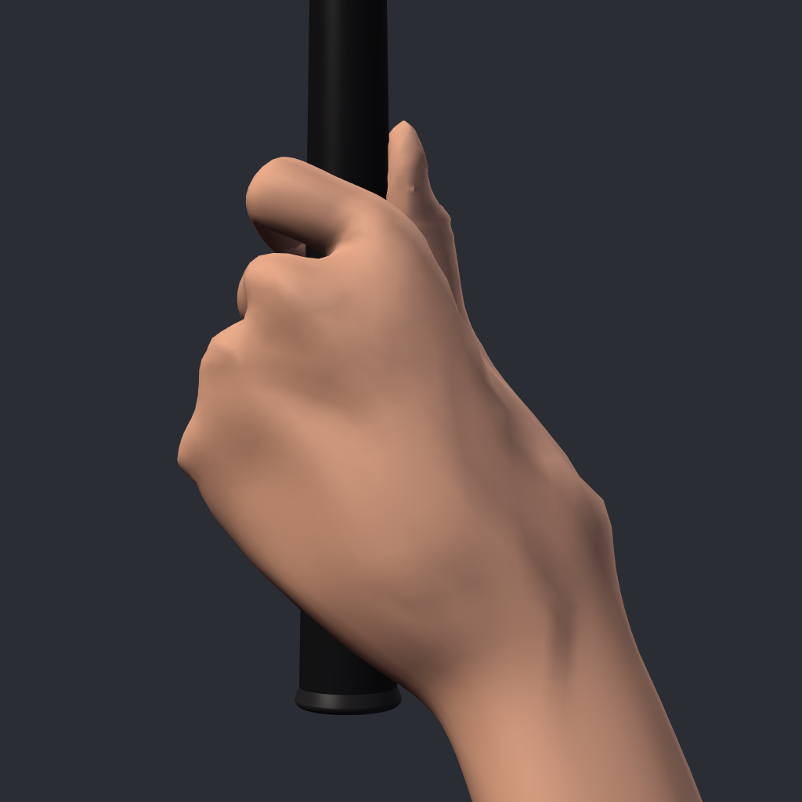
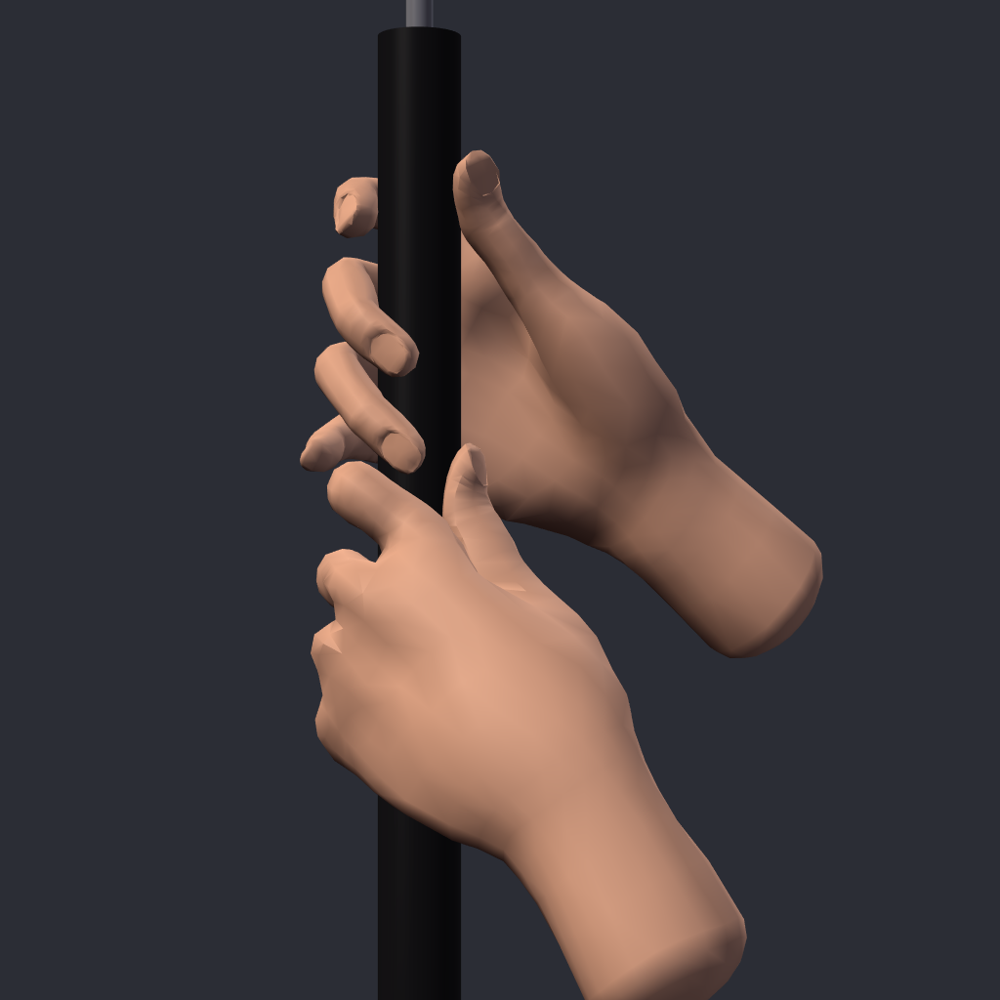
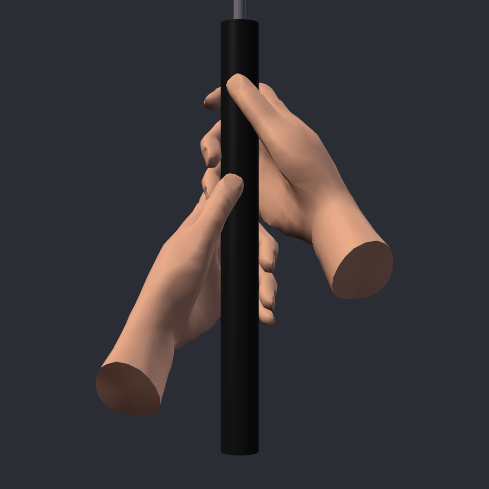

## Skinned Human Hand on the Club (MakeHuman CC0 Rig, Linear Blend Skinning)

Refs #15150 (epic), #15148. Stacked on `cursor/hrg-gb1b-shaft-roll-2882`. Auto-merge is not armed, on the owner's instruction.

### State at `fdf514a163` (2026-11-15)

- The hand is MakeHuman's hm08 mesh with MakeHuman's own `default.mhskel` skeleton and `default_weights.mhw` skin weights (CC0, pinned commit, recorded in `assets/hand_cc0/NOTICE` and `PROVENANCE.json`). Two declared changes to the weights and one to the mesh: see "Deviations".
- Posing is joint rotation plus linear blend skinning. Four owner-approved corrective shapes then move a little skin (`correctives.py`): fold relaxation around inside-out triangles, a palm pad that settles onto the grip, laying skin pressed up to 4 mm into the grip flat on its surface (`lift_out`, now with a bulge), and (new) relaxing creases that skinning pinched between the knuckles. All are switchable. With all off, a test rebuilds the mesh from the reported bone transforms and requires agreement to 1e-12 m; with them on, the solved joint angles are identical.
- **The skin is Loop-subdivided once** (`subdivision.py`, setting `mesh.subdivision_levels`, 0 switches it off): 7,074 vertices and 14,144 triangles per hand, up from 1,770 and 3,536. Skin weights go through the same operator. The grip is solved on the original vertices of the subdivided skin, so the solve costs the same and a solved contact is a contact of the drawn skin.
- **New: nail edges stay sharp.** Edges on the fingertip bones that fold by 40 degrees or more in MakeHuman's mesh are kept as creases through subdivision (`mesh.creases`; an empty bone list switches it off).
- **New: the hand squeezes the grip (#15179, #15180).** The joints used to stop at first touch, so each finger segment touched at one spot and the grip looked loose. The digits now close `squeeze.finger_depth_m` (2.5 mm) and the palm seats `squeeze.palm_depth_m` (1.5 mm) into the grip, standing for soft pad compression. The `press_flat` corrective then lays the pressed skin on the surface and bulges the skin beside it a little. Zero depths give the old pose. The drawn skin never enters the grip.
- The pose follows the grip spec: flat hand beside the club, club under the index finger's first segment and just below the base of the little finger, then MCP, PIP, DIP close in that order until the skin touches. Knuckle flexion drives the ring and little metacarpals so the palm cups.
- **New: the palm cups (#15181).** The thumb's base joint sat 66 mm from the grip axis, so the thumb reached the grip as a ramp. The base joint is now carried along an arc about a line parallel to the club, toward the line where the thumb is to lie, before the thumb is aimed (`thumb.palm_cup_max_deg`, zero switches it off). The thumb lies along the grip on both hands.
- `build_grip_hands` (new module `skinned_pair.py`) poses both hands on one club. The trail hand slides toward the club head by the least amount that frees its index, middle and ring fingers from the lead hand, then curls round the grip. Its little finger rests on the lead index finger (overlap grip).
- The forearm ends in a rounded cap, not a flat disc.
- Each hand declares which vertices a renderer should frame on (`frame_focus`: everything except the forearm stub), so the hand itself fills 0.70 of the frame.
- Shaft roll comes from `HandGripSpec.shaft_roll_deg`. Every size, tolerance, limit, gain and colour is in `scripts/config/skinned_human_hand.json`, `scripts/config/hand_visual_quality.json` or `assets/hand_cc0/build_settings.json`.
- Contact physics is untouched (still capsules). This is the visual model.
- Tests: 97 pass, 1 skipped (the source-rebuild check needs a MakeHuman checkout; the asset file is unchanged in this round).

### Measured (Legacy Grip Spec, Grip Radius 14 mm)

| Check | Before | Now | Limit (setting) |
| --- | --- | --- | --- |
| Thumb first segment to grip | 12.2 and 14.5 mm | 5.1 mm lead, 4.9 mm trail | 6 mm |
| Thumb first segment, median gap of the skin facing the grip | 15.0 mm lead, 16.4 mm trail | 2.5 mm lead, 3.7 mm trail | 5 mm (new) |
| Thumb base pad, median gap of the skin facing the grip | 35.7 mm lead, 37.0 mm trail | 21.3 mm lead, 18.1 mm trail | at least 10 mm closer than without the cup (new) |
| Fingertip and middle phalanx to grip, single hands | 0.95 mm | 1.0 mm | 1.5 mm |
| Trail index, middle, ring to the grip itself (pair) | ring 6.8 mm | at most 1.0 mm | 1.5 mm |
| Skin inside the grip | 0.3 mm | 0.0 mm (0.9 mm before the lift-out corrective, see Learnings) | 0.5 mm |
| One hand inside the other (pair, mesh winding number) | 0.0 mm | 0.0 mm | 1.0 mm |
| Forearms apart, seen from the butt | 25 degrees | 28 degrees | 15 to 50 |
| Degenerate triangles | 0 | 0 | 0 |
| Triangles folded into a crease | 2 per hand | 0 per hand, single and pair | 0 (tightened from 2) |
| Palm skin within 1.5 mm of the grip | 0 vertices | 95 vertices of the finer mesh, palm gap 0.3 mm (was 1.1 mm) | at least 8 |
| Farthest a corrective moves any vertex | 0 | 4.8 mm lead, 6.0 mm trail | 8 mm |
| Skin within 0.5 mm of the grip (pair) | 10.2 cm2 lead, 11.1 cm2 trail | 28.0 cm2 lead, 24.5 cm2 trail | none; the test uses the triangle measure below |
| Triangles wholly within 0.5 mm of the grip, single hands | under two thirds of now | 20.5 cm2 lead, 19.2 cm2 trail | at least 18 cm2 (new) and 1.5 times the unsqueezed hand |
| Angle of the grip covered by skin within 2 mm, per 10 mm slice | 100 to 150 degrees | 150 to 250 degrees | none yet |
| Finger and thumb bone axis to the grip surface | 4.8 mm | 1.75 mm lead (thumb tip), 2.7 mm trail | at least 1.5 mm (new) |
| Vertices any corrective moves | 7 % | 28.6 % lead, 28.2 % trail | 32 % (widened from 12 %: pressed pads move by design) |
| Mean triangle edge | 5.6 mm | 2.7 mm | 4 mm (new) |
| Edges pinched more than 45 degrees past rest, palm and first finger segments | 21 lead, 18 trail | 5 lead, 4 trail (the tighter knuckles pinch more web skin) | 6 |
| Hand share of the frame (forearm left out) | 0.48 to 0.60 | 0.67 to 0.70 | 0.70 plus or minus 0.12 |
| Left-handed golfer is the exact mirror | yes | yes | 1e-9 m |
| Shaft roll 0 and plus or minus 20 degrees is a rigid turn | yes | yes | 1e-9 m |

### Self-Review (I Opened All 36 Frames; Scores Out Of 5)

| Criterion | Lead | Trail | Both hands | Change |
| --- | --- | --- | --- | --- |
| Separate fingers and thumb | 4 | 4 | 4 | same |
| Cupped palm | 3 | 3 | 3 | same; accepted by the owner for this PR (2026-11-15) |
| Knuckle line | 4 | 4 | 4 | same |
| Fingers wrap the grip | 4 | 4 | 4 | same score, visibly tighter: the pads lie flat on the grip. The thumb now lies along the grip (#15181). Not 5: the index finger still hooks and the fingers do not touch side to side (#15182, #15184) |
| No tubes, blobs or torn triangles | 4 | 4 | 4 | same: no folded triangle on the finer mesh either |
| Smooth shading | 5 | 5 | 4 | trail up from 4: the knuckle creases are relaxed; the pair keeps faint creases where the fingers interlock |
| Correct mirroring | 5 | 5 | 5 | same |

Each hand reads as a human hand holding a golf club, and the pair now reads as two hands gripping one club with the trail fingers closed on it. It does not reach the bar yet. What still falls short:

- **Palm cup (3).** The palm pad corrective closes the heel of the hand onto the grip (12 palm vertices in contact, up from none), which shows in the butt views. From the palm view the palm still reads flatter than a real one. The thenar pad stays about 30 mm clear of the grip: in a finger grip the thumb's base sits about 66 mm from the grip axis. A stronger pad setting (25 mm reach, four passes) did close it, but it swelled the thumb and creased the palm, so I did not ship it.
- **Thumb.** With the palm cup the whole thumb lies along the grip: end pad on it, first segment 2.5 to 3.7 mm off. Harsh points: the skin between the wrist and the thumb is stretched, so the thumb base looks drawn out in the palm and butt views, and the base pad itself is still about 20 mm from the grip.
- **Thumb-to-index hollow.** What I called a notch between the knuckles is the hollow where the index finger leaves the hand behind the thumb. The pinched creases in it are relaxed; a small dark fold remains at its bottom in the lead thumb-side view.
- **Nail rims.** The nails have crisp rims again. The thumb nail's rim is slightly uneven where the source mesh has few edges.
- **Inner finger creases.** The creases inside the middle finger joints are still sharp (up to 119 degrees past rest). They face the grip and are hidden, and relaxing them would move skin that is in contact, so they are left out of the crease corrective.
- **Butt view.** Fixed in #15154: the view is now tilted to the palm side, so it shows the fingers wrapping and the heel of the hand on the grip. The grip end still crosses part of the frame.
- **Lead thumb in the pair.** It is hidden under the trail palm, as in a real grip. The trail thumb shows in the back and thumb-side views.

| | Palm | Back | Thumb side | Butt |
| --- | --- | --- | --- | --- |
| Lead |  |  |  |  |
| Trail |  |  |  |  |
| Both |  |  |  |  |
| Both, roll -20 |  |  |  |  |
| Both, roll +20 |  |  |  |  |

All 36 frames (1024 px, MuJoCo EGL through the shared renderer of #15154) and `render_manifest.json` are in `docs/development/full_body_models/evidence/hand_skinned_human/`.

### Deviations and Things to Check

- **Corrective shapes move skin after skinning** (`correctives.fold_relax`, `palm_pad`, `lift_out` and, new, `crease_relax`; approved 2026-11-15). Together they move at most 6.6 mm (palm pad). Lift-out moves finger skin by at most 0.9 mm, and only onto the grip surface. Crease relaxation acts only on skin led by the palm bones and the first finger segments. Zero iterations, zero reach and zero depth switch them off and give pure linear blend skinning back. The reported `contact_gaps_m` are measured on the corrected skin.
- **Fold relaxation may now run up to 16 passes** (was 8). It stops as soon as no triangle is inside out; one triangle needed more than 8 after the crease corrective.
- **The skin is subdivided at load, not in the asset file.** I had said build time; doing it at load keeps `hand_cc0.npz` and its provenance hash untouched and makes it a plain setting. Subdivision pulls the surface in by 0.5 mm on average (1.7 % of volume); the hand is scaled after subdividing, so length and breadth still match the spec.
- **A test contract changed.** The test used to require that no finger skin moves after skinning. It now requires that finger skin moves by at most the lift-out depth and ends on the grip surface.
- **Skin weights at the thumb web are smoothed** (`thumb_web_smoothing`, approved). Zero iterations rebuilds with MakeHuman's untouched weights.
- **Skin weights at the finger middle creases are lightly smoothed** (`finger_crease_smoothing`, kept with the owner's go-ahead on 2026-11-15). One ring, two passes at half blend. It took the folds from 5 to 2 per hand before the correctives. Zero iterations turns it off.
- **The forearm cut is closed with a dome** (`forearm_cap`: 4 rings, depth 0.6 of the loop radius). These vertices are not MakeHuman's. Zero rings gives the flat fan back.
- **The trail hand may slide up to 30 mm along the grip** beyond the spec's hand spacing (`pair.max_spacing_adjust_m`) so its fingers reach the grip. Zero keeps the spec's spacing exactly and puts the ring finger back on the lead hand.
- **The thumb's middle joint may bend back** (MCP to -10 degrees) so the pad lies flat; the end joint no longer does (IP from 0). These limits are my values.
- **The palm cup moves the thumb's base joint** by up to 70 degrees of arc about a line through the middle of the palm. A real hand gets there by folding the whole palm; this model moves only the thumb ray and lets skinning stretch the skin between. Visual only, switchable.
- **Wrist bend** (lead 0 and 20 degrees, trail 15 and 10) and **`palm_centre_wrap_deg` (37)** are my values, tuned by eye.
- **Finger-length references are unverified.** The ratios in `hand_visual_quality.json` are recalled from Buryanov and Kotiuch 2010 and were not checked against the paper.
- **Shared posing has no branch of its own**, so `hand_backends/posing.py` and its tests live here.
- **Size.** Several thousand added lines, far over the 500-line gate. It needs `large-pr-approved` or an owner decision.

### Blockers

- **CI.** `unit-test-gate` still lists `grip_spec/*` and `grip_contact/field_validation.py` as unregistered paths, and fails `test_matched_swing_status_freshness`. Those files belong to the base PRs or to `main`, not this one, so I left them. The Fleet policy gate is left alone as instructed.
- **Fleet claim.** The lease on #15148 lapsed at 15:49Z and the renewal call is refused ("no active lease"); the `claim:claude` label still stands. I carried on under the repository's fail-open rule.

## Learnings

- Rig with the source's own skeleton and weights. Cropping a body mesh and inventing weights gave tubes and tears; MakeHuman's rig gave a hand on the first pose.
- Fit finger hinge axes to the palm plane, not to each finger's nearly straight rest shape. The per-finger fit fanned the fingers.
- Greedy proximal-to-distal curl hooks a digit on its tip. Scan the first joint, close the others to contact, and keep the pose whose named segments both touch (`wrap_to_contact`). This also laid the thumb flat once its joints were allowed to bend back a little.
- The thumb is a ramp when its base joint is far from the grip, and no thumb joint limit fixes that: a flat palm is tangent to the grip, so the base joint ends up 66 mm from the axis. Move the base joint (palm cup), then aim.
- Carry the thumb base without turning it. Turning the thumb ray with the cup swings the tip round the grip faster than the base, and the aim (limited swing) cannot bring it back: the thumb landed 90 to 140 degrees off its azimuth.
- Choose the cup angle by where the base joint ends up relative to the thumb's line, not by first contact of the base pad: the pad never touches before the joint has passed the line.
- A joint that may bend backwards gives the wrap search two answers that are equally good, and it flips between them on small mesh changes. Allowing the thumb end joint only forward made the coarse and subdivided solves agree.
- For two hands, decide the spacing first: solve the trail hand alone on the bare grip, slide it by the least amount that frees its gripping fingers from the lead hand, then solve against grip plus lead hand. Curling against the lead hand at the spec's spacing left the ring finger 7 mm off the grip.
- Measure hand-in-hand overlap on the meshes (winding number), not on the capsules used to solve. A 1 mm capsule margin removed the last 1 mm of mesh overlap.
- Light weight smoothing at a crease removes folds; more smoothing adds them and lifts the palm off the grip.
- The folds that weights cannot remove go with a local Laplacian relaxation after skinning: two passes at half step over two edge rings were enough. Measure folds on the final mesh, not on a re-skinned copy, or the check cannot see the corrective.
- A contact pad corrective must be mild. Twelve millimetres of reach with a smoothed displacement field seats the heel pad; 25 mm swells the thumb. Smooth the displacement, not the positions, and repeat the pass, because smoothing spreads each pass short of contact.
- Zero folded triangles is not the same as no visible crease. A tight but valid crease still catches the light; report both.
- Frame the camera on the hand, not on hand plus forearm. A bounding-box fill of 0.70 that includes the forearm stub shows the hand at about 0.55.
- Subdividing the skin once removes facets that no shading setting could. Push the weights through the same operator and the finer mesh skins exactly like the coarse one.
- Solve the grip on the original vertices of the subdivided skin, not on the unsubdivided mesh. Subdivision shrinks the surface by about half a millimetre, so a contact solved on the old surface is a gap on the new one.
- A coarse mesh hides penetration. Two touching vertices 5 mm apart span a chord that dips 0.3 mm into a 14 mm grip; the finer mesh put vertices there and measured 0.9 mm. Lift that skin to the surface as flesh would compress, and cap the depth so a real posing fault still shows.
- A brute-force winding number over a 4x mesh is 16x the work (20 s per pair). A ray-parity test along two axes preselects the candidates and the exact winding number runs on those only: 0.6 s, same answer on every point checked.
- Measuring breadth in a band across the knuckles depends on the hand's length, so fit the breadth on the scaled hand, not before scaling.
- A view straight down the shaft shows the end cap, not the hand. Tilt it to the palm side.
- Smoothing a mesh blurs the features that were sharp on purpose. Tag the edges that are sharp in the source (the nails) as creases and subdivide with crease rules: midpoint on the edge, 3/4 and 1/8 along it at a vertex.
- Zero folded triangles still leaves pinched creases. Measure the fold of each edge against its fold at rest and relax the ones that grew too much; an absolute angle limit would flatten the nails.
- Keep a visual corrective off skin that is in contact. The sharpest creases are inside the finger joints against the grip; relaxing them would undo the contact the solver found, and nobody sees them.
- Two relaxers in a row can leave a fold the first one made. Run the fold check last and give it room to finish.
- A solver that stops at first touch gives point contact, and point contact reads as a loose grip however good the hand looks. Close a pad-compression depth past first touch and flatten the pressed skin; contact area nearly tripled.
- Shrink the obstacle for the solver rather than adding a compression term to the stop rule. Every joint then closes the same depth with no new logic, and the lead-hand capsules are left at full size so the hands still do not overlap.
- A tighter pose folds more skin. Each time the joints close further, re-check folded triangles and pinched edges and widen the relaxers' reach (rings) before adding passes.
- Relax creases before folds, never after: crease relaxation last re-folded two triangles.
- A contact-area measure that counts skin inside the obstacle cannot tell pressing from penetrating. Pair it with the penetration check.
- Solver speed is forward kinematics. Precomputed hinge matrices and skinning only the vertices a joint moves took a pair from 55 s to 14 s.
- Never run Python from inside `hand_backends/`: its `types.py` shadows the standard library.

### Next Steps

Filed from the grip review (2026-11-15), in order of impact:

1. #15181 thumb base: done with the palm cup. Still open there: the base pad is about 20 mm off the grip and the little-finger side of the palm is 9 to 11 mm off.
2. #15182 flex the index knuckle with the other fingers.
3. #15183 join the two hands: trail lifeline on the lead thumb, little finger in the groove.
4. #15184 close the fingers side to side.
5. #15185 tapered grip with a butt cap.
6. #15186 surface realism.

Open in this round: the bulge beside a pressed pad is faint (the skin there faces the grip, so little of its normal points sideways); the lead little fingertip shows a ragged nail edge where the creased nail rim is pressed flat; bone thickness is not modelled, only the bone axis.

🤖 Generated with [Claude Code](https://claude.com/claude-code)
