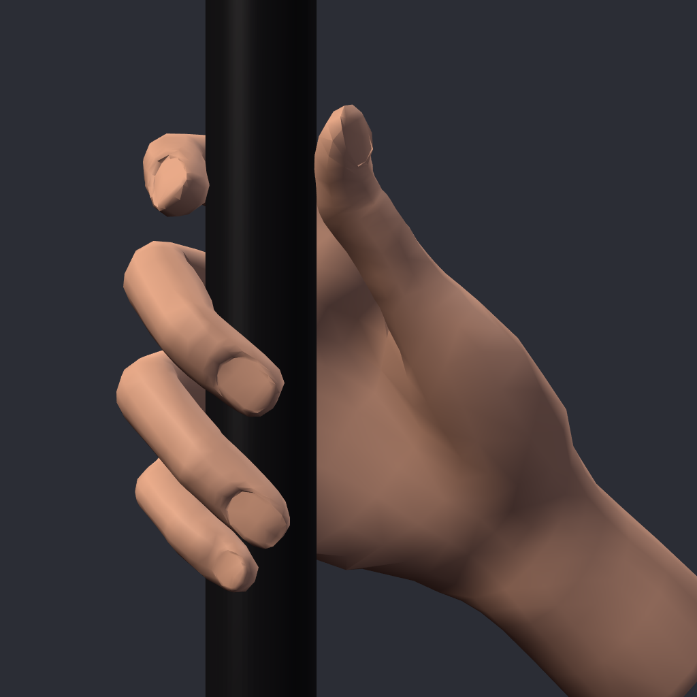
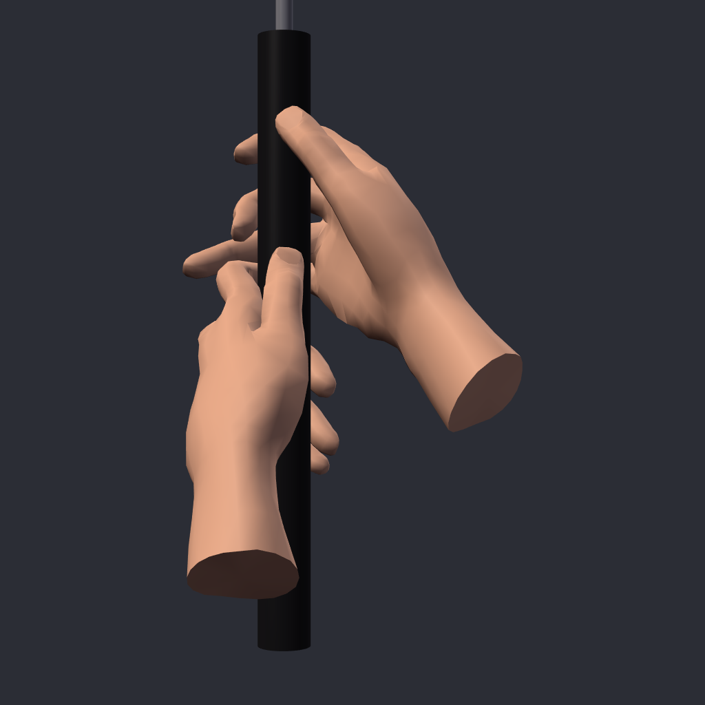

## Skinned Human Hand on the Club (MakeHuman CC0 Rig, Linear Blend Skinning)

Refs #15150 (epic), #15148. Stacked on `cursor/hrg-gb1b-shaft-roll-2882`. Auto-merge is not armed, on the owner's instruction.

### State at `208312257c` (2026-11-15)

- The hand is MakeHuman's hm08 mesh with MakeHuman's own `default.mhskel` skeleton and `default_weights.mhw` skin weights (CC0, pinned commit, recorded in `assets/hand_cc0/NOTICE` and `PROVENANCE.json`). Two declared changes to the weights and one to the mesh: see "Deviations".
- Posing is joint rotation plus linear blend skinning. Three owner-approved corrective shapes then move a little skin (`correctives.py`): fold relaxation around inside-out triangles, a palm pad that settles onto the grip, and (new) lifting skin that dips under 2 mm inside the grip back to its surface. All are switchable. With all off, a test rebuilds the mesh from the reported bone transforms and requires agreement to 1e-12 m; with them on, the solved joint angles are identical.
- **New: the skin is Loop-subdivided once** (`subdivision.py`, setting `mesh.subdivision_levels`, 0 switches it off): 7,074 vertices and 14,144 triangles per hand, up from 1,770 and 3,536. Skin weights go through the same operator. The grip is solved on the original vertices of the subdivided skin, so the solve costs the same and a solved contact is a contact of the drawn skin.
- The pose follows the grip spec: flat hand beside the club, club under the index finger's first segment and just below the base of the little finger, then MCP, PIP, DIP close in that order until the skin touches. Knuckle flexion drives the ring and little metacarpals so the palm cups.
- The thumb now lies on the grip along its pad, not on its tip.
- `build_grip_hands` (new module `skinned_pair.py`) poses both hands on one club. The trail hand slides toward the club head by the least amount that frees its index, middle and ring fingers from the lead hand, then curls round the grip. Its little finger rests on the lead index finger (overlap grip).
- The forearm ends in a rounded cap, not a flat disc.
- Each hand declares which vertices a renderer should frame on (`frame_focus`: everything except the forearm stub), so the hand itself fills 0.70 of the frame.
- Shaft roll comes from `HandGripSpec.shaft_roll_deg`. Every size, tolerance, limit, gain and colour is in `scripts/config/skinned_human_hand.json`, `scripts/config/hand_visual_quality.json` or `assets/hand_cc0/build_settings.json`.
- Contact physics is untouched (still capsules). This is the visual model.
- Tests: 84 pass, 1 skipped (the source-rebuild check needs a MakeHuman checkout; the asset file is unchanged in this round).

### Measured (Legacy Grip Spec, Grip Radius 14 mm)

| Check | Before | Now | Limit (setting) |
| --- | --- | --- | --- |
| Thumb first segment to grip | 12.2 and 14.5 mm | 5.1 mm lead, 4.9 mm trail | 6 mm |
| Fingertip and middle phalanx to grip, single hands | 0.95 mm | 1.0 mm | 1.5 mm |
| Trail index, middle, ring to the grip itself (pair) | ring 6.8 mm | at most 1.0 mm | 1.5 mm |
| Skin inside the grip | 0.3 mm | 0.0 mm (0.9 mm before the lift-out corrective, see Learnings) | 0.5 mm |
| One hand inside the other (pair, mesh winding number) | 0.0 mm | 0.0 mm | 1.0 mm |
| Forearms apart, seen from the butt | 25 degrees | 28 degrees | 15 to 50 |
| Degenerate triangles | 0 | 0 | 0 |
| Triangles folded into a crease | 2 per hand | 0 per hand, single and pair | 0 (tightened from 2) |
| Palm skin within 1.5 mm of the grip | 0 vertices | 95 vertices of the finer mesh, palm gap 0.3 mm (was 1.1 mm) | at least 8 |
| Farthest a corrective moves any vertex | 0 | 6.0 mm lead, 6.6 mm trail; 519 of 7,074 vertices move | 8 mm |
| Mean triangle edge | 5.6 mm | 2.7 mm | 4 mm (new) |
| Hand share of the frame (forearm left out) | 0.48 to 0.60 | 0.67 to 0.70 | 0.70 plus or minus 0.12 |
| Left-handed golfer is the exact mirror | yes | yes | 1e-9 m |
| Shaft roll 0 and plus or minus 20 degrees is a rigid turn | yes | yes | 1e-9 m |

### Self-Review (I Opened All 36 Frames; Scores Out Of 5)

| Criterion | Lead | Trail | Both hands | Change |
| --- | --- | --- | --- | --- |
| Separate fingers and thumb | 4 | 4 | 4 | same |
| Cupped palm | 3 | 3 | 3 | same; accepted by the owner for this PR (2026-11-15) |
| Knuckle line | 4 | 4 | 4 | same |
| Fingers wrap the grip | 4 | 4 | 4 | pair up from 3 |
| No tubes, blobs or torn triangles | 4 | 4 | 4 | same: no folded triangle on the finer mesh either |
| Smooth shading | 5 | 4 | 4 | lead up from 4, pair up from 3: the facets are gone; trail and pair keep faint creases at the finger bases |
| Correct mirroring | 5 | 5 | 5 | same |

Each hand reads as a human hand holding a golf club, and the pair now reads as two hands gripping one club with the trail fingers closed on it. It does not reach the bar yet. What still falls short:

- **Palm cup (3).** The palm pad corrective closes the heel of the hand onto the grip (12 palm vertices in contact, up from none), which shows in the butt views. From the palm view the palm still reads flatter than a real one. The thenar pad stays about 30 mm clear of the grip: in a finger grip the thumb's base sits about 66 mm from the grip axis. A stronger pad setting (25 mm reach, four passes) did close it, but it swelled the thumb and creased the palm, so I did not ship it.
- **Thumb first segment.** The thumb's end pad touches the grip (under 1 mm). Its first segment stays 5 mm off. Sliding the thumb toward the grip would push the tip inside it, so I left it.
- **Creases at the finger bases.** Subdivision turned the sharp ridges where the folds were into soft creases. A small pinched notch remains between the index and middle knuckles in the lead thumb-side view, and faint creases at the finger bases in the trail back view.
- **Nails.** Subdivision rounds the nail edges, so the nails read a little softer than before.
- **Butt view.** Fixed in #15154: the view is now tilted to the palm side, so it shows the fingers wrapping and the heel of the hand on the grip. The grip end still crosses part of the frame.
- **Lead thumb in the pair.** It is hidden under the trail palm, as in a real grip. The trail thumb shows in the back and thumb-side views.

| | Palm | Back | Thumb side | Butt |
| --- | --- | --- | --- | --- |
| Lead |  |  |  |  |
| Trail |  |  |  |  |
| Both |  |  |  |  |
| Both, roll -20 |  |  |  |  |
| Both, roll +20 |  |  |  |  |

All 36 frames (1024 px, MuJoCo EGL through the shared renderer of #15154) and `render_manifest.json` are in `docs/development/full_body_models/evidence/hand_skinned_human/`.

### Deviations and Things to Check

- **Corrective shapes move skin after skinning** (`correctives.fold_relax`, `correctives.palm_pad` and, new, `correctives.lift_out`; approved 2026-11-15). Together they move 519 of 7,074 vertices per hand, by at most 6.6 mm (palm pad). Lift-out moves finger skin by at most 0.9 mm, and only onto the grip surface. `iterations: 0`, `reach_m: 0` and `max_depth_m: 0` switch them off and give pure linear blend skinning back. The reported `contact_gaps_m` are measured on the corrected skin.
- **The skin is subdivided at load, not in the asset file.** I had said build time; doing it at load keeps `hand_cc0.npz` and its provenance hash untouched and makes it a plain setting. Subdivision pulls the surface in by 0.5 mm on average (1.7 % of volume); the hand is scaled after subdividing, so length and breadth still match the spec.
- **A test contract changed.** The test used to require that no finger skin moves after skinning. It now requires that finger skin moves by at most the lift-out depth and ends on the grip surface.
- **Skin weights at the thumb web are smoothed** (`thumb_web_smoothing`, approved). Zero iterations rebuilds with MakeHuman's untouched weights.
- **Skin weights at the finger middle creases are lightly smoothed** (`finger_crease_smoothing`, kept with the owner's go-ahead on 2026-11-15). One ring, two passes at half blend. It took the folds from 5 to 2 per hand before the correctives. Zero iterations turns it off.
- **The forearm cut is closed with a dome** (`forearm_cap`: 4 rings, depth 0.6 of the loop radius). These vertices are not MakeHuman's. Zero rings gives the flat fan back.
- **The trail hand may slide up to 30 mm along the grip** beyond the spec's hand spacing (`pair.max_spacing_adjust_m`) so its fingers reach the grip. Zero keeps the spec's spacing exactly and puts the ring finger back on the lead hand.
- **Thumb joints may bend back** (MCP to -10 degrees, IP to -25) so the pad lies flat. These limits are my values.
- **Wrist bend** (lead 0 and 20 degrees, trail 15 and 10) and **`palm_centre_wrap_deg` (37)** are my values, tuned by eye.
- **Finger-length references are unverified.** The ratios in `hand_visual_quality.json` are recalled from Buryanov and Kotiuch 2010 and were not checked against the paper.
- **Shared posing has no branch of its own**, so `hand_backends/posing.py` and its tests live here.
- **Size.** Several thousand added lines, far over the 500-line gate. It needs `large-pr-approved` or an owner decision.

### Blockers

- **CI.** `unit-test-gate` still lists `grip_spec/*` and `grip_contact/field_validation.py` as unregistered paths, and fails `test_matched_swing_status_freshness`. Those files belong to the base PRs or to `main`, not this one, so I left them. The Fleet policy gate is left alone as instructed.
- **Fleet claim.** The lease on #15148 lapsed at 15:49Z and the renewal call is refused ("no active lease"); the `claim:claude` label still stands. I carried on under the repository's fail-open rule.

## Learnings

- Rig with the source's own skeleton and weights. Cropping a body mesh and inventing weights gave tubes and tears; MakeHuman's rig gave a hand on the first pose.
- Fit finger hinge axes to the palm plane, not to each finger's nearly straight rest shape. The per-finger fit fanned the fingers.
- Greedy proximal-to-distal curl hooks a digit on its tip. Scan the first joint, close the others to contact, and keep the pose whose named segments both touch (`wrap_to_contact`). This also laid the thumb flat once its joints were allowed to bend back a little.
- The thumb is a ramp from its base to the grip. Do not try to press the thenar pad onto the grip; measure the pad of the thumb instead.
- For two hands, decide the spacing first: solve the trail hand alone on the bare grip, slide it by the least amount that frees its gripping fingers from the lead hand, then solve against grip plus lead hand. Curling against the lead hand at the spec's spacing left the ring finger 7 mm off the grip.
- Measure hand-in-hand overlap on the meshes (winding number), not on the capsules used to solve. A 1 mm capsule margin removed the last 1 mm of mesh overlap.
- Light weight smoothing at a crease removes folds; more smoothing adds them and lifts the palm off the grip.
- The folds that weights cannot remove go with a local Laplacian relaxation after skinning: two passes at half step over two edge rings were enough. Measure folds on the final mesh, not on a re-skinned copy, or the check cannot see the corrective.
- A contact pad corrective must be mild. Twelve millimetres of reach with a smoothed displacement field seats the heel pad; 25 mm swells the thumb. Smooth the displacement, not the positions, and repeat the pass, because smoothing spreads each pass short of contact.
- Zero folded triangles is not the same as no visible crease. A tight but valid crease still catches the light; report both.
- Frame the camera on the hand, not on hand plus forearm. A bounding-box fill of 0.70 that includes the forearm stub shows the hand at about 0.55.
- Subdividing the skin once removes facets that no shading setting could. Push the weights through the same operator and the finer mesh skins exactly like the coarse one.
- Solve the grip on the original vertices of the subdivided skin, not on the unsubdivided mesh. Subdivision shrinks the surface by about half a millimetre, so a contact solved on the old surface is a gap on the new one.
- A coarse mesh hides penetration. Two touching vertices 5 mm apart span a chord that dips 0.3 mm into a 14 mm grip; the finer mesh put vertices there and measured 0.9 mm. Lift that skin to the surface as flesh would compress, and cap the depth so a real posing fault still shows.
- A brute-force winding number over a 4x mesh is 16x the work (20 s per pair). A ray-parity test along two axes preselects the candidates and the exact winding number runs on those only: 0.6 s, same answer on every point checked.
- Measuring breadth in a band across the knuckles depends on the hand's length, so fit the breadth on the scaled hand, not before scaling.
- A view straight down the shaft shows the end cap, not the hand. Tilt it to the palm side.
- Solver speed is forward kinematics. Precomputed hinge matrices and skinning only the vertices a joint moves took a pair from 55 s to 14 s.
- Never run Python from inside `hand_backends/`: its `types.py` shadows the standard library.

### Next Steps

1. Soften the remaining notch between the index and middle knuckles.
2. Sharpen the nail edges after subdivision (crease weights on the nail loop).
3. A sculpted grip-pose palm shape, as a follow-up issue under #15150 if the palm view is still not good enough.
4. Check the finger-length references against the paper.

🤖 Generated with [Claude Code](https://claude.com/claude-code)
