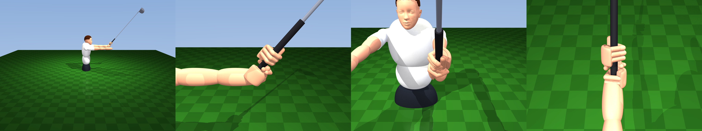
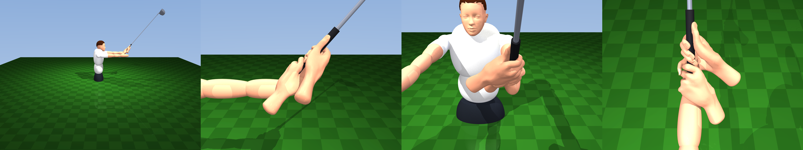

## Skinned Human Hands on the Golfer's Club, Squared to the Clubface

Refs #15251, Refs #15150. First of three narrow slices on #15251.

**This pull request builds on #15149's branch** (`cursor/skinned-human-hand-backend-751f` at `e415beabff`), because the skinned hand backend is not on `main` yet. Its own change is the six files listed below; the rest of the diff against `main` is #15149. It should merge after #15149. Auto-merge is not armed, by the owner's instruction for this epic.

### What Changes

- A spec can now choose the hands drawn on the club: `subject.hand_visual_backend` is `capsule` (the default, unchanged) or `skinned_human`. Any other value raises `ValueError`.
- With `skinned_human`, the posed pair from `hand_backends.skinned_pair` is placed in a frame taken from the clubface alone (`skinned_club_hands.skinned_hand_frame`): the top of the grip under the hands is at right angles to the face normal.
- `skinned_club_hands.wrist_joints_m(club)` gives each hand's wrist joint in the club frame. The next slice uses it to move the model's wrist joints to the hands.
- `grip_hand_frame`, which the force and contact adapters read, is not changed.

### Why

The owner's report: the grip is misaligned from the clubface. Measured on the driver model, the capsule hands' top of the grip sits 46.3 degrees round the shaft from the top of the grip the clubface defines, because the hands are turned from the wrist followers while only the head is squared at address. The skinned hands here are 0 degrees from the clubface by construction, and a test holds that.

### Measured on the Driver Model

| Quantity | Value | Limit |
|---|---|---|
| Hand frame's top of grip against the clubface normal | 90 degrees (dot product 0) | exact |
| Lead wrist joint, sideways from the shaft plane | 0 mm | at most 8 mm |
| Trail wrist joint, toward the trail side | 44 mm | 15 to 50 mm |
| Skin sunk into the club's drawn grip tube, lead | 0.97 mm | at most 2 mm |
| Skin sunk into the club's drawn grip tube, trail | 1.89 mm | at most 2 mm |
| Time to solve the pair, once per process | about 60 s | none |

### MuJoCo Stills (Model Default Pose, Not Address)

Capsule hands (default):

Skinned hands (`subject.hand_visual_backend: "skinned_human"`):

### Harsh Self-Review of the Stills

| View | Score Out Of 5 | What Is Wrong |
|---|---|---|
| Whole golfer | 2 | The model's default pose holds the arms straight out; it is not an address position. |
| Hands, side | 2 | The hands read as human hands on the grip, but each skinned hand's forearm stub points away from the model's forearm: the model forearms end 57 to 75 mm from the skinned wrists. |
| Hands, front | 2 | Same fault; the lead stub crosses in front of the trunk. |
| Hands, from above | 3 | The grip itself reads well; the two loose stubs spoil it. |

This slice only squares the hands to the face and makes them selectable. The hands are not yet joined to the arms.

### Not Done in This Slice

- The model's wrist joints are not moved to the skinned wrists, and the hand mesh is not cut at the wrist (slice 2).
- Address and swing are not refitted, and there is no full-swing render (slice 3).
- The club still draws its plain grip tube, up to about 1 mm fatter than the standard golf grip the hands are posed on, so the skin sinks up to 1.89 mm into it.
- The pair is solved for a right-handed golfer with the hand size of the skinned settings; the spec's `hand_length_m`, `grip_config` and handedness do not reach the skinned hands yet.
- The pair takes about a minute to solve the first time a process draws it. There is no disk cache.

### Files

- `src/shared/python/model_appearance/skinned_club_hands.py` (new)
- `src/shared/python/model_appearance/hand_spec.py`, `grip_hands.py` (the switch; `_club_axes` becomes public `face_square_axes`)
- `scripts/config/hand_visual_quality.json` (new `max_club_grip_sink_m`)
- `tests/unit/model_appearance/test_skinned_hands_on_club.py` (new, written first)
- `docs/.../hand_skinned_human/render_skinned_human_evidence.py` (reuses `owner_grip_spec` instead of its own copy)

### Validation

- `pytest tests/unit/model_appearance/test_skinned_hands_on_club.py test_grip_hands.py test_hand_spec_emitters.py test_grip_hand_dorsum_follows_wrist.py hand_backends/test_skinned_human.py`: 112 passed, 2 xfailed (#15181, from #15149), 10 min 54 s. The new file's 7 tests failed before the implementation (module missing).
- `ruff check`, `ruff format`, mypy on the three source files, architecture budget, Law of Demeter, file size and title-case checks: clean.
- Not run: the full test suite, and the 45-frame hand evidence render (the evidence script now takes its grip from `owner_grip_spec`, the same values).

## Handoff

- **Branch, commit, and pull request:** `claude/skinned-hands-on-club-15251`, built on `cursor/skinned-human-hand-backend-751f`.
- **Validation:** see above.
- **Blockers:** depends on #15149 merging first.
- **Next step:** slice 2 of #15251: add wrist joint anchors on the club from `wrist_joints_m`, cut the hand mesh at the wrist and draw the model forearms to it.

🤖 Generated with [Claude Code](https://claude.com/claude-code)
