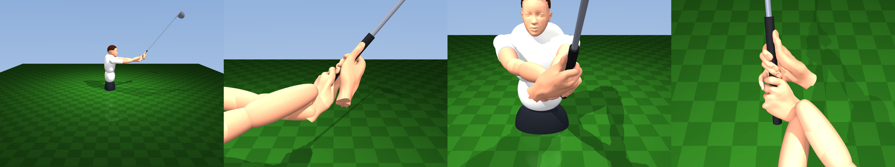

## Move the Golfer's Wrist Joints to the Skinned Hands' Wrists

Refs #15253, Refs #15251, Refs #15150. Owner decision, 2026-11-17: move the model's wrist joints, accepting that this changes the dynamics.

**This pull request builds on #15252** (`claude/skinned-hands-on-club-15251`), which builds on #15149. Its own change is the files listed below; the rest of the diff against `main` belongs to those two. It should merge after them. Auto-merge is not armed, by the owner's instruction for this epic.

### What Changes

- `skinned_hand_wrists.apply_skinned_hand_wrists(document)` returns a new spec revision whose lead and trail wrist joints sit at the wrist joints of the posed skinned hands on the club. It sets `subject.hand_visual_backend` to `skinned_human` and records the parent hashes in `spec_revision`.
- The skinned hands drawn on the club are cut 20 mm up the forearm from the wrist joint (`club_hand_forearm_cuff_m`, a setting) and the cut end is closed flat, so the mesh stays closed.
- No committed spec file is changed. Nothing uses the new revision unless a caller asks for it.

### What Moves and What Does Not

| Item | Before (Club Frame, m) | After (Club Frame, m) |
|---|---|---|
| Lead wrist joint | (-0.0250, -1.1240, 0.0591) | (0.0319, -1.1426, 0.0131) |
| Trail wrist joint | (-0.0250, -1.0478, 0.0591) | (0.0043, -1.0468, -0.0265) |

- The lead joint and the `LW` frame move on the club body. The trail joint moves by shifting the weld point on the trail hand body (`closure.placement_a`).
- Unchanged, and held by tests: every body (mass, inertia), every joint rotation, and the weld point on the club (`closure.placement_b`).
- The input document is not mutated, and applying the function to its own result returns an equal document.
- A left-handed document raises `ValueError`.

### MuJoCo Still (Not an Address Pose)

The model is built from the revised spec. The pose is the model's default pose with the trail weld settled by stepping without gravity; the weld's position error after settling is under 1 mm.

### Harsh Self-Review of the Still

| View | Score Out Of 5 | What Is Wrong |
|---|---|---|
| Whole golfer | 2 | Still the default pose, not address. |
| Hands, side | 2 | Both forearms now end at the hands, but they arrive at the wrong angle: the cut cuff of each hand points one way and the model forearm another, and the flat cap of the lead cuff shows. |
| Hands, front | 2 | The forearms cross in this settled pose; the trail wrist reads -110 degrees on one axis, outside its 80 degree range. |
| Hands, from above | 3 | The grip reads as two human hands on the club with arms attached. |

The joints are in the right place. The arms do not yet point where the hands expect them. That needs the address refit with the wrists held near the hand's posed angles (15 degrees extension lead, 20 degrees trail), which is slice 3.

### Not Done

- Address and swing are not refitted to the moved joints. Every committed fit, receipt and calibration still belongs to the unmoved spec.
- The hand mesh is rigid on the club: it does not bend with the model's wrist, so any wrist angle away from the posed one opens a step at the cuff.
- The rotation part of the trail weld does not close in MuJoCo at this pose (residual 0.43; 0.86 on the unmoved model settled the same way), so this is not introduced here, but I have not explained it.
- No engine other than MuJoCo was built from the revised spec.

### Files

- `src/shared/python/motion_matching/execution/skinned_hand_wrists.py` (new)
- `src/shared/python/model_appearance/skinned_club_hands.py` (wrist cut and cap, forearm direction, type fixes)
- `scripts/config/hand_visual_quality.json` (new `club_hand_forearm_cuff_m`)
- `tests/unit/motion_matching/test_skinned_hand_wrists.py` (new, written first), `tests/unit/model_appearance/test_skinned_hands_on_club.py` (closed-mesh check)

### Validation

- `pytest tests/unit/motion_matching/test_skinned_hand_wrists.py tests/unit/model_appearance/test_skinned_hands_on_club.py tests/unit/model_appearance/test_grip_hands.py tests/unit/motion_matching/test_grip_config.py`: 61 passed.
- `ruff check`, `ruff format`, mypy on the four source files, architecture budget, Law of Demeter and file size checks: clean.
- Not run: the full test suite.

## Handoff

- **Branch, commit, and pull request:** `claude/skinned-wrist-joints-15253`, built on `claude/skinned-hands-on-club-15251`.
- **Validation:** see above.
- **Blockers:** depends on #15252 and #15149 merging first.
- **Next step:** slice 3 of #15251: refit address with the revised spec, holding the wrists near the hands' posed extension, then render the full swing.

🤖 Generated with [Claude Code](https://claude.com/claude-code)
