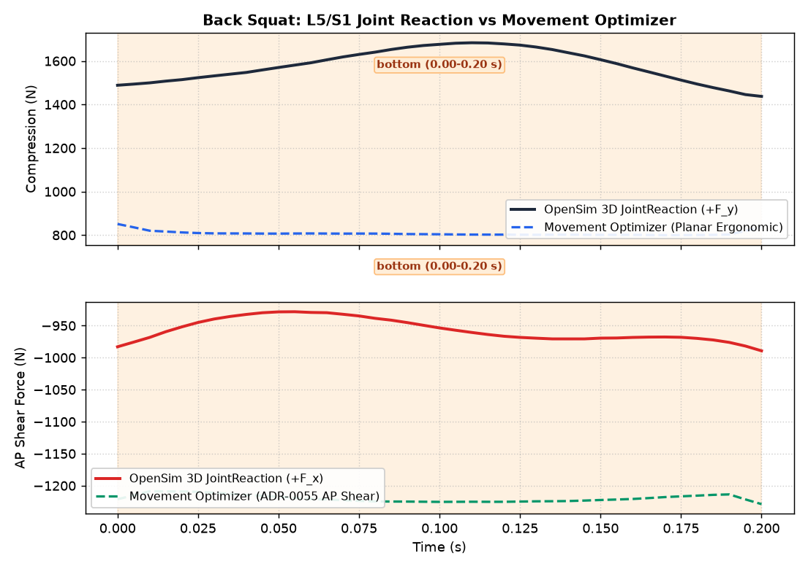
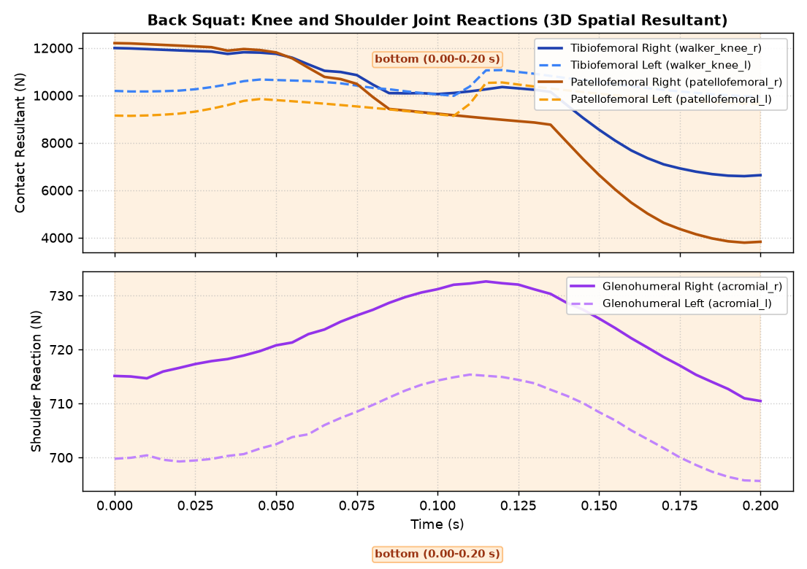

# OpenSim Barbell Lift Joint Reaction Load Receipts (OSL-5, #13043)

`receipts.json` and evidence plots are generated by `scripts/measure_opensim_lift_joint_reactions.py`
using real OpenSim 4.6 and the Rajagopal 2023 musculoskeletal model.

## Overview

OSL-5 computes 3D internal joint reaction loads across the barbell lift motion window:
1. **L5/S1 Lumbar Joint**: OpenSim `back` joint expressed in inferior pelvis ISB frame and torso frame.
   *Qualification*: lower bound: no trunk muscles; the lumbar moment is an ideal actuator.
2. **Knee Tibiofemoral Joint**: Resultant contact load across `walker_knee_r` and `walker_knee_l`.
3. **Knee Patellofemoral Joint**: Articulated patella joint contact load (`patellofemoral_r/l`).
4. **Shoulder Glenohumeral Joint**: Evaluated at articulated `acromial_r/l` CustomJoints (3 rotational DOFs).
5. **Movement Optimizer Cross-Check**: Compares L5/S1 loads against `movement_optimizer.spine_loads` in aligned torso frame.
6. **Static-Hold Analytic Bound**: Frame/sign self-consistency at default pose and evaluation on dynamic squat frame.

## Evidence Summary (Back Squat Slice)

- **Source Commit**: `b0e08b79d34e1f4e17b4c9ba808941f8b58a35c4`
- **Lifter Mass**: 80.31 kg (Body Weight = 787.60 N)
- **Barbell Mass**: 100.00 kg
- **Window**: 0.00 s to 0.20 s (41 frames, bottom inflection phase)
- **Inherited OSL-4 Qualification**: unqualified (mean reserve share: 0.5695, peak reserve share: 0.6766, threshold: 0.05)

### Measured Reaction Loads

| Joint | Metric | Qualification | Mean (N) | Peak (N) | Mean (BW) | Peak (BW) |
|---|---|---|---|---|---|---|
| **L5/S1 Axial Compression** | +F_y (pelvis frame) | lower bound: no trunk muscles; the lumbar moment is an ideal actuator | 1579.32 | 1683.66 | 2.01 | 2.14 |
| **L5/S1 AP Shear** | +F_x (pelvis frame) | lower bound: no trunk muscles; the lumbar moment is an ideal actuator | -956.85 | -989.32 | -1.21 | -1.26 |
| **L5/S1 Torso Compression** | +F_y (torso frame) | lower bound: no trunk muscles; the lumbar moment is an ideal actuator | 1104.77 | 1158.95 | unavailable | unavailable |
| **L5/S1 Torso AP Shear** | +F_x (torso frame) | lower bound: no trunk muscles; the lumbar moment is an ideal actuator | -1480.75 | -1555.69 | unavailable | unavailable |
| **Knee Tibiofemoral** | Resultant 3D norm | unqualified | 10154.88 | 11997.15 | 12.89 | 15.23 |
| **Knee Patellofemoral** | Resultant 3D norm | unqualified | 9295.27 | 12205.18 | 11.80 | 15.50 |
| **Shoulder Glenohumeral** | Resultant 3D norm | unqualified | 714.06 | 732.62 | 0.91 | 0.93 |

- **Peak Lumbar Actuator Moment**: 665.32 N·m (ideal coordinate actuator; no active erector spinae in Rajagopal)
- **Segmental Spine Reference**: Use segmental spine model (#12735) for multi-segment spinal load with active trunk muscles

### Static-Hold Analytic Bound & Dynamic Squat Frame Check

#### Default Pose Self-Consistency (Frame and Sign)
- **Upper Mass Above L5/S1**: 136.4979 kg (Torso, Arms, Barbell)
- **Gravitational Weight Above ($W_{\text{above}}$)**: 1338.59 N
- **Measured L5/S1 Compression**: 1338.59 N
- **Absolute Difference**: 2.2737e-13 N
- **Muscles Crossing L5/S1**: 0 (sum crossing forces = 0.0000 N)
- **Verification Status**: **PASSED** (Evaluates all-zero default pose; checks frame and sign self-consistency only (not verifying lift))

#### Dynamic Squat Minimal-Acceleration Frame Evaluation
- **Frame Index**: 40 (time = 0.2000 s)
- **Generalized Acceleration Norm ($\|\ddot{q}\|$)**: 20.0378 rad/s²
- **Upper Weight Above ($W_{\text{above}}$)**: 1338.59 N
- **Measured Pelvis Compression**: 1437.27 N
- **Measured Torso Compression**: 1030.71 N
- **Lower Bound ($W_{\text{above}} \le \text{Compression}$)**: PASSED
- **Upper Bound ($\text{Compression} \le W_{\text{above}} + \sum F_m$)**: FAILED
- **Evaluation Status**: **FAILED** (Evaluated (pelvis-frame compression) on the solved squat frame with the smallest generalized acceleration norm; the static bound ignores that frame's acceleration and the ideal lumbar actuator.)

### Movement Optimizer L5/S1 Cross-Check

- **Model**: planar_ergonomic_l5s1_estimate
- **Upper Body Mass ($m_{\text{above}}$)**: OpenSim = 136.4979 kg, Movement Optimizer default = 154.4522 kg, Movement Optimizer aligned = 136.4979 kg
- **Angle Definitions**:
  - OpenSim: Sagittal tilt of torso frame relative to vertical in ground: atan2(R_torso[0, 1], R_torso[1, 1])
  - Movement Optimizer: Torso inclination angle theta from vertical in 2D sagittal plane
- **Default Movement Optimizer**: Compression Mean = 807.98 N, Peak = 851.13 N; ADR-0055 AP Shear Mean = -1219.75 N, Peak = -1228.80 N
- **Aligned Movement Optimizer (Torso Frame)**: Compression Mean = 724.83 N, Peak = 757.81 N; ADR-0055 AP Shear Mean = -1083.96 N, Peak = -1089.20 N
- **Pre-Evaluation Tolerance**: 50.00 N
- **Residual Differences (OpenSim Torso vs Aligned Movement Optimizer)**:
  - Compression Mean Residual: 379.94 N (Peak: 439.35 N)
  - AP Shear Mean Residual: -396.78 N (Peak: 467.04 N)
- **Model Difference Analysis**: Movement Optimizer is a planar rigid-body estimate (gravity and torso inertia, no muscles); OpenSim is a 3D JointReaction with no trunk muscles. Rotated into the torso frame with matched m_above (136.50 kg), the residual is 379.94 N compression (max |439.35| N) and -396.78 N AP shear (max |467.04| N) against the 50.0 N tolerance. The residual is not yet decomposed into its sources (pelvis acceleration, 3D coupling, contact).

### Status of Other Four Lifts

The other four lifts (`deadlift`, `bench_press`, `snatch`, `clean_and_jerk`) are reported as `unavailable`
with reason: `no OSL-4 muscle solve (needs OSL-3 #13041 bundles)`. Values are explicitly `null` (never synthetic zeros).

## Evidence Figures

### L5/S1 Joint Reaction Loads vs Movement Optimizer


### Knee and Shoulder Joint Reactions


## Reproduction Commands

```bash
UPSTREAMDRIFT_MSK_BASE_MODEL=$HOME/Repositories/ud-13044/shared/models/opensim/opensim-models/Models/Rajagopal/RajagopalLaiUhlrich2023.osim \
PYTHONPATH=$PWD QT_QPA_PLATFORM=offscreen MPLBACKEND=Agg \
    ~/Repositories/UpstreamDrift/.venv/bin/python3 scripts/measure_opensim_lift_joint_reactions.py
```
