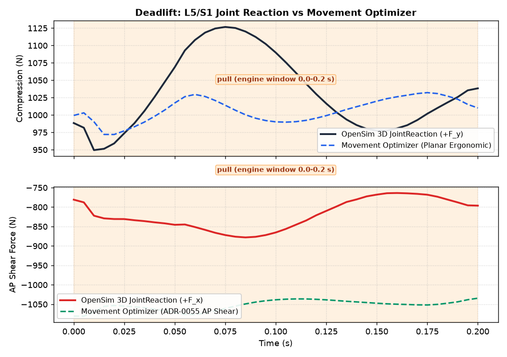
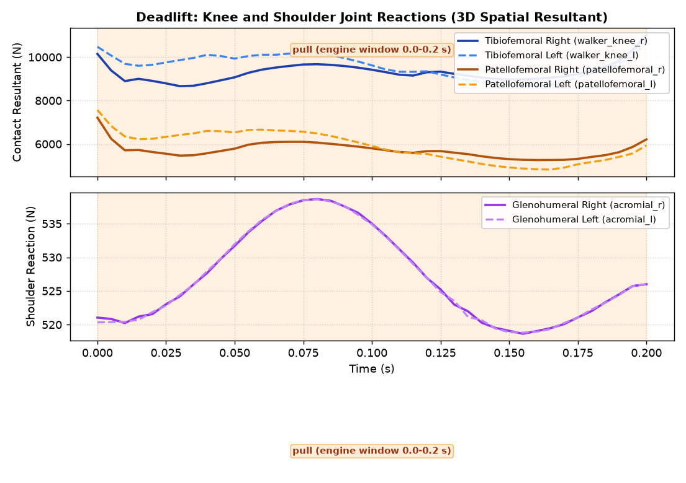
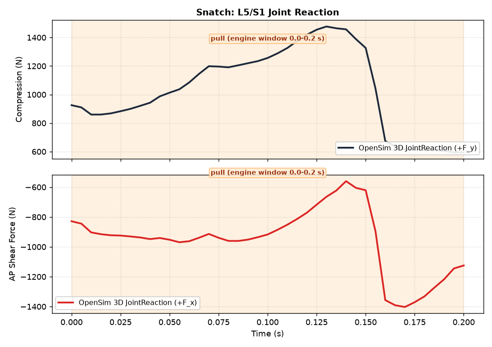
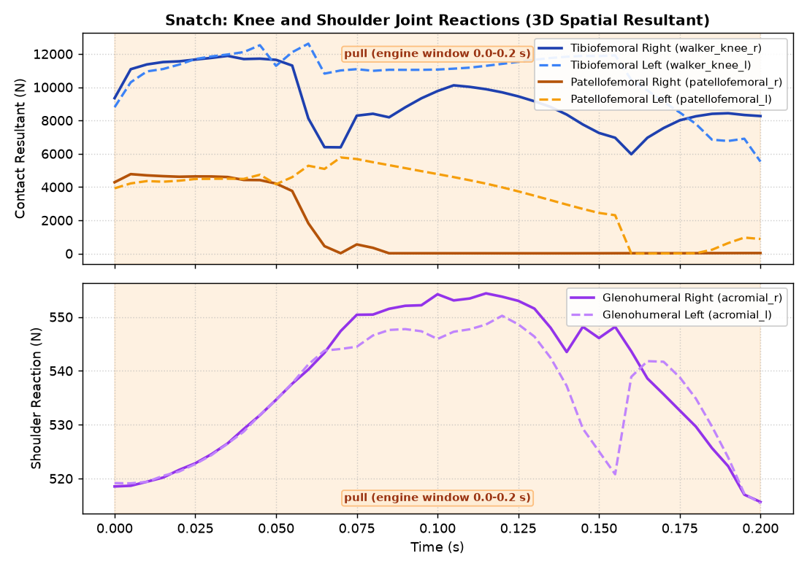
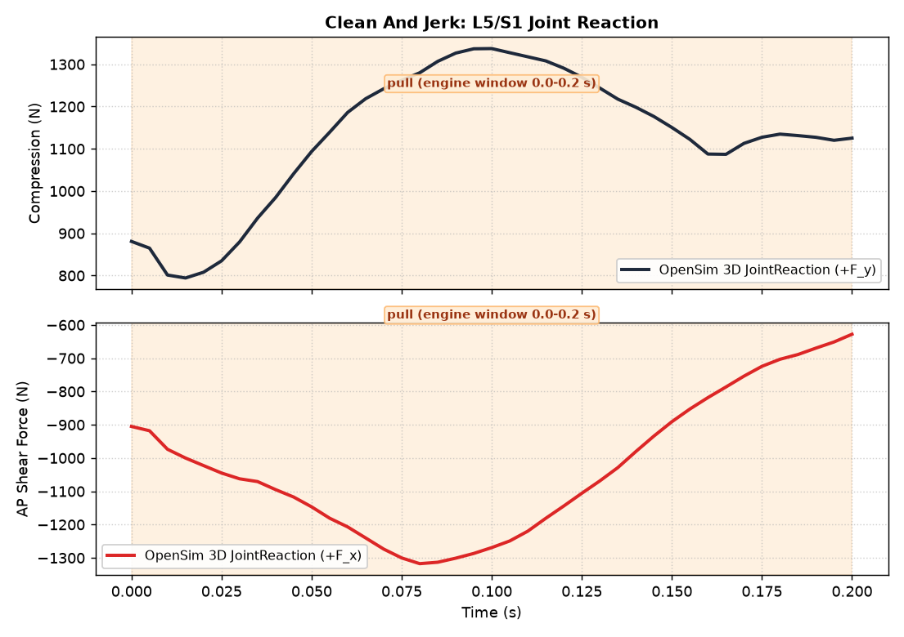
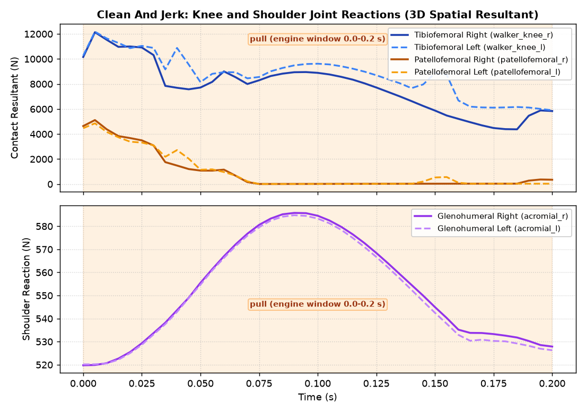

# OpenSim Barbell Lift Joint Reaction Load Receipts (OSL-5, #13043)

`receipts.json` and evidence plots are generated by `scripts/measure_opensim_lift_joint_reactions.py`
using real OpenSim 4.6 and the Rajagopal 2023 musculoskeletal model.

## Overview

OSL-5 computes 3D internal joint reaction loads across the barbell lift motion window:
1. **L5/S1 Lumbar Joint**: OpenSim `back` joint expressed in inferior pelvis ISB frame and torso frame.
   *Qualification*: lower bound: no trunk muscles; the lumbar moment is an ideal actuator.
2. **Knee Tibiofemoral Joint**: Resultant contact load across `walker_knee_r` and `walker_knee_l`.
3. **Knee Patellofemoral Joint**: Articulated patella joint contact load (`patellofemoral_r/l`).
4. **Shoulder Glenohumeral Joint**: Evaluated at articulated `acromial_r/l` CustomJoints (3 rotational DOFs).
5. **Movement Optimizer Cross-Check**: Compares L5/S1 loads against `movement_optimizer.spine_loads` in aligned torso frame for the squat and deadlift.
6. **Static-Hold Analytic Bound**: Frame/sign self-consistency at default pose and evaluation on dynamic lift frames.

## Evidence Summary

- **Source Commit**: `bf10d600d0c4860fe1be6877ab22187fa0476df4`
- **Lifter Mass**: 80.31 kg (Body Weight = 787.60 N)
- **Barbell Mass**: 100.00 kg
- **Motion Window**: 0.00 s to 0.20 s (41 frames)
- **Completed Lifts (4/5)**: Squat, Deadlift, Snatch, Clean And Jerk
- **Unavailable Lifts (1/5)**: Bench Press (supine posture limitation)
- **Inherited OSL-4 Qualification**: unqualified

### Measured Reaction Loads

#### Back Squat

| Joint | Metric | Qualification | Mean (N) | Peak (N) | Mean (BW) | Peak (BW) |
|---|---|---|---|---|---|---|
| **L5/S1 Axial Compression** | +F_y (pelvis frame) | lower bound: no trunk muscles; the lumbar moment is an ideal actuator | 1579.34 | 1683.68 | 2.01 | 2.14 |
| **L5/S1 AP Shear** | +F_x (pelvis frame) | lower bound: no trunk muscles; the lumbar moment is an ideal actuator | -956.80 | -989.17 | -1.21 | -1.26 |
| **L5/S1 Torso Compression** | +F_y (torso frame) | lower bound: no trunk muscles; the lumbar moment is an ideal actuator | 1104.80 | 1158.96 | unavailable | unavailable |
| **L5/S1 Torso AP Shear** | +F_x (torso frame) | lower bound: no trunk muscles; the lumbar moment is an ideal actuator | -1480.72 | -1555.61 | unavailable | unavailable |
| **Knee Tibiofemoral** | Resultant 3D norm | unqualified | 10154.70 | 11997.23 | 12.89 | 15.23 |
| **Knee Patellofemoral** | Resultant 3D norm | unqualified | 9295.12 | 12205.34 | 11.80 | 15.50 |
| **Shoulder Glenohumeral** | Resultant 3D norm | unqualified | 714.06 | 732.58 | 0.91 | 0.93 |

- **Peak Lumbar Actuator Moment**: 665.62 N·m (ideal coordinate actuator; no active erector spinae in Rajagopal)
- **Segmental Spine Reference**: Use segmental spine model (#12735) for multi-segment spinal load with active trunk muscles

#### Deadlift

| Joint | Metric | Qualification | Mean (N) | Peak (N) | Mean (BW) | Peak (BW) |
|---|---|---|---|---|---|---|
| **L5/S1 Axial Compression** | +F_y (pelvis frame) | lower bound: no trunk muscles; the lumbar moment is an ideal actuator | 1031.58 | 1126.71 | 1.31 | 1.43 |
| **L5/S1 AP Shear** | +F_x (pelvis frame) | lower bound: no trunk muscles; the lumbar moment is an ideal actuator | -818.82 | -878.01 | -1.04 | -1.11 |
| **L5/S1 Torso Compression** | +F_y (torso frame) | lower bound: no trunk muscles; the lumbar moment is an ideal actuator | 945.98 | 1040.64 | unavailable | unavailable |
| **L5/S1 Torso AP Shear** | +F_x (torso frame) | lower bound: no trunk muscles; the lumbar moment is an ideal actuator | -919.34 | -983.80 | unavailable | unavailable |
| **Knee Tibiofemoral** | Resultant 3D norm | unqualified | 9457.62 | 11027.46 | 12.01 | 14.00 |
| **Knee Patellofemoral** | Resultant 3D norm | unqualified | 5806.06 | 7568.23 | 7.37 | 9.61 |
| **Shoulder Glenohumeral** | Resultant 3D norm | unqualified | 526.94 | 538.66 | 0.67 | 0.68 |

- **Peak Lumbar Actuator Moment**: 487.28 N·m (ideal coordinate actuator; no active erector spinae in Rajagopal)
- **Segmental Spine Reference**: Use segmental spine model (#12735) for multi-segment spinal load with active trunk muscles

#### Snatch

| Joint | Metric | Qualification | Mean (N) | Peak (N) | Mean (BW) | Peak (BW) |
|---|---|---|---|---|---|---|
| **L5/S1 Axial Compression** | +F_y (pelvis frame) | lower bound: no trunk muscles; the lumbar moment is an ideal actuator | 1034.51 | 1477.06 | 1.31 | 1.88 |
| **L5/S1 AP Shear** | +F_x (pelvis frame) | lower bound: no trunk muscles; the lumbar moment is an ideal actuator | -954.10 | -1402.93 | -1.21 | -1.78 |
| **L5/S1 Torso Compression** | +F_y (torso frame) | lower bound: no trunk muscles; the lumbar moment is an ideal actuator | 942.44 | 1415.07 | unavailable | unavailable |
| **L5/S1 Torso AP Shear** | +F_x (torso frame) | lower bound: no trunk muscles; the lumbar moment is an ideal actuator | -1043.01 | -1464.53 | unavailable | unavailable |
| **Knee Tibiofemoral** | Resultant 3D norm | unqualified | 9921.70 | 12617.83 | 12.60 | 16.02 |
| **Knee Patellofemoral** | Resultant 3D norm | unqualified | 2418.29 | 5777.86 | 3.07 | 7.34 |
| **Shoulder Glenohumeral** | Resultant 3D norm | unqualified | 536.60 | 554.39 | 0.68 | 0.70 |

- **Peak Lumbar Actuator Moment**: 1145.59 N·m (ideal coordinate actuator; no active erector spinae in Rajagopal)
- **Segmental Spine Reference**: Use segmental spine model (#12735) for multi-segment spinal load with active trunk muscles

#### Clean and Jerk

| Joint | Metric | Qualification | Mean (N) | Peak (N) | Mean (BW) | Peak (BW) |
|---|---|---|---|---|---|---|
| **L5/S1 Axial Compression** | +F_y (pelvis frame) | lower bound: no trunk muscles; the lumbar moment is an ideal actuator | 1127.55 | 1337.21 | 1.43 | 1.70 |
| **L5/S1 AP Shear** | +F_x (pelvis frame) | lower bound: no trunk muscles; the lumbar moment is an ideal actuator | -1027.45 | -1317.43 | -1.30 | -1.67 |
| **L5/S1 Torso Compression** | +F_y (torso frame) | lower bound: no trunk muscles; the lumbar moment is an ideal actuator | 979.69 | 1177.60 | unavailable | unavailable |
| **L5/S1 Torso AP Shear** | +F_x (torso frame) | lower bound: no trunk muscles; the lumbar moment is an ideal actuator | -1180.83 | -1451.76 | unavailable | unavailable |
| **Knee Tibiofemoral** | Resultant 3D norm | unqualified | 8255.45 | 12178.43 | 10.48 | 15.46 |
| **Knee Patellofemoral** | Resultant 3D norm | unqualified | 956.58 | 5115.51 | 1.21 | 6.50 |
| **Shoulder Glenohumeral** | Resultant 3D norm | unqualified | 551.03 | 585.77 | 0.70 | 0.74 |

- **Peak Lumbar Actuator Moment**: 1296.56 N·m (ideal coordinate actuator; no active erector spinae in Rajagopal)
- **Segmental Spine Reference**: Use segmental spine model (#12735) for multi-segment spinal load with active trunk muscles

### Static-Hold Analytic Bound & Dynamic Frame Checks

#### Back Squat Analytic Bound
- **Default Pose Upper Mass ($m_{\text{above}}$)**: 136.4979 kg, Weight = 1338.59 N, Measured Compression = 1338.59 N (Diff: 2.2737e-13 N)
- **Muscles Crossing L5/S1**: 0 (sum crossing forces = 0.0000 N)
- **Default Pose Status**: **PASSED** (Evaluates all-zero default pose; checks frame and sign self-consistency only (not verifying lift))
- **Dynamic Minimal-Acceleration Frame**: Frame 39 ($t = 0.1950$ s, $\|\ddot{q}\| = 20.1178$ rad/s²)
- **Dynamic Weight Above ($W_{\text{above}}$)**: 1338.59 N, Pelvis Compression = 1445.38 N, Torso Compression = 1031.19 N
- **Dynamic Bound Status**: **FAILED** (Evaluated (pelvis-frame compression) on the solved squat frame with the smallest generalized acceleration norm; the static bound ignores that frame's acceleration and the ideal lumbar actuator.)

#### Deadlift Analytic Bound
- **Default Pose Upper Mass ($m_{\text{above}}$)**: 136.4979 kg, Weight = 1338.59 N, Measured Compression = 1338.59 N (Diff: 2.2737e-13 N)
- **Muscles Crossing L5/S1**: 0 (sum crossing forces = 0.0000 N)
- **Default Pose Status**: **PASSED** (Evaluates all-zero default pose; checks frame and sign self-consistency only (not verifying lift))
- **Dynamic Minimal-Acceleration Frame**: Frame 7 ($t = 0.0350$ s, $\|\ddot{q}\| = 2.5631$ rad/s²)
- **Dynamic Weight Above ($W_{\text{above}}$)**: 1338.59 N, Pelvis Compression = 1005.87 N, Torso Compression = 931.54 N
- **Dynamic Bound Status**: **FAILED** (Evaluated (pelvis-frame compression) on the solved deadlift frame with the smallest generalized acceleration norm; the static bound ignores that frame's acceleration and the ideal lumbar actuator.)

#### Snatch Analytic Bound
- **Default Pose Upper Mass ($m_{\text{above}}$)**: 136.4979 kg, Weight = 1338.59 N, Measured Compression = 1338.59 N (Diff: 2.2737e-13 N)
- **Muscles Crossing L5/S1**: 0 (sum crossing forces = 0.0000 N)
- **Default Pose Status**: **PASSED** (Evaluates all-zero default pose; checks frame and sign self-consistency only (not verifying lift))
- **Dynamic Minimal-Acceleration Frame**: Frame 6 ($t = 0.0300$ s, $\|\ddot{q}\| = 10.6142$ rad/s²)
- **Dynamic Weight Above ($W_{\text{above}}$)**: 1338.59 N, Pelvis Compression = 899.69 N, Torso Compression = 822.54 N
- **Dynamic Bound Status**: **FAILED** (Evaluated (pelvis-frame compression) on the solved snatch frame with the smallest generalized acceleration norm; the static bound ignores that frame's acceleration and the ideal lumbar actuator.)

#### Clean and Jerk Analytic Bound
- **Default Pose Upper Mass ($m_{\text{above}}$)**: 136.4979 kg, Weight = 1338.59 N, Measured Compression = 1338.59 N (Diff: 2.2737e-13 N)
- **Muscles Crossing L5/S1**: 0 (sum crossing forces = 0.0000 N)
- **Default Pose Status**: **PASSED** (Evaluates all-zero default pose; checks frame and sign self-consistency only (not verifying lift))
- **Dynamic Minimal-Acceleration Frame**: Frame 2 ($t = 0.0100$ s, $\|\ddot{q}\| = 20.5182$ rad/s²)
- **Dynamic Weight Above ($W_{\text{above}}$)**: 1338.59 N, Pelvis Compression = 801.23 N, Torso Compression = 716.25 N
- **Dynamic Bound Status**: **FAILED** (Evaluated (pelvis-frame compression) on the solved clean_and_jerk frame with the smallest generalized acceleration norm; the static bound ignores that frame's acceleration and the ideal lumbar actuator.)

### Movement Optimizer L5/S1 Cross-Check

#### Back Squat Movement Optimizer Cross-Check
- **Model**: planar_ergonomic_l5s1_estimate
- **Upper Body Mass ($m_{\text{above}}$)**: OpenSim = 136.4979 kg, Movement Optimizer default = 154.4522 kg, Movement Optimizer aligned = 136.4979 kg
- **Angle Definitions**:
  - OpenSim: Sagittal tilt of torso frame relative to vertical in ground: atan2(R_torso[0, 1], R_torso[1, 1])
  - Movement Optimizer: Torso inclination angle theta from vertical in 2D sagittal plane
- **Aligned Movement Optimizer (Torso Frame)**: Compression Mean = 724.87 N, Peak = 757.79 N; ADR-0055 AP Shear Mean = -1083.96 N, Peak = -1089.23 N
- **Pre-Evaluation Tolerance**: 50.00 N (Tolerance Satisfied: FAILED)
- **Residual Differences (OpenSim Torso vs Aligned Movement Optimizer)**:
  - Compression Mean Residual: 379.93 N (Peak: 439.34 N)
  - AP Shear Mean Residual: -396.77 N (Peak: 466.98 N)
- **Model Difference Analysis**: Movement Optimizer is a planar rigid-body estimate (gravity and torso inertia, no muscles); OpenSim is a 3D JointReaction with no trunk muscles. Rotated into the torso frame with matched m_above (136.50 kg), the residual is 379.93 N compression (max |439.34| N) and -396.77 N AP shear (max |466.98| N) against the 50.0 N tolerance. The residual is not yet decomposed into its sources (pelvis acceleration, 3D coupling, contact).

#### Deadlift Movement Optimizer Cross-Check
- **Model**: planar_ergonomic_l5s1_estimate
- **Upper Body Mass ($m_{\text{above}}$)**: OpenSim = 136.4979 kg, Movement Optimizer default = 146.4209 kg, Movement Optimizer aligned = 136.4979 kg
- **Angle Definitions**:
  - OpenSim: Sagittal tilt of torso frame relative to vertical in ground: atan2(R_torso[0, 1], R_torso[1, 1])
  - Movement Optimizer: Torso inclination angle theta from vertical in 2D sagittal plane
- **Aligned Movement Optimizer (Torso Frame)**: Compression Mean = 936.18 N, Peak = 957.64 N; ADR-0055 AP Shear Mean = -979.61 N, Peak = -1004.19 N
- **Pre-Evaluation Tolerance**: 50.00 N (Tolerance Satisfied: FAILED)
- **Residual Differences (OpenSim Torso vs Aligned Movement Optimizer)**:
  - Compression Mean Residual: 9.80 N (Peak: 101.78 N)
  - AP Shear Mean Residual: 60.27 N (Peak: 146.48 N)
- **Model Difference Analysis**: Movement Optimizer is a planar rigid-body estimate (gravity and torso inertia, no muscles); OpenSim is a 3D JointReaction with no trunk muscles. Rotated into the torso frame with matched m_above (136.50 kg), the residual is 9.80 N compression (max |101.78| N) and 60.27 N AP shear (max |146.48| N) against the 50.0 N tolerance. The residual is not yet decomposed into its sources (pelvis acceleration, 3D coupling, contact).

### Status of Unavailable Lifts

- **Bench Press (`bench_press`)**: `unavailable` — reason: `bench press IK does not pose a supine lifter; standing posture on bench is unphysical`

Values are explicitly `null` (never synthetic zeros).

## Evidence Figures

### Back Squat
- **L5/S1 Reactions vs Movement Optimizer**: 
- **Knee & Shoulder Reactions**: 

### Deadlift
- **L5/S1 Reactions vs Movement Optimizer**: 
- **Knee & Shoulder Reactions**: 

### Snatch
- **L5/S1 Reactions**: 
- **Knee & Shoulder Reactions**: 

### Clean and Jerk
- **L5/S1 Reactions**: 
- **Knee & Shoulder Reactions**: 

## Reproduction Commands

```bash
UPSTREAMDRIFT_MSK_BASE_MODEL=$HOME/Repositories/ud-13044/shared/models/opensim/opensim-models/Models/Rajagopal/RajagopalLaiUhlrich2023.osim \
PYTHONPATH=$PWD QT_QPA_PLATFORM=offscreen MPLBACKEND=Agg \
    ~/Repositories/UpstreamDrift/.venv/bin/python3 scripts/measure_opensim_lift_joint_reactions.py
```
