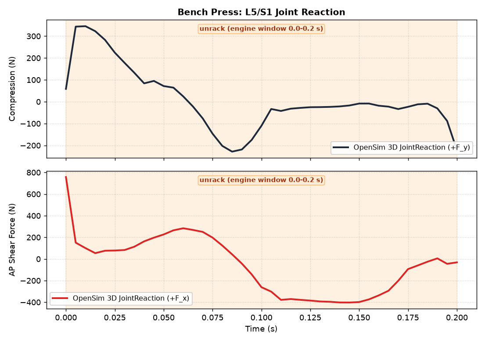
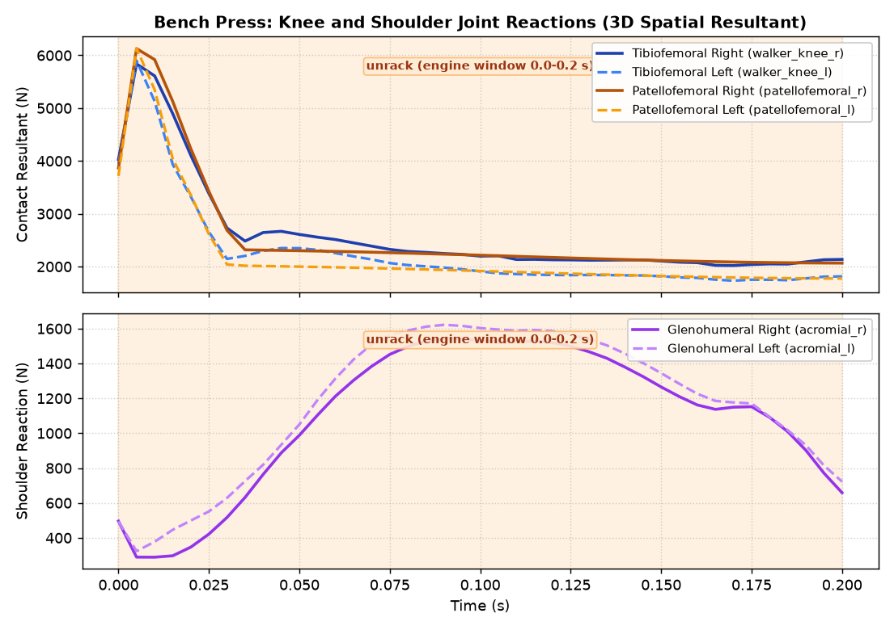

# OpenSim Barbell Lift Joint Reaction Load Receipts (OSL-5, #13043)

`receipts.json` and evidence plots are generated by `scripts/measure_opensim_lift_joint_reactions.py`
using real OpenSim 4.6 and the Rajagopal 2023 musculoskeletal model.

## Overview

OSL-5 computes 3D internal joint reaction loads across the barbell lift motion window:
1. **L5/S1 Lumbar Joint**: OpenSim `back` joint expressed in inferior pelvis ISB frame and torso frame.
   *Qualification*: lower bound: no trunk muscles; the lumbar moment is an ideal actuator.
2. **Knee Tibiofemoral Joint**: Resultant contact load across `walker_knee_r` and `walker_knee_l`.
3. **Knee Patellofemoral Joint**: Articulated patella joint contact load (`patellofemoral_r/l`).
4. **Shoulder Glenohumeral Joint**: Evaluated at articulated `acromial_r/l` CustomJoints (3 rotational DOFs).
5. **Movement Optimizer Cross-Check**: Compares L5/S1 loads against `movement_optimizer.spine_loads` in aligned torso frame for the squat and deadlift.
6. **Static-Hold Analytic Bound**: Frame/sign self-consistency at default pose and evaluation on dynamic lift frames.

## Evidence Summary

- **Source Commit**: `5dcdbd0286db051c28f33e5a973e8086226ed36d`
- **Lifter Mass**: 80.31 kg (Body Weight = 787.60 N)
- **Barbell Mass**: 100.00 kg
- **Motion Window**: 0.00 s to 0.20 s (41 frames)
- **Completed Lifts (5/5)**: Back Squat, Deadlift, Bench Press, Snatch, Clean and Jerk
- **Unavailable Lifts (0/5)**: none
- **Inherited OSL-4 Qualification**: unqualified

### Measured Reaction Loads

#### Back Squat

| Joint | Metric | Qualification | Mean (N) | Peak (N) | Mean (BW) | Peak (BW) |
|---|---|---|---|---|---|---|
| **L5/S1 Axial Compression** | +F_y (pelvis frame) | lower bound: no trunk muscles; the lumbar moment is an ideal actuator | 1704.28 | 2035.72 | 2.16 | 2.58 |
| **L5/S1 AP Shear** | +F_x (pelvis frame) | lower bound: no trunk muscles; the lumbar moment is an ideal actuator | -1193.05 | -1383.43 | -1.51 | -1.76 |
| **L5/S1 Torso Compression** | +F_y (torso frame) | lower bound: no trunk muscles; the lumbar moment is an ideal actuator | 1127.77 | 1314.33 | unavailable | unavailable |
| **L5/S1 Torso AP Shear** | +F_x (torso frame) | lower bound: no trunk muscles; the lumbar moment is an ideal actuator | -1749.27 | -2082.33 | unavailable | unavailable |
| **Knee Tibiofemoral** | Resultant 3D norm | unqualified | 10354.04 | 12251.54 | 13.15 | 15.56 |
| **Knee Patellofemoral** | Resultant 3D norm | unqualified | 9394.15 | 12205.29 | 11.93 | 15.50 |
| **Shoulder Glenohumeral** | Resultant 3D norm | unqualified | 802.98 | 943.20 | 1.02 | 1.20 |

- **Peak Lumbar Actuator Moment**: 770.29 N·m (ideal coordinate actuator; no active erector spinae in Rajagopal)
- **Segmental Spine Reference**: Use segmental spine model (#12735) for multi-segment spinal load with active trunk muscles

#### Deadlift

| Joint | Metric | Qualification | Mean (N) | Peak (N) | Mean (BW) | Peak (BW) |
|---|---|---|---|---|---|---|
| **L5/S1 Axial Compression** | +F_y (pelvis frame) | lower bound: no trunk muscles; the lumbar moment is an ideal actuator | 1035.25 | 1344.15 | 1.31 | 1.71 |
| **L5/S1 AP Shear** | +F_x (pelvis frame) | lower bound: no trunk muscles; the lumbar moment is an ideal actuator | -740.90 | -911.16 | -0.94 | -1.16 |
| **L5/S1 Torso Compression** | +F_y (torso frame) | lower bound: no trunk muscles; the lumbar moment is an ideal actuator | 957.28 | 1252.27 | unavailable | unavailable |
| **L5/S1 Torso AP Shear** | +F_x (torso frame) | lower bound: no trunk muscles; the lumbar moment is an ideal actuator | -841.36 | -1033.73 | unavailable | unavailable |
| **Knee Tibiofemoral** | Resultant 3D norm | unqualified | 9611.73 | 11315.30 | 12.20 | 14.37 |
| **Knee Patellofemoral** | Resultant 3D norm | unqualified | 5847.96 | 7554.74 | 7.43 | 9.59 |
| **Shoulder Glenohumeral** | Resultant 3D norm | unqualified | 500.33 | 641.21 | 0.64 | 0.81 |

- **Peak Lumbar Actuator Moment**: 472.57 N·m (ideal coordinate actuator; no active erector spinae in Rajagopal)
- **Segmental Spine Reference**: Use segmental spine model (#12735) for multi-segment spinal load with active trunk muscles

#### Bench Press

| Joint | Metric | Qualification | Mean (N) | Peak (N) | Mean (BW) | Peak (BW) |
|---|---|---|---|---|---|---|
| **L5/S1 Axial Compression** | +F_y (pelvis frame) | lower bound: no trunk muscles; the lumbar moment is an ideal actuator | 7.88 | 345.51 | 0.01 | 0.44 |
| **L5/S1 AP Shear** | +F_x (pelvis frame) | lower bound: no trunk muscles; the lumbar moment is an ideal actuator | -55.60 | 757.13 | -0.07 | 0.96 |
| **L5/S1 Torso Compression** | +F_y (torso frame) | lower bound: no trunk muscles; the lumbar moment is an ideal actuator | 13.91 | 362.87 | unavailable | unavailable |
| **L5/S1 Torso AP Shear** | +F_x (torso frame) | lower bound: no trunk muscles; the lumbar moment is an ideal actuator | -61.07 | 742.56 | unavailable | unavailable |
| **Knee Tibiofemoral** | Resultant 3D norm | unqualified | 2435.16 | 5897.99 | 3.09 | 7.49 |
| **Knee Patellofemoral** | Resultant 3D norm | unqualified | 2401.98 | 6132.56 | 3.05 | 7.79 |
| **Shoulder Glenohumeral** | Resultant 3D norm | unqualified | 1126.83 | 1621.56 | 1.43 | 2.06 |

- **Peak Lumbar Actuator Moment**: 370.73 N·m (ideal coordinate actuator; no active erector spinae in Rajagopal)
- **Segmental Spine Reference**: Use segmental spine model (#12735) for multi-segment spinal load with active trunk muscles

#### Snatch

| Joint | Metric | Qualification | Mean (N) | Peak (N) | Mean (BW) | Peak (BW) |
|---|---|---|---|---|---|---|
| **L5/S1 Axial Compression** | +F_y (pelvis frame) | lower bound: no trunk muscles; the lumbar moment is an ideal actuator | 1334.69 | 2085.73 | 1.69 | 2.65 |
| **L5/S1 AP Shear** | +F_x (pelvis frame) | lower bound: no trunk muscles; the lumbar moment is an ideal actuator | -1081.81 | -1869.91 | -1.37 | -2.37 |
| **L5/S1 Torso Compression** | +F_y (torso frame) | lower bound: no trunk muscles; the lumbar moment is an ideal actuator | 1242.18 | 2049.38 | unavailable | unavailable |
| **L5/S1 Torso AP Shear** | +F_x (torso frame) | lower bound: no trunk muscles; the lumbar moment is an ideal actuator | -1207.48 | -1977.48 | unavailable | unavailable |
| **Knee Tibiofemoral** | Resultant 3D norm | unqualified | 10415.72 | 13675.05 | 13.22 | 17.36 |
| **Knee Patellofemoral** | Resultant 3D norm | unqualified | 2389.28 | 5890.89 | 3.03 | 7.48 |
| **Shoulder Glenohumeral** | Resultant 3D norm | unqualified | 751.64 | 1268.20 | 0.95 | 1.61 |

- **Peak Lumbar Actuator Moment**: 634.21 N·m (ideal coordinate actuator; no active erector spinae in Rajagopal)
- **Segmental Spine Reference**: Use segmental spine model (#12735) for multi-segment spinal load with active trunk muscles

#### Clean and Jerk

| Joint | Metric | Qualification | Mean (N) | Peak (N) | Mean (BW) | Peak (BW) |
|---|---|---|---|---|---|---|
| **L5/S1 Axial Compression** | +F_y (pelvis frame) | lower bound: no trunk muscles; the lumbar moment is an ideal actuator | 1687.88 | 2747.32 | 2.14 | 3.49 |
| **L5/S1 AP Shear** | +F_x (pelvis frame) | lower bound: no trunk muscles; the lumbar moment is an ideal actuator | -1304.11 | -2129.96 | -1.66 | -2.70 |
| **L5/S1 Torso Compression** | +F_y (torso frame) | lower bound: no trunk muscles; the lumbar moment is an ideal actuator | 1504.08 | 2488.53 | unavailable | unavailable |
| **L5/S1 Torso AP Shear** | +F_x (torso frame) | lower bound: no trunk muscles; the lumbar moment is an ideal actuator | -1526.60 | -2438.01 | unavailable | unavailable |
| **Knee Tibiofemoral** | Resultant 3D norm | unqualified | 9918.83 | 12607.93 | 12.59 | 16.01 |
| **Knee Patellofemoral** | Resultant 3D norm | unqualified | 839.85 | 5089.58 | 1.07 | 6.46 |
| **Shoulder Glenohumeral** | Resultant 3D norm | unqualified | 909.85 | 1490.19 | 1.16 | 1.89 |

- **Peak Lumbar Actuator Moment**: 1105.89 N·m (ideal coordinate actuator; no active erector spinae in Rajagopal)
- **Segmental Spine Reference**: Use segmental spine model (#12735) for multi-segment spinal load with active trunk muscles

### Static-Hold Analytic Bound & Dynamic Frame Checks

#### Back Squat Analytic Bound
- **Default Pose Upper Mass ($m_{\text{above}}$)**: 136.4979 kg, Weight = 1338.59 N, Measured Compression = 1338.59 N (Diff: 2.2737e-13 N)
- **Muscles Crossing L5/S1**: 0 (sum crossing forces = 0.0000 N)
- **Default Pose Status**: **PASSED** (Evaluates all-zero default pose; checks frame and sign self-consistency only (not verifying lift))
- **Dynamic Minimal-Acceleration Frame**: Frame 39 ($t = 0.1950$ s, $\|\ddot{q}\| = 20.1100$ rad/s²)
- **Dynamic Weight Above ($W_{\text{above}}$)**: 1338.59 N, Pelvis Compression = 1309.47 N, Torso Compression = 892.24 N
- **Dynamic Bound Status**: **FAILED** (Evaluated (pelvis-frame compression) on the solved squat frame with the smallest generalized acceleration norm; the static bound ignores that frame's acceleration and the ideal lumbar actuator.)

#### Deadlift Analytic Bound
- **Default Pose Upper Mass ($m_{\text{above}}$)**: 136.4979 kg, Weight = 1338.59 N, Measured Compression = 1338.59 N (Diff: 2.2737e-13 N)
- **Muscles Crossing L5/S1**: 0 (sum crossing forces = 0.0000 N)
- **Default Pose Status**: **PASSED** (Evaluates all-zero default pose; checks frame and sign self-consistency only (not verifying lift))
- **Dynamic Minimal-Acceleration Frame**: Frame 8 ($t = 0.0400$ s, $\|\ddot{q}\| = 2.3663$ rad/s²)
- **Dynamic Weight Above ($W_{\text{above}}$)**: 1338.59 N, Pelvis Compression = 1022.49 N, Torso Compression = 957.11 N
- **Dynamic Bound Status**: **FAILED** (Evaluated (pelvis-frame compression) on the solved deadlift frame with the smallest generalized acceleration norm; the static bound ignores that frame's acceleration and the ideal lumbar actuator.)

#### Bench Press Analytic Bound
- **Default Pose Upper Mass ($m_{\text{above}}$)**: 136.4979 kg, Weight = 1338.59 N, Measured Compression = 1338.59 N (Diff: 6.9198e-05 N)
- **Muscles Crossing L5/S1**: 0 (sum crossing forces = 0.0000 N)
- **Default Pose Status**: **PASSED** (Evaluates all-zero default pose; checks frame and sign self-consistency only (not verifying lift))
- **Dynamic Minimal-Acceleration Frame**: Frame 7 ($t = 0.0350$ s, $\|\ddot{q}\| = 18.7041$ rad/s²)
- **Dynamic Weight Above ($W_{\text{above}}$)**: 1338.59 N, Pelvis Compression = 132.21 N, Torso Compression = 142.88 N
- **Dynamic Bound Status**: **unavailable** (not applicable: supine on the bench, the trunk weight is carried by the bench contact, not through L5/S1)
- **Bench Static-Hold Support Balance**: right = 249.96 N, left = 25.23 N, bench = 1493.08 N; expected (body + bar) x g = 1768.27 N, relative error -2.04e-14 **PASSED**

#### Snatch Analytic Bound
- **Default Pose Upper Mass ($m_{\text{above}}$)**: 136.4979 kg, Weight = 1338.59 N, Measured Compression = 1338.59 N (Diff: 2.2737e-13 N)
- **Muscles Crossing L5/S1**: 0 (sum crossing forces = 0.0000 N)
- **Default Pose Status**: **PASSED** (Evaluates all-zero default pose; checks frame and sign self-consistency only (not verifying lift))
- **Dynamic Minimal-Acceleration Frame**: Frame 6 ($t = 0.0300$ s, $\|\ddot{q}\| = 10.6144$ rad/s²)
- **Dynamic Weight Above ($W_{\text{above}}$)**: 1338.59 N, Pelvis Compression = 891.59 N, Torso Compression = 828.49 N
- **Dynamic Bound Status**: **FAILED** (Evaluated (pelvis-frame compression) on the solved snatch frame with the smallest generalized acceleration norm; the static bound ignores that frame's acceleration and the ideal lumbar actuator.)

#### Clean and Jerk Analytic Bound
- **Default Pose Upper Mass ($m_{\text{above}}$)**: 136.4979 kg, Weight = 1338.59 N, Measured Compression = 1338.59 N (Diff: 2.2737e-13 N)
- **Muscles Crossing L5/S1**: 0 (sum crossing forces = 0.0000 N)
- **Default Pose Status**: **PASSED** (Evaluates all-zero default pose; checks frame and sign self-consistency only (not verifying lift))
- **Dynamic Minimal-Acceleration Frame**: Frame 2 ($t = 0.0100$ s, $\|\ddot{q}\| = 21.9364$ rad/s²)
- **Dynamic Weight Above ($W_{\text{above}}$)**: 1338.59 N, Pelvis Compression = 701.48 N, Torso Compression = 632.78 N
- **Dynamic Bound Status**: **FAILED** (Evaluated (pelvis-frame compression) on the solved clean_and_jerk frame with the smallest generalized acceleration norm; the static bound ignores that frame's acceleration and the ideal lumbar actuator.)

### Movement Optimizer L5/S1 Cross-Check

#### Back Squat Movement Optimizer Cross-Check
- **Model**: planar_ergonomic_l5s1_estimate
- **Upper Body Mass ($m_{\text{above}}$)**: OpenSim = 136.4979 kg, Movement Optimizer default = 154.4522 kg, Movement Optimizer aligned = 136.4979 kg
- **Angle Definitions**:
  - OpenSim: Sagittal tilt of torso frame relative to vertical in ground: atan2(R_torso[0, 1], R_torso[1, 1])
  - Movement Optimizer: Torso inclination angle theta from vertical in 2D sagittal plane
- **Aligned Movement Optimizer (Torso Frame)**: Compression Mean = 724.87 N, Peak = 757.83 N; ADR-0055 AP Shear Mean = -1083.96 N, Peak = -1089.23 N
- **Pre-Evaluation Tolerance**: 50.00 N (Tolerance Satisfied: FAILED)
- **Residual Differences (OpenSim Torso vs Aligned Movement Optimizer)**:
  - Compression Mean Residual: 402.90 N (Peak: 594.78 N)
  - AP Shear Mean Residual: -665.31 N (Peak: 993.70 N)
- **Model Difference Analysis**: Movement Optimizer is a planar rigid-body estimate (gravity and torso inertia, no muscles); OpenSim is a 3D JointReaction with no trunk muscles. Rotated into the torso frame with matched m_above (136.50 kg), the residual is 402.90 N compression (max |594.78| N) and -665.31 N AP shear (max |993.70| N) against the 50.0 N tolerance. The residual is not yet decomposed into its sources (pelvis acceleration, 3D coupling, contact).

#### Deadlift Movement Optimizer Cross-Check
- **Model**: planar_ergonomic_l5s1_estimate
- **Upper Body Mass ($m_{\text{above}}$)**: OpenSim = 136.4979 kg, Movement Optimizer default = 146.4209 kg, Movement Optimizer aligned = 136.4979 kg
- **Angle Definitions**:
  - OpenSim: Sagittal tilt of torso frame relative to vertical in ground: atan2(R_torso[0, 1], R_torso[1, 1])
  - Movement Optimizer: Torso inclination angle theta from vertical in 2D sagittal plane
- **Aligned Movement Optimizer (Torso Frame)**: Compression Mean = 937.72 N, Peak = 958.06 N; ADR-0055 AP Shear Mean = -978.42 N, Peak = -1003.95 N
- **Pre-Evaluation Tolerance**: 50.00 N (Tolerance Satisfied: FAILED)
- **Residual Differences (OpenSim Torso vs Aligned Movement Optimizer)**:
  - Compression Mean Residual: 19.55 N (Peak: 318.33 N)
  - AP Shear Mean Residual: 137.06 N (Peak: 308.75 N)
- **Model Difference Analysis**: Movement Optimizer is a planar rigid-body estimate (gravity and torso inertia, no muscles); OpenSim is a 3D JointReaction with no trunk muscles. Rotated into the torso frame with matched m_above (136.50 kg), the residual is 19.55 N compression (max |318.33| N) and 137.06 N AP shear (max |308.75| N) against the 50.0 N tolerance. The residual is not yet decomposed into its sources (pelvis acceleration, 3D coupling, contact).

### Status of Unavailable Lifts

- none: every lift has a complete joint reaction solve

Values are explicitly `null` (never synthetic zeros).

## Evidence Figures

### Back Squat
- **L5/S1 Reactions vs Movement Optimizer**: 
- **Knee & Shoulder Reactions**: 

### Deadlift
- **L5/S1 Reactions vs Movement Optimizer**: 
- **Knee & Shoulder Reactions**: 

### Snatch
- **L5/S1 Reactions**: 
- **Knee & Shoulder Reactions**: 

### Clean and Jerk
- **L5/S1 Reactions**: 
- **Knee & Shoulder Reactions**: 

### Bench Press
- **L5/S1 Reactions**: 
- **Knee & Shoulder Reactions**: 

## Reproduction Commands

```bash
UPSTREAMDRIFT_MSK_BASE_MODEL=$HOME/Repositories/ud-13044/shared/models/opensim/opensim-models/Models/Rajagopal/RajagopalLaiUhlrich2023.osim \
PYTHONPATH=$PWD QT_QPA_PLATFORM=offscreen MPLBACKEND=Agg \
    ~/Repositories/UpstreamDrift/.venv/bin/python3 scripts/measure_opensim_lift_joint_reactions.py
```
