# OpenSim Muscle Forces and Activations Receipts (OSL-4, #13042)

`receipts.json` and the accompanying evidence plots are generated by
`scripts/measure_opensim_lift_muscles.py` using real OpenSim 4.6 and the
Rajagopal lower-extremity musculoskeletal model.

## Overview

OSL-4 completes the muscle-force and activation pipeline for the barbell lifts.
It evaluates muscle redundancy against inverse-dynamics joint moments using
OpenSim `StaticOptimization` and `MocoInverse` (where converging), reusing the
reserve-share gating from `musculoskeletal_static_opt.py` and
`musculoskeletal_solvers.py`.

### Major Functional Muscle Groups

The pipeline monitors the seven major functional groups:

1. **Quadriceps** (8 muscles: `recfem_r/l`, `vasint_r/l`, `vaslat_r/l`, `vasmed_r/l`)
2. **Gluteals** (18 muscles: `glmax1-3_r/l`, `glmed1-3_r/l`, `glmin1-3_r/l`)
3. **Hamstrings** (8 muscles: `bflh_r/l`, `bfsh_r/l`, `semimem_r/l`, `semiten_r/l`)
4. **Erector Spinae** (0 muscles in Rajagopal base model; upper-body coordinate actuator)
5. **Deltoids** (0 muscles in Rajagopal base model; upper-body coordinate actuator)
6. **Trapezius** (0 muscles in Rajagopal base model; upper-body coordinate actuator)
7. **Triceps** (0 muscles in Rajagopal base model; upper-body coordinate actuator)

### Model Muscle List Citation

> Rajagopal A, Dembia CL, DeMers MS, Delp DD, Hicks JL, Delp SL.
> Full-Body Musculoskeletal Model for Muscle-Driven Simulation of Human Gait.
> IEEE Trans Biomed Eng. 2016;63(10):2068-2079. doi:10.1109/TBME.2016.2586862

The base Rajagopal model includes 80 Hill-type Millard muscles actuating the lower
extremities (14 degrees of freedom across hip, knee, ankle, subtalar, and MTP joints).
Trunk and upper-extremity coordinates are actuated by `upper_*` coordinate actuators.

---

## Solvers and Reserve-Share Gating

### Formulation

For each frame $t$:

$$\min_{a} \sum_{m} a_m^2 + w \sum_{c} r_c^2 \quad \text{s.t.} \quad 0 \le a_m \le 1$$

$$\tau_c = \sum_{m} R_{mc} \left( F_{\text{pas},m} + a_m F_{\text{act},m} \right) + r_c$$

where $R_{mc}$ are muscle moment arms, $F_{\text{pas}}$ and $F_{\text{act}}$ are the
passive and active capacities from rigid-tendon Millard muscles, and $r_c$ are the
reserve actuator torques.

The reserve share across the motion is:

$$\text{Reserve Share} = \frac{\sum_t \sum_c |r_c(t)|}{\sum_t \sum_c |\tau_c(t)|}$$

### Qualification Gate

A lift is classified as **`qualified`** only when its reserve share is strictly below
5% ($< 0.05$). Otherwise, it is classified as **`unqualified`** with the exact reserve
share reported.

---

## Lift Status Summary

The table below is generated directly from `receipts.json` via `scripts/measure_opensim_lift_muscles.py`:

| Lift | Status | Classification | Window (s) | Mean Reserve Share | Peak Reserve Share | Pelvis Residual Force (N, vs Hicks) | Pelvis Residual Moment (N·m, vs Hicks) | Within / Outside |
| :--- | :--- | :--- | :---: | :---: | :---: | :---: | :---: | :---: |
| Squat | `complete` | `unqualified` | 0.0–0.2 | 56.9% | 67.7% | 23.82 (vs 146.93) | 11.75 (vs 18.64) | Within |
| Deadlift | `complete` | `unqualified` | 0.0–0.2 | 17.3% | 20.2% | 288.29 (vs 110.92) | 148.02 (vs 18.28) | Outside |
| Bench Press | `complete` | `unqualified` | 0.0–0.2 | 6.0% | 26.3% | 511.58 (vs 221.85) | 318.32 (vs 23.54) | Outside |
| Snatch | `complete` | `unqualified` | 0.0–0.2 | 37.7% | 71.3% | 463.21 (vs 155.12) | 202.62 (vs 27.10) | Outside |
| Clean & Jerk | `complete` | `unqualified` | 0.0–0.2 | 38.9% | 58.5% | 458.56 (vs 223.10) | 259.00 (vs 38.77) | Outside |

### Plain Assessment Statements

- **Partial Engine Window:** The analyzed window is the 0.2 s LIFT-5 engine window from the setup (unrack for bench press, start of pull for deadlift/snatch/clean & jerk, bottom for squat), so it does not cover the full lift, chest press, or jerk.
- **Qualification and Residuals:** Every lift is `unqualified`. Squat passes the Hicks residual gate but fails reserve share (56.9%); bench press, deadlift, snatch, and clean-and-jerk fail the Hicks residual gate.
- **Bench Press and Upper-Body Actuation:** Bench press IK poses a supine lifter with back-sphere bench contact. However, the RajagopalLaiUhlrich2023 base model contains 80 lower-limb muscles only. Upper-limb coordinates (14 DOFs across shoulders, elbows, and wrists) have 0 muscles in this model; 100% of upper-limb joint moments (peak elbow flexion 414.9 N·m, arm rotation 249.3 N·m) are carried by coordinate and reserve actuators, not muscles.

---

## Back Squat Muscle Activation and Force Results

### Motion Window and Phase Labeling

The back squat bundle (`back_squat_bundle.npz`, 0.2 s duration, 41 frames at stride 5) is a partial engine window located entirely at the deep squat bottom. The lifter begins at:

- `hip_flexion_r`: $119.95^\circ$ (pinned at model bound $120.0^\circ$)
- `hip_flexion_l`: $120.00^\circ$ (pinned at model bound $120.0^\circ$)
- `knee_angle_r`: $109.73^\circ$
- `knee_angle_l`: $109.43^\circ$

Because the motion remains in deep flexion throughout ($> 100^\circ$ knee angle) and never approaches standing ($< 25^\circ$), it does not cover standard standing, descent, ascent, or lockout phases. The pipeline derives phase segments directly from kinematics and reports the single honest segment:

| Phase                                | Quadriceps Act (Mean) | Gluteals Act (Mean) | Hamstrings Act (Mean) | Quadriceps Force (Pk N) | Gluteals Force (Pk N) | Hamstrings Force (Pk N) |
| :----------------------------------- | :-------------------: | :-----------------: | :-------------------: | :---------------------: | :-------------------: | :---------------------: |
| **Bottom (engine window 0.0–0.2 s)** |         0.782         |        0.360        |         0.409         |         4559.5          |        1156.4         |         2145.2          |

### Per-Group Summary Across the Motion Window

| Muscle Group       | Muscles | Peak Activation | Mean Activation | Peak Force (N) | Mean Force (N) |
| :----------------- | :-----: | :-------------: | :-------------: | :------------: | :------------: |
| **Quadriceps**     |    8    |      1.000      |      0.782      |     4559.5     |     1929.6     |
| **Gluteals**       |   18    |      1.000      |      0.360      |     1156.4     |     344.8      |
| **Hamstrings**     |    8    |      1.000      |      0.409      |     2145.2     |     444.3      |
| **Erector Spinae** |    0    |        —        |        —        |       —        |       —        |
| **Deltoids**       |    0    |        —        |        —        |       —        |       —        |
| **Trapezius**      |    0    |        —        |        —        |       —        |       —        |
| **Triceps**        |    0    |        —        |        —        |       —        |       —        |

_Numerical sanity check: Moment balance residual error $< 1.14 \times 10^{-13}\text{ N m}$ holds by construction because reserve actuators close any remainder in the static optimization solve; this is not evidence of physical acceptance._

### Leg Coordinate Breakdown (Demands, Capacities, and Reserves)

At frame 0, the hip extension demand is $-222.16\text{ N m}$ (right) and $-381.00\text{ N m}$ (left) against physiological active extensor capacities of $-204.67\text{ N m}$ and $-200.03\text{ N m}$ at full activation, requiring substantial reserve actuator assistance.

| Coordinate         | ID Demand Frame 0 (N·m) | ID Demand Mean (N·m) | Active Capacity Neg (Mean N·m) | Active Capacity Pos (Mean N·m) | Passive Moment (Mean N·m) | Reserve Mean (N·m) | Reserve Peak (N·m) | Reserve Share |
| :----------------- | :---------------------: | :------------------: | :----------------------------: | :----------------------------: | :-----------------------: | :----------------: | :----------------: | :-----------: |
| `hip_flexion_r`    |         -222.16         |        357.24        |            -204.67             |             +75.05             |          -28.26           |       202.34       |       270.08       |     56.6%     |
| `hip_flexion_l`    |         -381.00         |        321.01        |            -200.03             |             +63.10             |          -31.76           |       177.26       |       237.95       |     55.2%     |
| `hip_adduction_r`  |         -125.34         |        50.91         |            -106.52             |            +360.92             |          +15.45           |       107.96       |       134.86       |    212.1%     |
| `hip_adduction_l`  |         -134.90         |        58.31         |            -103.56             |            +350.20             |          +18.33           |       102.48       |       169.39       |    175.8%     |
| `hip_rotation_r`   |         +151.88         |        92.14         |             -37.14             |            +197.86             |          +26.40           |       93.04        |       167.15       |    101.0%     |
| `hip_rotation_l`   |         +157.70         |        97.27         |             -35.40             |            +199.48             |          +23.10           |       93.64        |       154.47       |     96.3%     |
| `knee_angle_r`     |         -214.07         |        126.73        |            -187.05             |            +218.27             |           +4.50           |       21.38        |       43.46        |     16.9%     |
| `knee_angle_l`     |         -53.11          |        159.54        |            -178.39             |            +211.49             |           +6.00           |       50.15        |       98.92        |     31.4%     |
| `ankle_angle_r`    |         -48.26          |        84.70         |            -277.33             |             +72.32             |          -28.31           |        0.00        |        0.00        |     0.0%      |
| `ankle_angle_l`    |         -72.73          |        94.62         |            -276.59             |             +71.83             |          -28.94           |        0.15        |        1.58        |     0.2%      |
| `subtalar_angle_r` |         -12.82          |        18.77         |             -45.58             |             +83.20             |           +4.25           |        0.02        |        0.05        |     0.1%      |
| `subtalar_angle_l` |         -10.40          |        30.85         |             -45.33             |             +82.93             |           +4.36           |        0.49        |        6.42        |     1.6%      |
| `mtp_angle_r`      |          -0.04          |         0.04         |             -4.38              |             +7.40              |           +0.16           |        0.05        |        0.09        |    115.0%     |
| `mtp_angle_l`      |          -0.04          |         0.04         |             -4.40              |             +7.39              |           +0.16           |        0.90        |        7.35        |    2250.8%    |

**Primary Reserve Drivers:** `hip_flexion_r`, `hip_flexion_l`, `hip_adduction_r`, `hip_adduction_l`.

### Coordinate Range Bounds and Pose Credibility

> **Warning:** An IK result pinned at a coordinate bound is not a credible posture.

Both `hip_flexion_r` and `hip_flexion_l` sit at the model upper range bound of $120.0^\circ$ ($2.0944\text{ rad}$) across all 41 frames ($100\%$ pinned, margin $0.001^\circ$–$0.002^\circ$). The lifter's posture represents a boundary singularity of the Rajagopal model rather than an unconstrained physiological configuration.

### Ground Shear Asymmetry and Hip vs Knee Torque Split

At frame 0, total sagittal extension demand ($\tau_{\text{hip}} + \tau_{\text{knee}}$) is virtually identical across both legs:

- **Right Leg:** $-222.16 + (-214.07) = -436.23\text{ N m}$
- **Left Leg:** $-381.00 + (-53.11) = -434.11\text{ N m}$ (agreement within 0.5%)
- **Vertical Ground Reactions:** $1142.99\text{ N}$ (right) vs $1128.94\text{ N}$ (left)

The large hip-extension asymmetry ($-222.2\text{ N m}$ right vs $-381.0\text{ N m}$ left) is driven by the anterior-posterior ground shear force:

- **Left Foot:** $+207.67\text{ N}$ (forward shear)
- **Right Foot:** $-125.01\text{ N}$ (backward shear)
- **Shear Differential:** $332.68\text{ N}$

Because the knee is anterior to the ankle and the hip is posterior in a deep squat, forward ground shear ($+F_x$) produces a clockwise moment about the knee (assisting extension, reducing required internal knee moment from $-214.1\text{ N m}$ to $-53.1\text{ N m}$) while shifting the ground reaction force line of action forward relative to the hip (increasing internal hip extension demand from $-222.2\text{ N m}$ to $-381.0\text{ N m}$).

### Solver Comparison: Static Optimization vs MocoInverse

| Solver                 | Formulation                                   | Convergence | Reserve Share | Wall Clock (s) | Status / Notes                                                                  |
| :--------------------- | :-------------------------------------------- | :---------: | :-----------: | :------------: | :------------------------------------------------------------------------------ |
| **StaticOptimization** | Per-frame QP, rigid tendon Millard            |  Converged  |   **57.0%**   |     54.1 s     | Evaluated across 41 frames; reserves required to resolve physiological deficits |
| **MocoInverse**        | Direct collocation (Hermite-Simpson, DGF2016) | Unconverged |       —       |    143.0 s     | Completed 20 iterations (`Maximum_Iterations_Exceeded`), objective $142,168$    |

---

## Evidence Plots

### 1. Back Squat

- **Muscle Activations:** 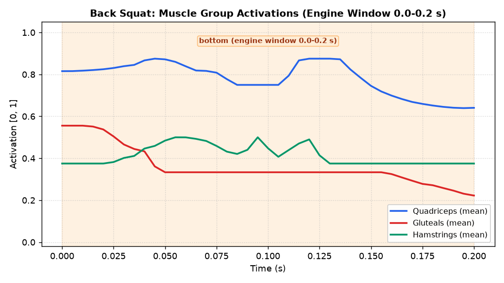
- **Muscle Forces:** 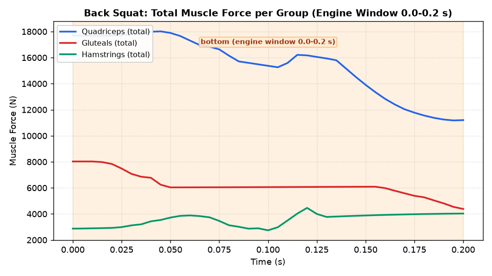
- **Joint Moments and Reserves:** 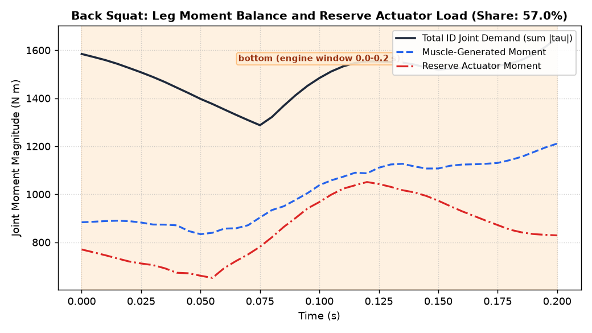

### 2. Deadlift

- **Muscle Activations:** 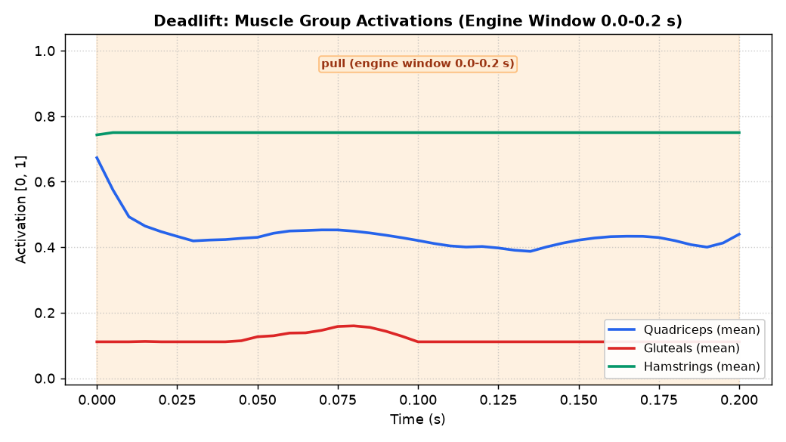
- **Muscle Forces:** 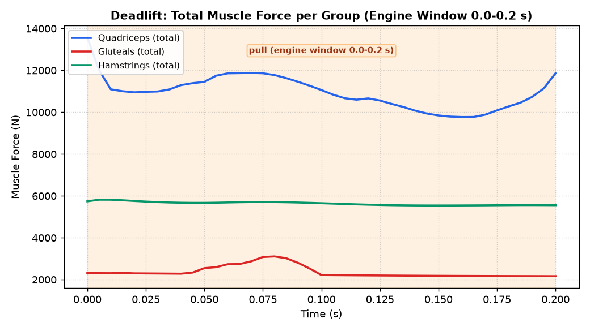
- **Joint Moments and Reserves:** 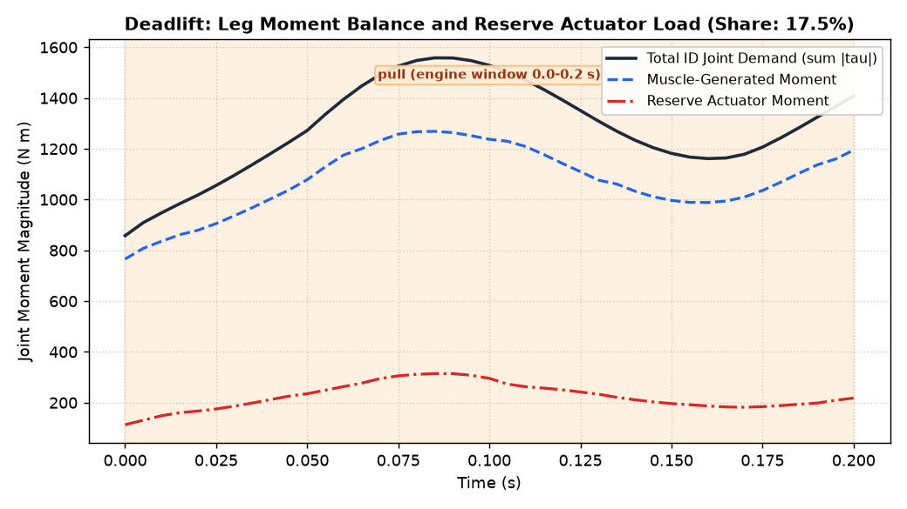

### 3. Snatch

- **Muscle Activations:** 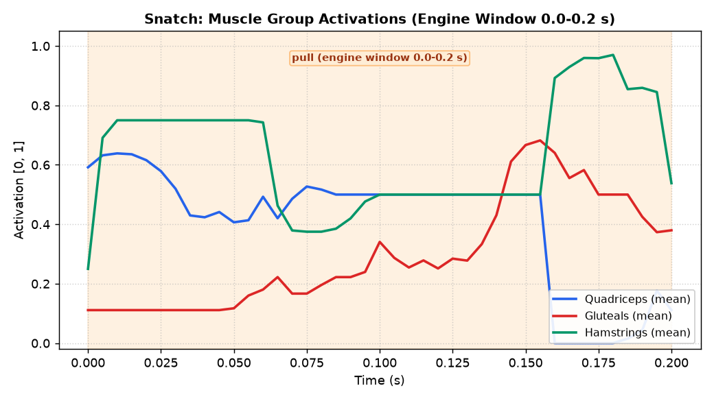
- **Muscle Forces:** 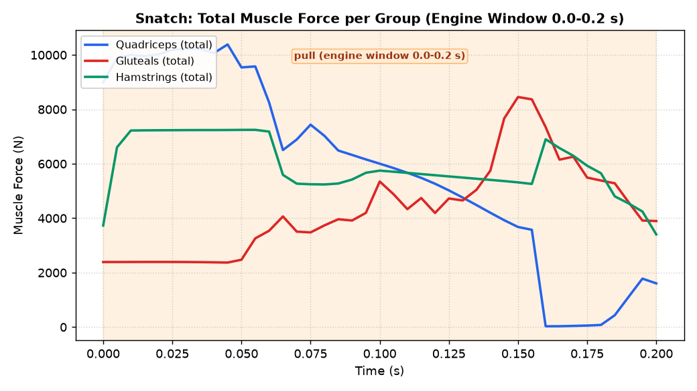
- **Joint Moments and Reserves:** 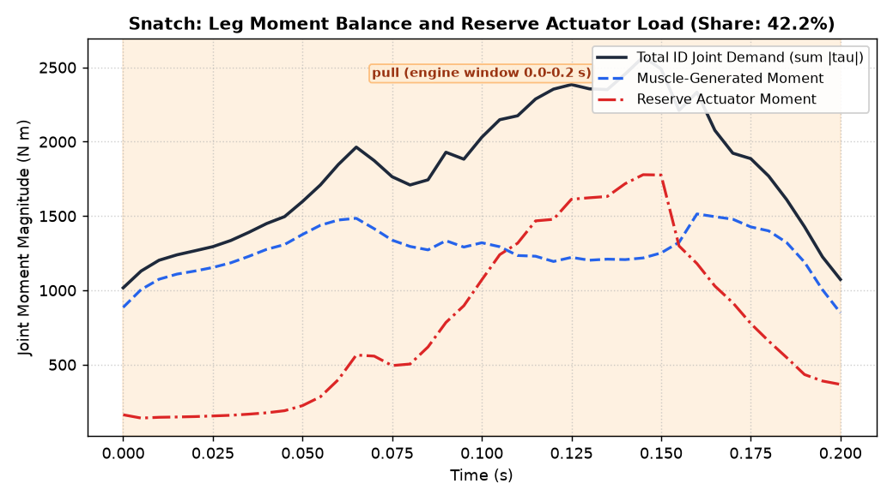

### 4. Clean & Jerk

- **Muscle Activations:** 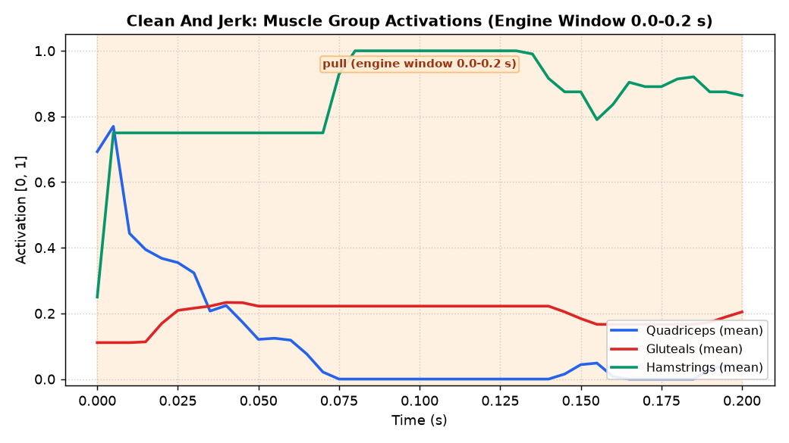
- **Muscle Forces:** 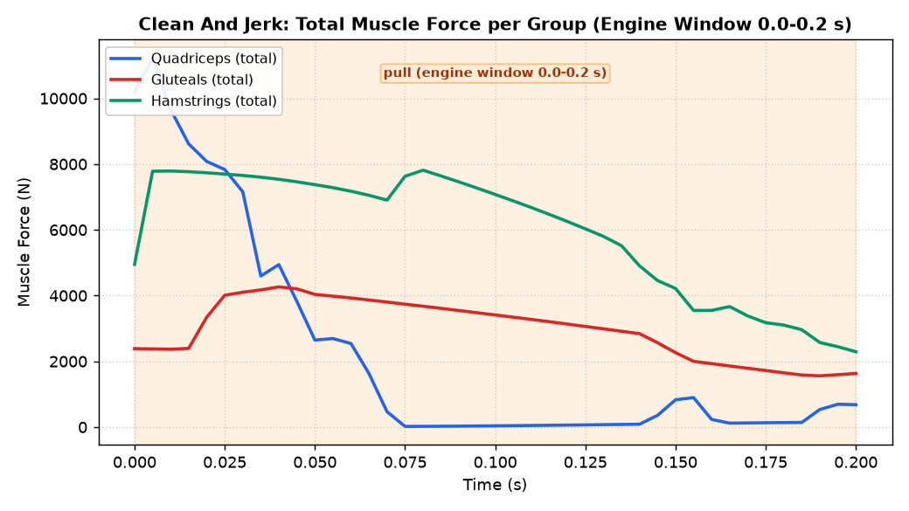
- **Joint Moments and Reserves:** 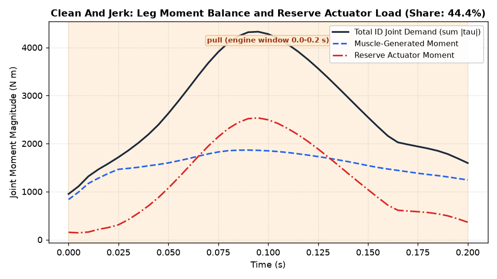

### 5. Bench Press

- **Muscle Activations:** 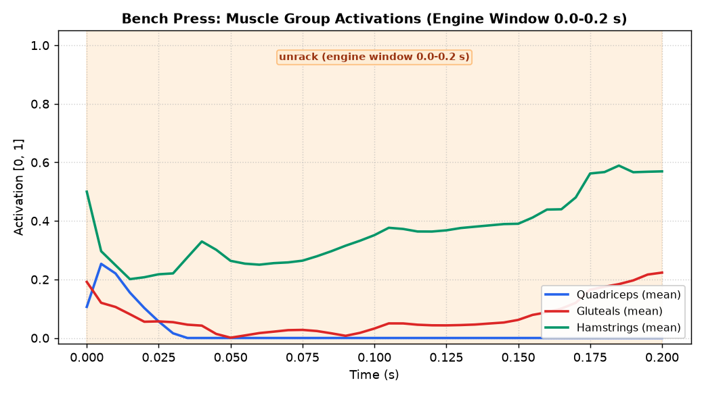
- **Muscle Forces:** 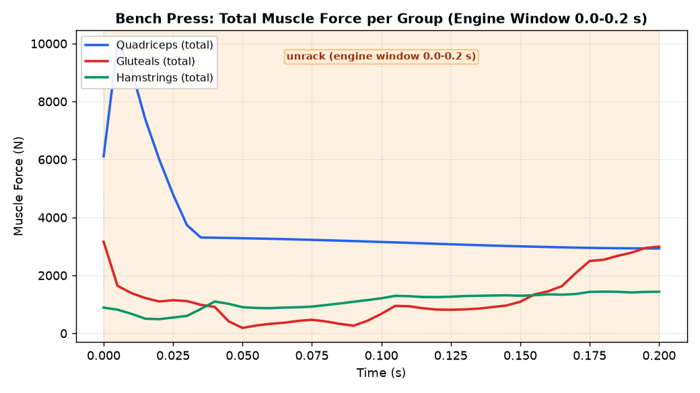
- **Joint Moments and Reserves:** 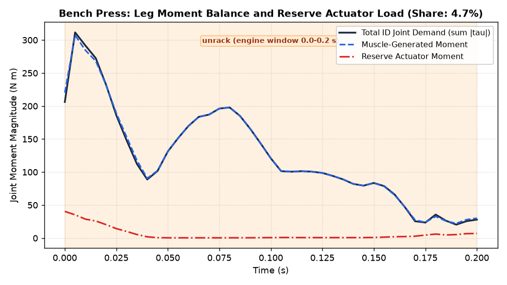

---

## Exact Reproduction Commands

From the repository root (headless environment):

```bash
export QT_QPA_PLATFORM=offscreen
export MPLBACKEND=Agg
export MUJOCO_GL=egl
export SDL_VIDEODRIVER=dummy

python3 scripts/measure_opensim_lift_muscles.py \
    --out docs/development/lifting/evidence/opensim_muscles/receipts.json
```
