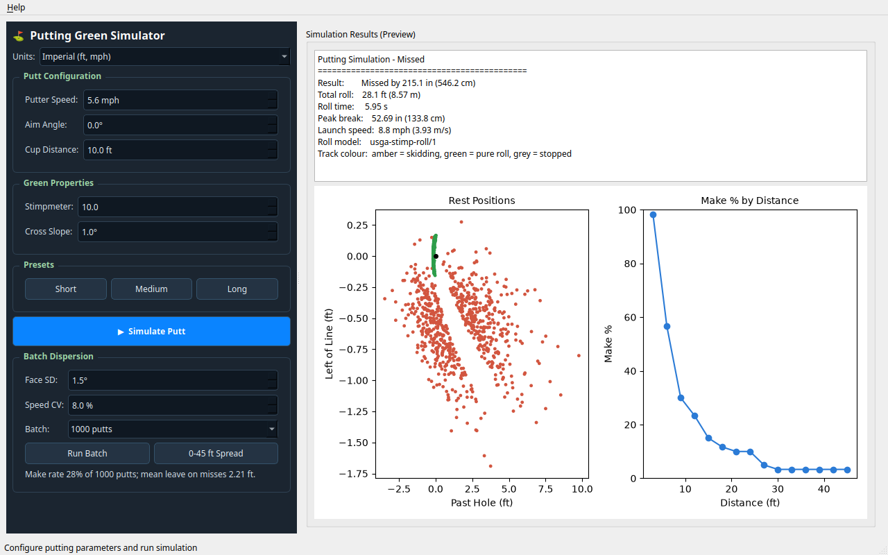

# Putting Green

## Purpose

Roll a putt across a sloped green and see whether it drops. You set the stroke
speed, your aim, how far away the cup is, and how fast and how tilted the green
is; the tile runs the shared putting physics core and shows the ball track, the
break, and whether the putt was holed. It is a green-authoring and roll-reading
surface, not a putter-fitting or impact-analysis tool.

## Launch

From the repository root:

```bash
python -m src.tools.putting_green_gui
```

`python -m src.tools.putting_green_gui --smoke` opens the window, runs one putt,
prints the metrics and exits `0`. Add `QT_QPA_PLATFORM=offscreen` on a headless
host. If the shared putting core cannot be imported, both commands exit `2`
with a message that names the missing module. The 3D view needs the optional
`pyqtgraph` and `PyOpenGL` packages. Without them, the metrics panel still works.

## Inputs

| Control      | Unit | Range accepted      | Default |
| ------------ | ---- | ------------------- | ------- |
| Putter Speed | m/s  | 0.5 to 8.0          | 2.5     |
| Aim Angle    | deg  | -45 to 45           | 0       |
| Cup Distance | ft   | 1 to 30             | 10      |
| Stimpmeter   | ft   | 6.0 to 14.0         | 10.0    |
| Cross Slope  | deg  | 0 to 5              | 1.0     |
| Strike       | mm   | -40 to 40           | 0       |
| Balance      | -    | Typical or a preset | Typical |

- The **Units** selector switches the display between Metric (m, m/s) and
  Imperial (ft, mph). It converts the speed and distance controls and the
  metrics panel in place, and saves the choice as the shared unit preference
  (`src/shared/python/ui/units.py`), so other tools open in the same units.
  The engine always receives SI values.
- Every control is range-checked before the engine runs; an out-of-range or
  non-finite value raises rather than being silently clamped
  (`_validate` in `src/tools/putting_green_gui/_scene_builder.py`).
- Strike is the impact point from the face centre, heel negative and toe
  positive, shown in inches in imperial. Balance picks a shared putter preset
  (toe-hang, face-balanced, zero-torque, counterbalanced) that sets head
  mass, MOI and hosel position (`putting_dynamics.BALANCE_PRESETS`).
- Presets stamp speed and distance pairs only: Short (1.5 m/s, 5 ft),
  Medium (2.5 m/s, 15 ft), Long (4.0 m/s, 30 ft).
- Not exposed on this tile, but fixed: the shared solver's RK4 at a 0.002 s
  timestep (`putting_dynamics.solver.DT_S`) and a terrain grid resolution of 48. Cup distance is converted to metres; the green is sized around the putt
  with fixed margins.
- The Stimpmeter reading is the only turf control on the tile. Grass type,
  condition, and grain exist in the shared `TurfSpec` but are left at their
  defaults here.

## Outputs

- Result: holed, or missed by a lateral distance reported in cm.
- Total roll: metres, with a feet conversion alongside.
- Roll time: seconds.
- Peak break: cm, the largest perpendicular deviation of the path from the
  straight ball-to-cup line.
- Launch speed: m/s, taken from the first integrated velocity.
- **Roll model name**, printed verbatim in the metrics panel. Read this before
  you compare any number above with anything.
- Impact: the strike offset, launch angle, launch spin, skid distance, face
  twist rate (positive opens the face), impact energy loss and putter
  slowdown, all from the shared `strike()` collision report. An off-centre
  strike lowers the effective head mass, so the ball leaves slower and the
  face twists about the shaft.
- A contour-shaded green mesh, an animated ball, a flagstick, the aim line, and
  a ball track coloured by roll mode: amber while skidding, green in pure roll,
  grey once stopped.
- **Batch Dispersion** (#14459): set the stroke noise (face-angle SD and speed
  CV), pick 40, 100 or 1000 putts and press **Run Batch** to roll them on the
  green you have dialled in (distance, stimp, cross slope). The rest positions
  are plotted around the hole (green holed, red missed) with the make rate and
  mean leave on misses. **0-45 ft Spread** plots the make % from 3 to 45 ft on
  the same green. Both come from the shared dispersion service and run in the
  background; changing units replots them.

  

## Method

The GUI is a thin renderer. All domain logic is in
`src/tools/putting_green_gui/_scene_builder.py`, which builds a shared
`SurfaceSpec` (a uniform cross-slope `HeightField` with the friction from
`stimp_to_rolling_mu`) and runs `simulate_strike` from
`src/shared/python/putting_dynamics`. The shared solver resolves the airborne,
slide and roll phases, applies the turf friction law, captures the ball with
the offset-aware chord bound (Holmes 1991), and reports a motion mode per
sample.

**This tile runs the one active roll model, `usga-stimp-roll/1`.** Its rolling
resistance follows the USGA Stimpmeter geometry (mu approximately
0.559/stimp). The API routes, the MCP putting tools, the strokes-gained make
probability and the putting engine use the same core.
[ADR-0058](../adr/0058-one-shared-putting-core.md) retired the agronomic
`ud-legacy-roll/1` law (mu approximately 0.196/stimp) that this tile ran
before epic #14141, superseding decision 4 of
[ADR-0045](../adr/0045-putting-integration-one-experience-two-preserved-stacks.md).
At equal stimp and launch speed, putts now roll out about 2.854 times shorter
than under the retired law. Every result names its `roll_model`, and readers
refuse a payload that does not, so an archived legacy result is never mistaken
for a current one.

Turf and stimpmeter references, with provenance classes, are collected in
[../physics/PUTTING_KINEMATICS_KINETICS_REVIEW.md](../physics/PUTTING_KINEMATICS_KINETICS_REVIEW.md).

## Limitations

- **The roll is model output, not measurement.** No number on this tile is a
  measured putt.
- **Never compare a result from this tile with a result from the other roll
  model without both model names attached.** The two preserved models differ by
  a roll-out ratio of approximately 2.854; an unlabelled comparison is
  meaningless, and ADR-0045 makes naming the model mandatory rather than
  optional.
- There is no stroke or impact solve. Putter speed is the launch input; face
  angle, path, attack angle, impact offset, and putter MOI are not modelled
  here. Those belong to the analytics stack described in ADR-0045.
- No dispersion, no Monte Carlo, no repeated-putt statistics: one putt per run.
- The green geometry on this tile is a **uniform cross-slope only**. The
  engine's topography presets and its grid, `.npy`, GeoTIFF, and
  scattered-point importers are not reachable from these five controls.
- Grain direction, grass type, height of cut, and green condition are left at
  `TurfProperties` defaults and are not adjustable here, even though they scale
  the friction law.
- No wind, and no practice mode, though the engine supports both.
- Without `pyqtgraph` and OpenGL the 3D scene is absent; the metrics panel
  still computes.

## See Also

- [ADR-0045: Putting Integration - One Experience, Two Preserved Physics Stacks](../adr/0045-putting-integration-one-experience-two-preserved-stacks.md)
- [Putting Kinematics and Kinetics - Public-Data Review](../physics/PUTTING_KINEMATICS_KINETICS_REVIEW.md)
- [Terrain Engine](terrain_engine.md) - surface presets and material queries
- [Simulation Controls](simulation_controls.md)
- [Visualization Settings](visualization.md)
