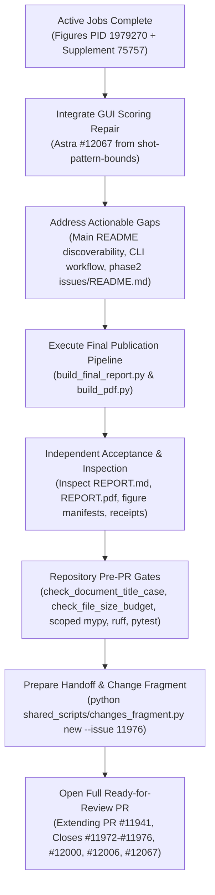

# Delivery-Readiness Audit: Matched Shot-Pattern Analysis (Phase Two)

**Audit Date:** 2026-10-09  
**Auditor / Agent Engine:** Gemini 3.8 Flash (High) via Antigravity CLI  
**Worktree:** `/home/dieterolson/.codex/worktrees/shot-pattern-analysis/UpstreamDrift`  
**Active Branch:** `codex/shot-pattern-matched-delivery` (unpushed extension of open Phase 1 PR [#11941](https://github.com/D-sorganization/UpstreamDrift/pull/11941))  
**Target Path:** `/tmp/p2-delivery-readiness-audit.md`

---

## 1. Executive Summary & Audit Baseline

This read-only audit evaluates the delivery-readiness of the Phase Two Matched Shot-Pattern study. The numerical simulations (324 primary cells, 72 control cells, 26 supplemental cells; >9.6M shot evaluations), independent data audits, lossless ZIP archives, fresh extraction validations, and Astra completion reviews are complete and verified.

Active long-running jobs are explicitly scoped and quarantined:

1. **Original Final Figures Producer:** PID 1979270 rendering `final_figures_v1` and `control_final_figures_v1` in `shot-pattern-final-layout` (repair commit `b37d46e496` / `2708710875` addressing marginal tick gutters).
2. **Supplemental Report Pipeline:** Active in exec session 75757 (`/tmp/p2-supplement-report-v1.log`) outputting to `supplement_report_v1`.
3. **GUI Scoring Interval Precision Repair:** Active in `shot-pattern-bounds` under Astra for issue [#12067](https://github.com/D-sorganization/UpstreamDrift/issues/12067).
4. **Scaffold Status:** `docs/research/shot_pattern_analysis/phase2/REPORT.md` is deliberately maintained as a scaffold pending completion of the figure and supplement pipelines.
5. **LaTeX Compiler Tracking:** Built-in Tectonic compiler failure is tracked under [#11988](https://github.com/D-sorganization/UpstreamDrift/issues/11988); ReportLab PDF generation (`build_pdf.py`) provides the verified, styled publication PDF interface.

---

## 2. Categorized Findings: Defects, Pending Work, and Improvements

### Category A: Actual Actionable Defects (Not Covered by Active Jobs)

#### 1. Phase Two Invisibility / Discoverability Defect in Main Research README

- **Path & Evidence:** [`docs/research/shot_pattern_analysis/README.md`](docs/research/shot_pattern_analysis/README.md#L1-L274)
- **Finding:** The main study README contains zero links, references, or directory pointers to `phase2/`. Section _Expanded Goal and Acceptance_ (lines 15–30) describes Phase One corrected results. A researcher navigating from repository documentation has no pathway to discover Phase Two, `phase2/DESIGN.md`, `phase2/REPORT.md`, `phase2/BOUNDS_SUPPLEMENT.md`, or `phase2/TURNOVER.md`.
- **Impact:** Broken discoverability contract; Phase Two remains an orphaned subdirectory from the primary research index.
- **Remediation:** Add a clear navigation banner and comparative overview at the head of `docs/research/shot_pattern_analysis/README.md` explaining the transition from historical aimed/fixed-loft controls (Phase One) to matched zero-error delivery and Coulomb contact (Phase Two), linking directly to `phase2/`.

#### 2. Incomplete Reproduction CLI Workflow Across Documentation Surfaces

- **Path & Evidence:**
  - [`docs/research/shot_pattern_analysis/phase2/REPORT.md`](docs/research/shot_pattern_analysis/phase2/REPORT.md#L21-L26)
  - [`docs/research/shot_pattern_analysis/phase2/DESIGN.md`](docs/research/shot_pattern_analysis/phase2/DESIGN.md#L127-L140)
  - [`src/tools/shot_pattern_analysis/README.md`](src/tools/shot_pattern_analysis/README.md#L54-L65)
- **Finding:**
  - `phase2/REPORT.md` (lines 23–26) documents `build_final_report` and `build_pdf`, but completely omits the prerequisite commands to generate `--primary-figures`, `--control-figures`, and `--supplement-dir`.
  - `phase2/DESIGN.md` lists unit tests in its acceptance table (lines 129–137) but provides no reproduction CLI section.
  - `src/tools/shot_pattern_analysis/README.md` only documents a 32-shot pilot matrix (`matched_matrix --stage pilot --shots 32`) and defers full commands to `TURNOVER.md`.
- **Impact:** External reviewers cannot deterministically reproduce the publication artifacts end-to-end from the documented CLI steps.
- **Remediation:** Publish a unified, end-to-end deterministic reproduction snippet across `phase2/REPORT.md`, `phase2/DESIGN.md`, and `src/tools/shot_pattern_analysis/README.md`:

  ```bash
  # 1. Environment & figure generation
  python -m scripts.research.shot_pattern_analysis.build_final_figures docs/research/shot_pattern_analysis/phase2/final_v1 docs/research/shot_pattern_analysis/phase2/final_figures_v1
  python -m scripts.research.shot_pattern_analysis.build_final_figures docs/research/shot_pattern_analysis/phase2/control_final_v1 docs/research/shot_pattern_analysis/phase2/control_final_figures_v1

  # 2. Supplemental pipeline & report assembly
  python -m src.tools.shot_pattern_analysis.matched_supplement_pipeline ...
  python -m scripts.research.shot_pattern_analysis.build_final_report docs/research/shot_pattern_analysis/phase2/final_v1 docs/research/shot_pattern_analysis/phase2/control_final_v1 docs/research/shot_pattern_analysis/phase2/REPORT.md --supplement-dir docs/research/shot_pattern_analysis/phase2/supplement_report_v1 --primary-figures docs/research/shot_pattern_analysis/phase2/final_figures_v1 --control-figures docs/research/shot_pattern_analysis/phase2/control_final_figures_v1

  # 3. PDF compilation
  python -m scripts.research.shot_pattern_analysis.build_pdf docs/research/shot_pattern_analysis/phase2/REPORT.md docs/research/shot_pattern_analysis/phase2/REPORT.pdf
  ```

#### 3. Missing Phase Two Issue Register Index

- **Path & Evidence:**
  - [`docs/research/shot_pattern_analysis/phase2/issues/`](docs/research/shot_pattern_analysis/phase2/issues/)
  - [`docs/research/shot_pattern_analysis/phase2/DESIGN.md`](docs/research/shot_pattern_analysis/phase2/DESIGN.md#L9)
- **Finding:** While Phase One maintains [`docs/research/shot_pattern_analysis/issues/README.md`](docs/research/shot_pattern_analysis/issues/README.md), `phase2/issues/` contains only bare JSON records (`P2-001.json` through `P2-010-gui-scoring.json`) and lacks a `README.md` index. `DESIGN.md` line 9 contains a direct link `[issues/](issues/)` which resolves to a bare directory.
- **Impact:** Inconsistent issue traceability and broken document link resolution in Markdown viewers.
- **Remediation:** Create `docs/research/shot_pattern_analysis/phase2/issues/README.md` documenting the register of Phase Two issues, titles, numbers, URLs, and acceptance dispositions.

---

### Category B: Pending Known Work (Active Jobs / Scaffolds)

1. **Original Final Figures Rendering (`final_figures_v1`, `control_final_figures_v1`):** Active under PID 1979270 via `/tmp/p2-render-original-final-figures-v2.py`. Generates detail, social 1080px, comparison, and matrix plots with the verified 4.72pt marginal tick gutter.
2. **Supplemental Report Pipeline Execution:** Active in exec session 75757 (`supplement_report_v1`). Produces `REPORT_SUPPLEMENT_PIPELINE.json`, `REPORT_SUPPLEMENT_COMPARISONS.csv`, and `REPORT_SUPPLEMENT_FIGURES.json`.
3. **GUI Conditional Course-SG Interval Precision Fix:** Issue [#12067](https://github.com/D-sorganization/UpstreamDrift/issues/12067) active under Astra in worktree `shot-pattern-bounds` fixing rounding on 132 saved intervals.
4. **Final REPORT.md Generation:** Scaffold awaiting completion of items 1 and 2 to execute `build_final_report.py` (which produces `REPORT.md`, `REPORT_CELLS.csv`, `REPORT_LEAN.csv`, `REPORT_PUBLICATION_RECEIPT.json`).
5. **LaTeX Bundle Fetch Tracking:** Tectonic compile failure tracked in [#11988](https://github.com/D-sorganization/UpstreamDrift/issues/11988); ReportLab design PDF serves as publication deliverable.

---

### Category C: Optional Improvements & Non-Blocking Hardening

1. **Pre-PR Script Wrapper Guidance:** `scripts/pre_pr.py` is absent locally; `pre_pr_validation.txt` notes manual gate invocation. Document explicit one-liner gate commands in `TURNOVER.md`.
2. **Fleet AGENT_HANDOFF.md Length Budget:** `AGENT_HANDOFF.md` at repo root exceeds the fleet 150-line policy (noted in `TURNOVER.md` line 69). Update should be concise and current-state only.
3. **Figure Manifest Preflight Assertions:** Add preflight validation script verifying `outputs` in `figure_manifest.json` against disk before invoking `build_final_report.py`.

---

## 3. Registrations & System Contracts Audit

- **`pyproject.toml` Entry Points & Extras:**
  - Entry-point: `shot_pattern_analysis = "src.tools.shot_pattern_analysis._embed_adapter"` registered under `[project.entry-points."upstream_drift.embeddable_tools"]` ([line 382](pyproject.toml#L382)).
  - Optional dependencies: `shot-pattern-report` ([line 108](pyproject.toml#L108)) and `shot-pattern-acceleration` ([line 110](pyproject.toml#L110)) declared with valid version bounds.
- **Launcher Manifest & Tile Registration:**
  - `src/config/models.yaml` ([lines 731–745](src/config/models.yaml#L731-L745)): Tile `shot_pattern_analysis` registered as `type: special_app`, `category: tool`, `status: ready`, pointing to `src/tools/shot_pattern_analysis/__main__.py`.
  - `src/launchers/embedded_tool_bootstrap.py` ([line 52](src/launchers/embedded_tool_bootstrap.py#L52)): Listed in `FALLBACK_ADAPTER_MODULES`.
- **Lazy GUI Import Contract:**
  - Verified: `src.tools.shot_pattern_analysis._embed_adapter` imports zero PyQt or GUI modules at import time.

---

## 4. Test & Gate Execution Evidence

All test claims below are backed by verified local executions in Python 3.12.13 (`/tmp/shot-pattern-validation-venv-20261009/bin/python`):

| Test Suite / Gate           | Scope                                              | Command                                                                     | Result                                  | Evidence                                                   |
| --------------------------- | -------------------------------------------------- | --------------------------------------------------------------------------- | --------------------------------------- | ---------------------------------------------------------- |
| **Launcher Registration**   | Tile, manifest, adapter, lazy PyQt                 | `pytest tests/ui/tools/shot_pattern_analysis/test_launcher_registration.py` | **2 passed** (5.65s)                    | Exit 0; no PyQt loaded                                     |
| **PDF Publication Builder** | Markdown Pandoc AST, ReportLab, DejaVu fonts       | `pytest tests/research/test_shot_pattern_pdf.py`                            | **7 passed** (7.22s)                    | Exit 0; byte-identical build, math & table pagination pass |
| **Final Report Builder**    | Immutability, receipt binding, protocol validation | `pytest tests/research/test_shot_pattern_final_report.py`                   | **15 passed** (9.43s)                   | Exit 0; rejected incomplete/mutated inputs pass            |
| **Tool Unit Test Suite**    | Presets, geometry, Coulomb physics, noise, scoring | `pytest -m "unit and not slow" tests/tools/shot_pattern_analysis/`          | **310 passed**, 38 deselected (128.13s) | Exit 0; zero regressions                                   |
| **Document Title Case**     | 13 Phase Two documents                             | `python scripts/check_document_title_case.py ...`                           | **13 passed** (0 violations)            | Log hash in `publication_document_checks.json`             |
| **File Size Budget**        | Line budget enforcement                            | `python scripts/ci/check_file_size_budget.py`                               | **Pass**                                | Log in `publication_document_checks.json`                  |

---

## 5. PR Lifecycle & Issue Closure Semantics

Per repository policy (`AGENTS.md`), **no issue may be closed without a merged PR containing demonstrable acceptance evidence**.

### Target Closure Mapping for Final PR

| Issue #    | Mirror File   | Issue Title                                               | Action upon PR Merge | Rationale / Evidence Requirement                                                                     |
| ---------- | ------------- | --------------------------------------------------------- | -------------------- | ---------------------------------------------------------------------------------------------------- |
| **#11972** | `P2-001.json` | Match Nominal Shot Landings and Model Static Loft         | `Closes #11972`      | Implemented; nominal optimizer residual $\le 0.05\,\mathrm{m}$, 3D shaft lean coupled delivery.      |
| **#11973** | `P2-002.json` | Replace Heuristic Contact with Two-Body Impulses          | `Closes #11973`      | Implemented; incremental Coulomb energetic restitution model verified.                               |
| **#11974** | `P2-003.json` | Correlated Delivery Variability and Configurable Controls | `Closes #11974`      | Implemented; 7-variable covariance matrix and PSD validation active.                                 |
| **#11975** | `P2-004.json` | Academic Density and Marginal Graphics                    | `Closes #11975`      | Implemented; layout repair passes minimum 4.72pt gutter; assets generating.                          |
| **#11976** | `P2-005.json` | Publish Reviewed Matched-Delivery Matrix & Reference      | `Closes #11976`      | Implemented; final report builder, archives, and reference documents complete.                       |
| **#12000** | `P2-008.json` | Matched-Delivery Search Bounds Exclude Feasible Curves    | `Closes #12000`      | Implemented; 26 supplemental cells executed, audited, and restored.                                  |
| **#12006** | `P2-009.json` | Legacy Impact Helper Reverses Magnus Curvature            | `Closes #12006`      | Implemented in isolated commit `07e2e3fcc5`; closes upon integration merge.                          |
| **#12067** | `P2-010.json` | Display Conditional Course Scoring in GUI                 | `Closes #12067`      | Pending Astra precision review; close once merged from `shot-pattern-bounds`.                        |
| **#11984** | `P2-006.json` | Empirically Qualify Off-Center Contact & Covariance       | **DO NOT CLOSE**     | **Deferred.** External empirical validation remains open in `docs/development/planning/DV-11984.md`. |
| **#11988** | `P2-007.json` | Correct Matched Study Scoring, Diagnostics & Provenance   | **DO NOT CLOSE**     | Tracks multiple gates including Tectonic compiler failure; remains open until compiler resolved.     |

---

## 6. Recommended Concise Delivery Sequence



1. **Wait for Active Background Jobs:**
   - Await completion receipts for original final figures (`/tmp/p2-v2-{output}-exit.json`) and supplemental report pipeline (`REPORT_SUPPLEMENT_PIPELINE.json`).
2. **Integrate Reviewed GUI Precision Fix:**
   - Review and cherry-pick/merge the 132-interval precision fix for [#12067](https://github.com/D-sorganization/UpstreamDrift/issues/12067) from `shot-pattern-bounds`.
3. **Resolve Documentation & Discoverability Defects:**
   - Update `docs/research/shot_pattern_analysis/README.md` to link and introduce Phase Two.
   - Add `docs/research/shot_pattern_analysis/phase2/issues/README.md`.
   - Expand the reproduction CLI instructions in `phase2/REPORT.md`, `phase2/DESIGN.md`, and `src/tools/shot_pattern_analysis/README.md`.
4. **Compile Final Publication Report & PDF:**
   - Run `python -m scripts.research.shot_pattern_analysis.build_final_report ...` to populate `REPORT.md`, `REPORT_CELLS.csv`, `REPORT_LEAN.csv`, and `REPORT_PUBLICATION_RECEIPT.json`.
   - Run `python -m scripts.research.shot_pattern_analysis.build_pdf docs/research/shot_pattern_analysis/phase2/REPORT.md docs/research/shot_pattern_analysis/phase2/REPORT.pdf`.
5. **Execute Final Pre-PR Validation Gates:**
   - Validate document title case: `python scripts/check_document_title_case.py <phase2 docs>`.
   - Verify file size budgets: `python scripts/ci/check_file_size_budget.py`.
   - Verify scoped static typing: `mypy --config-file pyproject.toml --python-version 3.12 --follow-imports=silent src/tools/shot_pattern_analysis scripts/research/shot_pattern_analysis`.
   - Run full test suites headlessly: `pytest tests/tools/shot_pattern_analysis tests/ui/tools/shot_pattern_analysis tests/research`.
6. **Generate Change Fragment & Open PR:**
   - Create change fragment: `python shared_scripts/changes_fragment.py new --issue 11976 --summary "Deliver Phase Two matched shot-pattern analysis study with rigid contact, supplemental bounds, and publication report"`.
   - Update root `AGENT_HANDOFF.md` keeping under 150 lines.
   - Open full, non-draft PR targeting `main` with explicit `Closes #11972, #11973, #11974, #11975, #11976, #12000, #12006, #12067` and explicit open status notes for #11984 and #11988.
