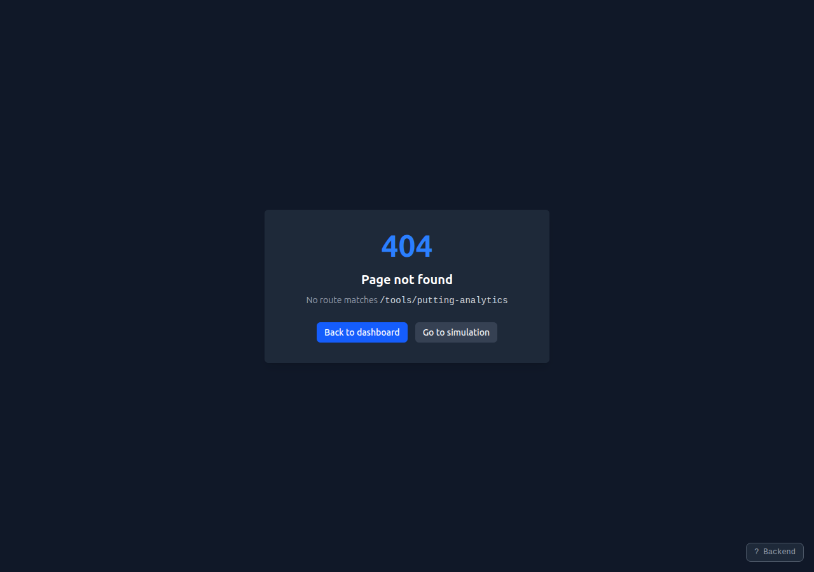
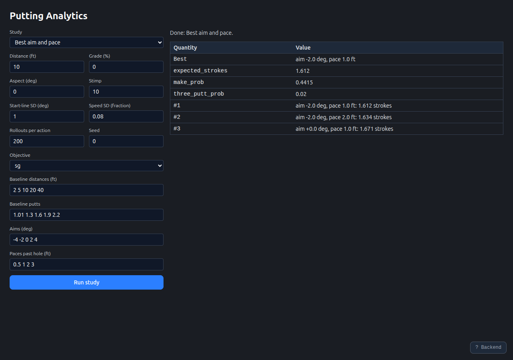
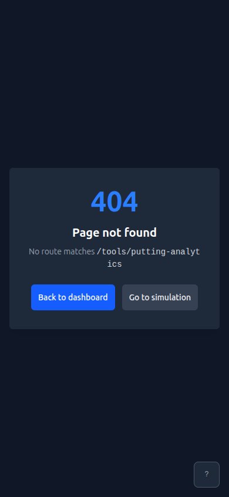
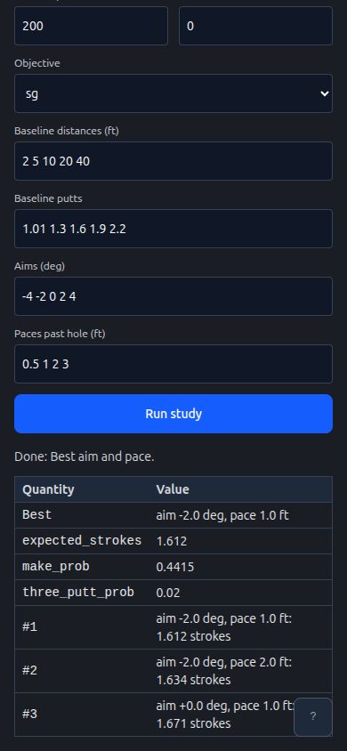

# Putting Analytics Web Page (#14235)

`/tools/putting-analytics` in the web UI, captured with Playwright at desktop
1280x900 and phone 390x844. The `/limits` and `/optimize` API routes were served
from local fixtures, and the onboarding panel was dismissed. The "after"
captures show a best-aim-and-pace study run from the page.

| Viewport | Before                          | After                         |
| -------- | ------------------------------- | ----------------------------- |
| 1280     |  |  |
| 390      |    |    |

## Measurements

| Check                      | Before         | After                                    |
| -------------------------- | -------------- | ---------------------------------------- |
| Page heading               | Page not found | Putting Analytics                        |
| Result rows after a study  | None           | 7 (Best, three quantities, three ranked) |
| Horizontal overflow at 390 | None           | None                                     |
