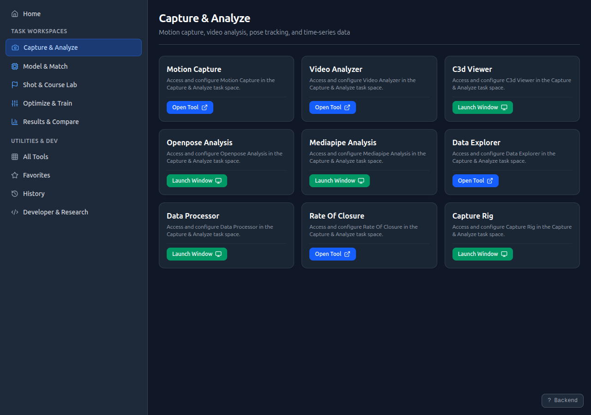
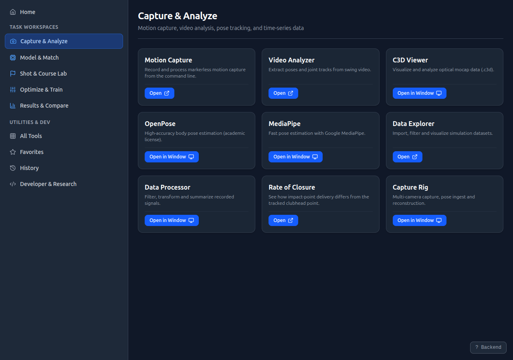
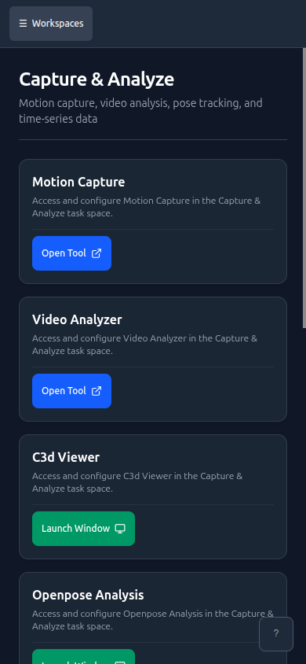
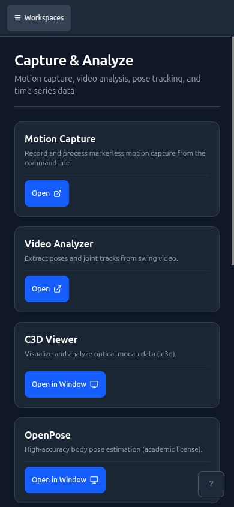

# Workspace Card Copy and Buttons (#14261)

Capture & Analyze workspace in the web UI, captured with Playwright at desktop
1280x900 and phone 390x844. Launcher manifest and onboarding were served from
local fixtures, and the onboarding panel was dismissed.

| Viewport | Before                          | After                         |
| -------- | ------------------------------- | ----------------------------- |
| 1280     |  |  |
| 390      |    |    |

## Measurements

| Check                                | Before                           | After                    |
| ------------------------------------ | -------------------------------- | ------------------------ |
| Card names                           | C3d Viewer, Openpose Analysis    | C3D Viewer, OpenPose     |
|                                      | Mediapipe Analysis               | MediaPipe                |
| "Access and configure …" on the page | Yes, on every card               | No                       |
| Button styles                        | Blue "Open Tool", green "Launch" | One blue primary style   |
| Button labels                        | "Open Tool", "Launch Window"     | "Open", "Open in Window" |
| Horizontal overflow at 390           | None                             | None                     |
