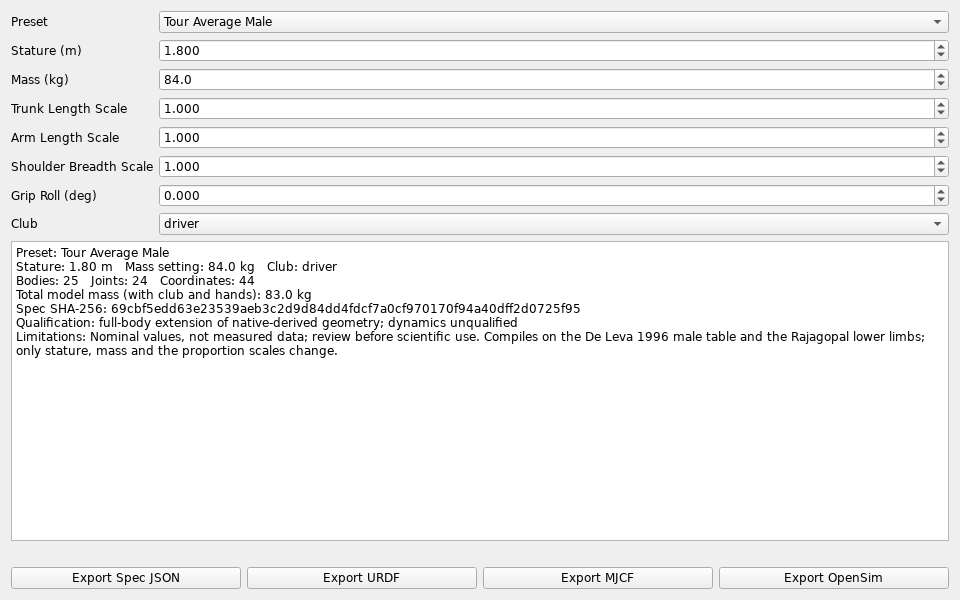
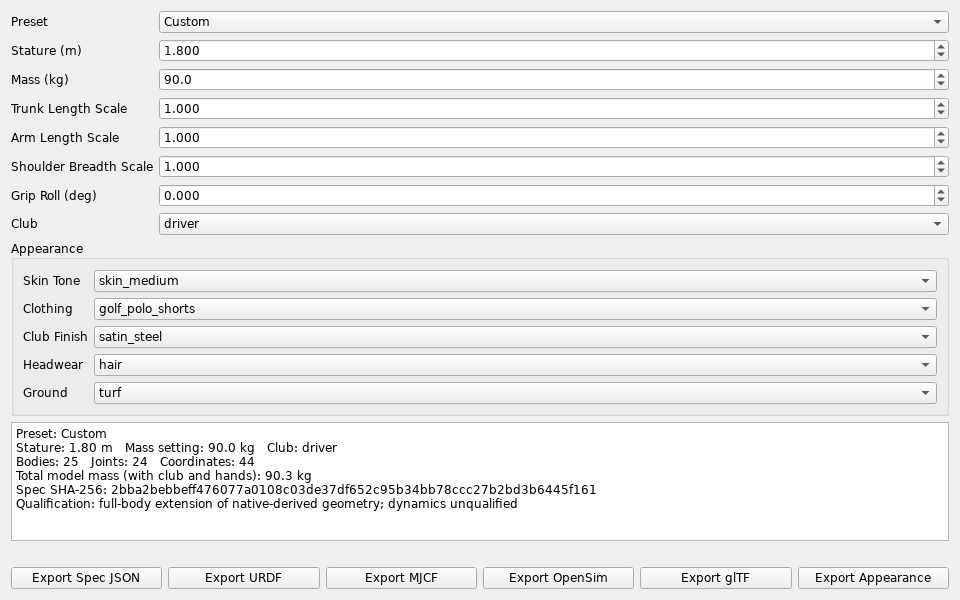
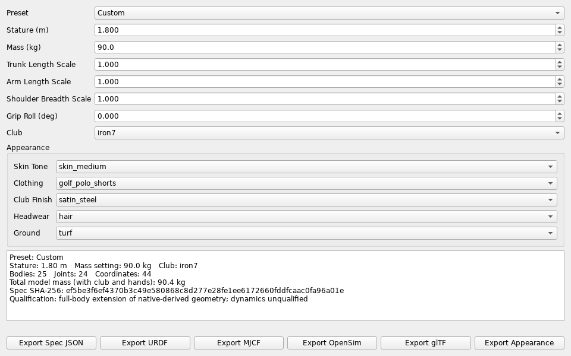
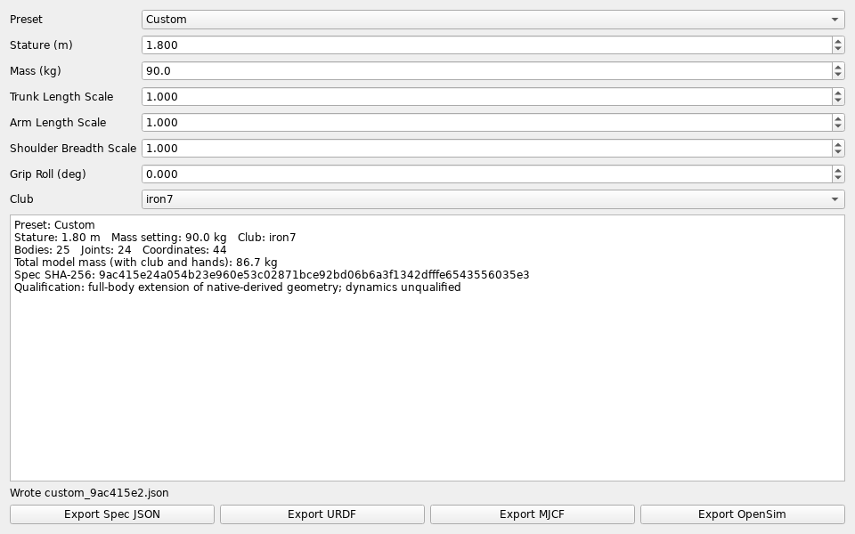

# Build, Dress and Export a Golfer

An end-to-end walk-through of the spec-native Character Builder (CMB
epic, #11652-#11658): build a golfer from a preset, dress them with an
appearance document bound to that spec, swap the club, export every engine
format, and load the result into MuJoCo. Every command below is the exact
Python used to verify this tutorial; sha256 values are truncated to their
first 8 hex characters and are what this commit's verification run
produced for these exact inputs.

## Prerequisites

Run from the repository root. One module deep in the import chain
(`simulation_backends.wrench_extractor`) imports `bunkershot3d` as a
top-level package rather than `src.bunkershot3d`, so put both the
repository root and `src/` on the path:

```bash
export PYTHONPATH="$PWD:$PWD/src"
```

## Step 1: Build a Golfer From a Preset With an Override

The spec-native builder (`src/shared/python/humanoid_character_builder/spec_export.py`)
compiles a preset plus overrides to a validated `full-body-v1` document and
hashes it:

```python
from src.shared.python.humanoid_character_builder.spec_export import (
    compile_character,
    build_summary,
)

# "tour_average_male" ships at 84.0 kg (see character_presets.md); override
# mass_kg to 90.0 and keep every other preset value (driver, stature 1.80 m).
compiled = compile_character("tour_average_male", {"mass_kg": 90.0})
print(compiled.preset_id)     # tour_average_male
print(compiled.sha256[:8])    # 4ee2c43d
print(build_summary(compiled))
```

This produced `preset_id="tour_average_male"`, spec hash `4ee2c43d...`, and
a summary of 25 bodies, 24 joints, 44 coordinates and 86.58 kg total mass
(De Leva 1996 male table plus Rajagopal lower limbs — unqualified geometry,
not a validated subject; see **Limitations** below). The total is below the
requested 90.0 kg because the lower limbs do not yet scale with `mass_kg`
(#12199).

**Web/API equivalent:** `GET /api/character-builder/presets` lists
`tour_average_male` with its description and limitations;
`POST /api/character-builder/build` with
`{"preset": "tour_average_male", "mass_kg": 90.0, ...}` returns the same
summary (the web `CharacterSpecPanel` sends every slider value alongside
the preset id, so an unedited slider simply repeats the preset's own
value).

## Step 2: Dress the Golfer

Build an `appearance-v1` document bound to the compiled spec's hash, then
write it beside the spec file using the same stem (`appearance_path_for`):

```python
import json
from src.api.services.character_appearance_service import (
    build_appearance,
    appearance_sidecar_filename,
)

choices = {
    "skin_tone": "skin_tan",
    "clothing": "golf_polo_trousers",
    "club_finish": "chrome",
}
appearance_doc = build_appearance(choices, compiled.sha256)
print(appearance_doc["spec_sha256"][:8])  # 4ee2c43d — bound to Step 1's spec

sidecar_name = appearance_sidecar_filename(
    appearance_doc, preset_id=compiled.preset_id, spec_sha256=compiled.sha256
)
print(sidecar_name)  # tour_average_male_4ee2c43d.appearance.json

with open(sidecar_name, "w", encoding="utf-8") as f:
    f.write(json.dumps(appearance_doc, indent=2) + "\n")
```

`build_appearance` fails closed: an unknown skin tone, clothing preset,
club finish or ground material name raises `ValueError` rather than
silently falling back to a default. Nothing here can change
`compiled.sha256` — `physics_spec_sha256` only ever hashes the spec with
`visual_hints` and `appearance` keys stripped.

**Web/API equivalent:** `GET /api/character-builder/appearance/library`
lists every pickable name; `POST /api/character-builder/appearance/export`
with the same picks plus `"character": {"preset": "tour_average_male",
"mass_kg": 90.0, ...}` has the server recompile that character, stamp its
hash onto the document the same way, and name the download from the
preset id and hash. The web Appearance panel's Export Appearance button
sends exactly this request.

## Step 3: Swap the Club

Compile the same preset again with `club="iron7"` instead of the preset's
default `driver`:

```python
compiled_iron = compile_character(
    "tour_average_male", {"mass_kg": 90.0, "club": "iron7"}
)
print(compiled_iron.sha256[:8])              # 9ac415e2
print(compiled.sha256 != compiled_iron.sha256)  # True
```

The spec hash changed (`4ee2c43d...` to `9ac415e2...`) because the club is
part of the physics spec. The Step 2 appearance document is still a valid
`appearance-v1` document — `document_from_dict` on it still passes — but
its `spec_sha256` now names a spec that no longer exists; rebind it to the
new hash before relying on the pairing:

```python
rebound = build_appearance(choices, compiled_iron.sha256)
print(rebound["spec_sha256"][:8])  # 9ac415e2
print(
    appearance_sidecar_filename(
        rebound, preset_id=compiled_iron.preset_id, spec_sha256=compiled_iron.sha256
    )
)  # tour_average_male_9ac415e2.appearance.json
```

**Web/API equivalent:** re-`POST /api/character-builder/build` with
`"club": "iron7"`; the response's `spec_sha256` changes and
`AppearancePanel`'s bound export (Step 2) picks up the new hash on its next
export because it always sends the current `CharacterSpecPanel` state as
`character`.

## Step 4: Export the Spec, URDF, MJCF and OpenSim

`export_character` shares one exporter per format with the API and the
desktop tool:

```python
from src.shared.python.humanoid_character_builder.spec_export import export_character

for fmt in ("spec", "urdf", "mjcf", "osim"):
    text, media_type, filename = export_character(compiled, fmt)
    with open(filename, "w", encoding="utf-8") as f:
        f.write(text)
    print(fmt, filename, len(text), media_type)
```

For the driver character from Step 1 this wrote:

| Format | Filename                          | Bytes | Media Type         |
| ------ | --------------------------------- | ----- | ------------------ |
| `spec` | `tour_average_male_4ee2c43d.json` | 85519 | `application/json` |
| `urdf` | `tour_average_male_4ee2c43d.urdf` | 57439 | `text/xml`         |
| `mjcf` | `tour_average_male_4ee2c43d.xml`  | 18287 | `text/xml`         |
| `osim` | `tour_average_male_4ee2c43d.osim` | 88892 | `text/xml`         |

**Web/API equivalent:** `POST /api/character-builder/export/{fmt}` for
`fmt` in `spec`, `urdf`, `mjcf`, `osim` — the Export buttons in
`CharacterSpecPanel`.

### Legacy Mesh-URDF CLI

The original mesh/URDF builder (a separate, older pipeline with its own
built-in presets such as `golfer_pro` — not the spec-native presets above,
and with no club or stature/mass-override arguments) is still available as
a module CLI:

```bash
python3 -m src.shared.python.humanoid_character_builder build \
    --preset golfer_pro --output golfer_pro_humanoid.urdf
```

This wrote a 36960-byte URDF and printed `Successfully built character and
saved to golfer_pro_humanoid.urdf`. Use the spec-native path above for club
swapping, appearance binding or engine export beyond URDF.

## Step 5: Export and Animate a Skinned glTF Body

`gltf` is a fifth export format. It writes a glTF 2.0 skinned mesh lofted
from the compiled spec's skeleton, with one bone per spec body. You can
view it in any glTF viewer with no physics engine:

```python
import json

text, media_type, filename = export_character(compiled, "gltf")
with open(filename, "w", encoding="utf-8") as f:
    f.write(text)

doc = json.loads(text)
print(filename, len(text), media_type)
# tour_average_male_4ee2c43d.gltf 334632 model/gltf+json
print(len(doc["skins"][0]["joints"]))      # 24 bones
print(doc["accessors"][0]["count"])        # 3416 vertices
print(doc["extras"]["spec_sha256"][:8])    # 4ee2c43d
```

For the driver character from Step 1, this wrote a 334632-byte document
with 24 bones and 3416 vertices. The bytes are identical on every run for
the same spec. `extras.spec_sha256` ties the mesh back to Step 1's spec
`4ee2c43d...`. The mesh is visual only and never changes mass, inertia or
contact. Every vertex follows exactly one bone (rigid skinning); smooth
blending across joints is still open (#11657).

The static export has no animation. To play spec motion on the skin,
build the body yourself, run the spec forward kinematics over a
coordinate trajectory, and pass the poses in. This example turns the torso
from 0 to 0.8 rad over 31 frames at 60 fps:

```python
from src.shared.python.model_appearance.skinned_body import (
    build_skinned_body,
    skinned_body_gltf_text,
    spec_motion_bone_poses,
)

body = build_skinned_body(compiled.document, spec_sha256=compiled.sha256)
frames = [{"TorsoInput": 0.8 * i / 30} for i in range(31)]
motion = spec_motion_bone_poses(body, compiled.document, frames)
print(motion.shape)  # (31, 24, 4, 4)

with open("tour_average_male_4ee2c43d_turn.gltf", "w", encoding="utf-8") as f:
    f.write(skinned_body_gltf_text(body, motion, fps=60.0))
```

Each frame is a mapping from spec coordinate name to value. Any coordinate
you leave out is zero, and an unknown name raises `ValueError`. The
document carries one LINEAR animation with 48 channels: a translation and
a rotation channel per bone, keyed over 0.5 s.

**Web/API equivalent:** `POST /api/character-builder/export/gltf` returns
the static document; the **glTF** export button in `CharacterSpecPanel`
sends this request. On the web Character Builder page, tick **Preview spec
body (glTF)** to load that export into the 3D view, tinted with the
appearance trunk colour. The preview refetches after each slider change. The desktop builder's **Export glTF** button writes
`custom_<sha8>.gltf`, byte-identical to the API export for the same hash.
Animated export is Python-only for now.

## Desktop Walkthrough

Steps 1, 3 and 4 also run in the desktop builder: the **Character Builder**
launcher tile, or `python3 -m src.tools.character_builder` on its own. The
screenshots below come from
`python3 scripts/capture_character_builder_screenshots.py`, which drives
the same widget offscreen and regenerates every image in this section.

1. **Pick the preset.** Choose **Tour Average Male** in **Preset**. The form
   fills with the preset's values (1.80 m, 84.0 kg, driver) and the summary
   shows the compiled spec, its hash and the preset's limitations.

   

2. **Override the mass.** Set **Mass (kg)** to 90.0. Any edit switches
   **Preset** to **Custom** and recompiles at once. The spec hash is
   `4ee2c43d...`, the same as Step 1, so the desktop and the API compile
   identical specs. The summary shows 86.6 kg total for the reason given in
   Step 1 (#12199).

   

3. **Swap the club.** Choose **iron7** in **Club**. The hash changes to
   `9ac415e2...`, as in Step 3.

   

4. **Export.** Each export button asks for a folder and writes one file. The
   status line names it. Because the edited character is **Custom**, the
   desktop names its files `custom_<sha8>`, for example
   `custom_9ac415e2.json`, where the API in Step 4 uses the preset id. The
   contents are byte-identical for the same hash.

   

The desktop builder has no appearance picker yet. Dress the character
through the API or the web Appearance panel (Step 2).

## Step 6: Simulate (Requires MuJoCo)

This step needs the `mujoco` package, which is not installed on every
host; it was not run as part of this tutorial's verification. Loading the
Step 4 MJCF follows the same pattern already documented in
[Character Builder Quickstart](character_builder_quickstart.md) and used
in `tests/unit/engines/mujoco/test_continuous_torque_simulate.py`:

```python
import mujoco

model = mujoco.MjModel.from_xml_path("tour_average_male_4ee2c43d.xml")
data = mujoco.MjData(model)

for _ in range(100):
    mujoco.mj_step(model, data)

print(data.qpos[:6])
```

## Limitations

The compiled spec is unqualified geometry: validated for structure and
loadability, not against a measured subject. Appearance is purely visual
and never influences `compiled.sha256` or any dynamics. See
[Character Builder](../help/character_builder.md) for the full reference
and [Character Presets](character_presets.md) for every shipped preset's
provenance.

## See Also

- [Character Builder](../help/character_builder.md)
- [Character Builder Quickstart](character_builder_quickstart.md)
- [Character Presets](character_presets.md)
